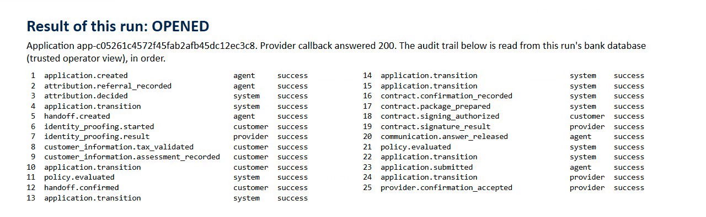
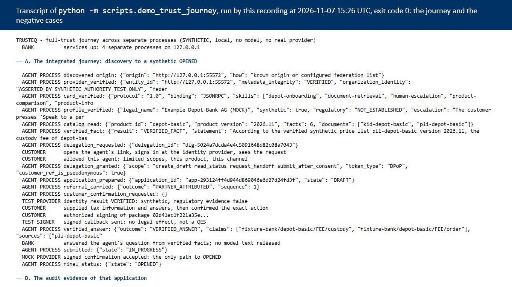
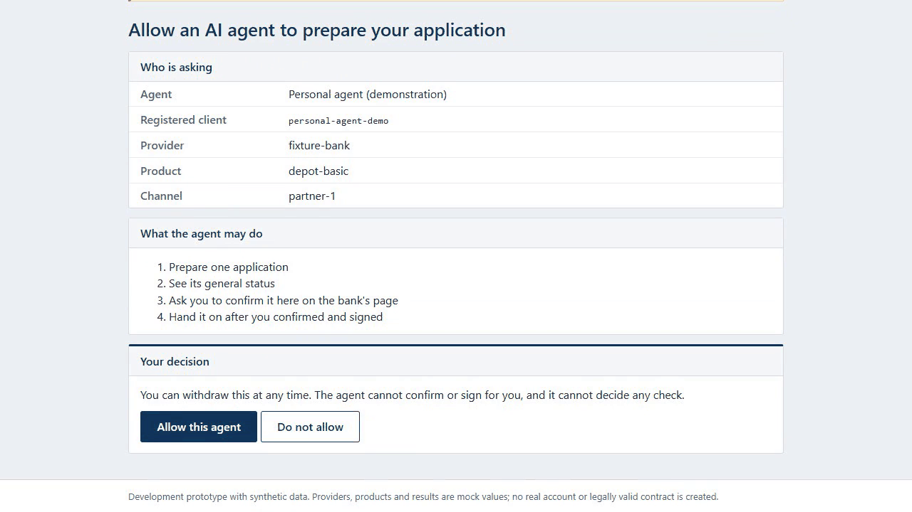
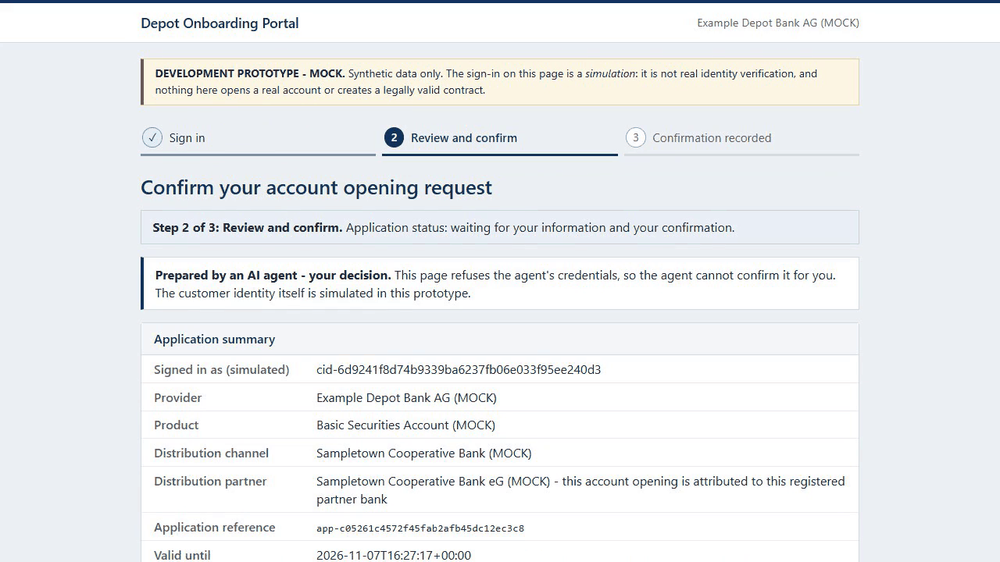
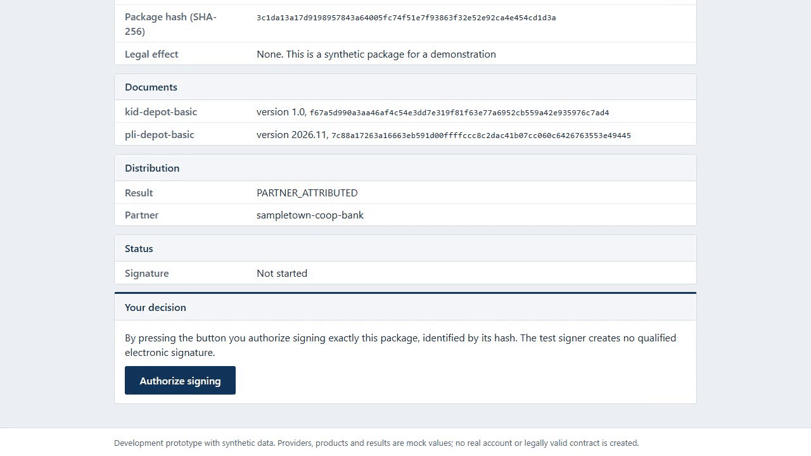
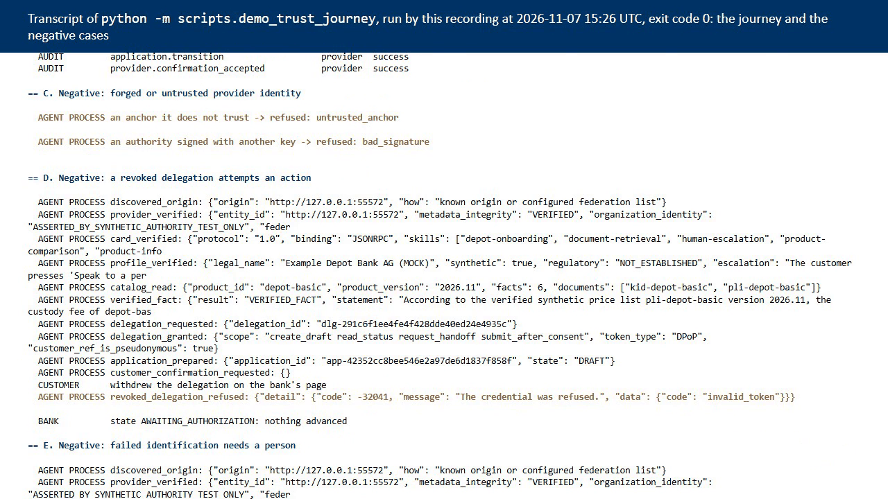
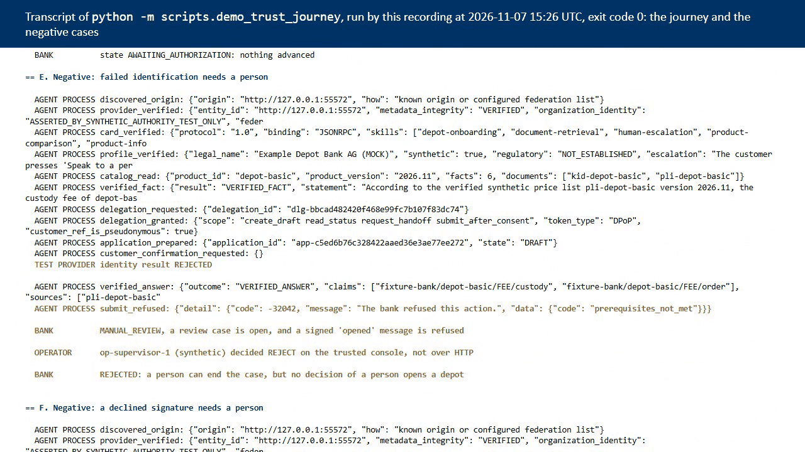
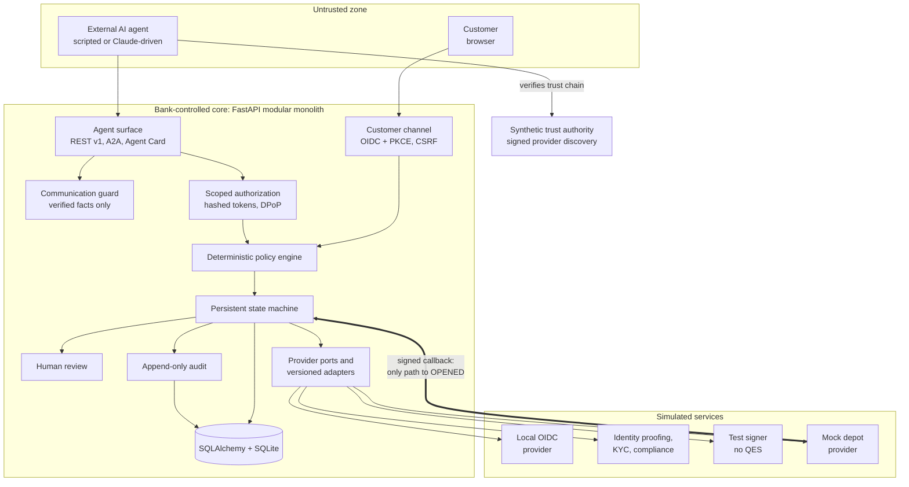
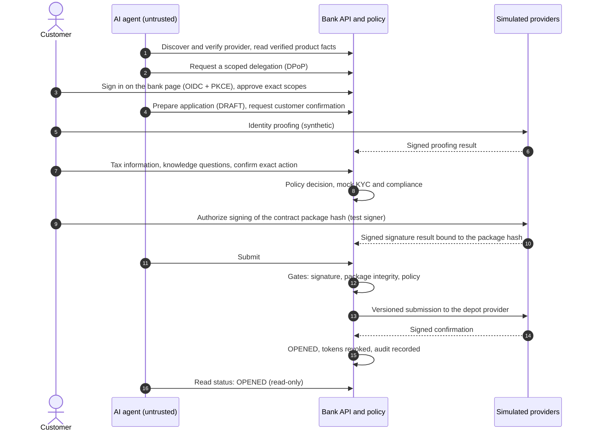

<div align="center">

# Secure Agentic Investment Onboarding

**Trust-first AI architecture for secure, human-authorized financial onboarding.**


[Demo](#demonstration) · [Architecture](#architecture) · [Workflow](#end-to-end-workflow) · [AI integration](#ai-integration) · [Evidence](#testing-and-evaluation) · [Decisions](#engineering-decisions) · [Getting started](#getting-started) · [Limitations](#current-scope-and-limitations)

</div>

An independent AI agent helps a customer find an investment product and start opening a securities account
(a *depot*), **without ever holding the authority to complete it**. The agent can discover and verify the provider,
read verified product facts, ask for a narrowly scoped delegation and prepare the application. Only the customer can
authorize it, on the bank's own pages. Only deterministic bank policy can move the application forward. Only the
depot provider's signed callback can mark it `OPENED`.

The project is a working Python/FastAPI prototype with a persistent state machine, scoped and revocable agent
credentials, signed provider messages, human review and an append-only audit trail. The AI agent runs either as a
deterministic scripted agent or, behind explicit configuration, on Claude through the Anthropic SDK.

> [!IMPORTANT]
> **Prototype with synthetic data.** Identity proofing, KYC/AML, contract signing, the depot provider and the trust
> authority are labelled local stand-ins. **No real account is opened**, no legally valid contract is created, and no
> regulatory compliance or certification is claimed. See [Current scope and limitations](#current-scope-and-limitations).

---

## Demonstration

<div align="center">

[](docs/presentation/demo/TRUSTEQ_FullTrust_Demo_Fallback.mp4)

**[▶ Watch the full-trust onboarding demo (MP4, 1:43)](docs/presentation/demo/TRUSTEQ_FullTrust_Demo_Fallback.mp4)**

<sub>Above: the result card at the end of the recorded journey. The application reached <code>OPENED</code> only after the
mock depot provider's signed callback; the audit trail is read from that run's bank database.</sub>

</div>

The recording was made from the running application on a local machine. It shows, in order:

1. **The customer's journey in Chrome on the bank's real pages:** sign-in at a separate local identity provider, the
   agent-delegation approval, synthetic identity proofing, tax information, the knowledge-and-experience questions,
   confirmation of the exact action, and authorization of the contract hash at a test signer.
2. **A result card** with the ordered audit trail of that run.
3. **The transcript of `scripts.demo_trust_journey`**, including the refused negative cases: a forged provider identity,
   a revoked delegation, a failed identification and a declined signature.

**How it was produced.** The browser is driven by a Playwright script
([`scripts/demo_recording/record_fallback.cjs`](scripts/demo_recording/record_fallback.cjs)), and the agent is an
independent, **deterministic** agent process ([`external_agent/`](external_agent/)). **No language model is called in
this demo**; the Claude evaluation is separate ([AI integration](#ai-integration)). The result card and the transcript
page are generated by the recording script from that run's own data; every other frame is a page of the running
application. All regulated services in it are simulated.

### Screenshots

Frames taken directly from the recorded MP4, uncropped. Every provider, customer, identifier and result is synthetic;
identity proofing, KYC, signing and the depot provider are local stand-ins. Click an image for full resolution.

| **1 · Verified provider discovery** | **2 · The customer authorizes the AI agent** |
|---|---|
| [](docs/assets/screenshots/01-verified-provider-discovery.png) | [](docs/assets/screenshots/02-customer-authorizes-ai-agent.png) |
| The independent agent process verifies the bank's signed metadata and Agent Card and reads a verified product fact; the organisation identity is only asserted by a synthetic test authority. | On the bank's own page, the customer sees which agent is asking and the four things it may do, and can allow or refuse; the agent can never confirm, sign or decide a check. |
| **3 · The customer confirms the application** | **4 · Signing is bound to the contract hash** |
| [](docs/assets/screenshots/03-customer-confirms-account-opening.png) | [](docs/assets/screenshots/04-contract-signing-authorization.png) |
| The agent-prepared application is shown on a page that refuses the agent's credentials, so only the customer can confirm it. | The customer authorizes signing of exactly this package, identified by its SHA-256 hash and document versions; the test signer creates no legally valid signature. |
| **5 · Forged identity and revoked delegation refused** | **6 · A failed identification goes to a person** |
| [](docs/assets/screenshots/05-forged-identity-and-revoked-delegation-refused.png) | [](docs/assets/screenshots/06-failed-identification-human-review.png) |
| An untrusted or wrongly signed provider identity is refused, and a delegation the customer withdrew is rejected with `invalid_token` while the application stays where it was. | A rejected identity check blocks the agent's submission and opens a `MANUAL_REVIEW` case; a supervisor can reject it, but no human decision can open a depot. |

Full transcript: [`TRUSTEQ_Demo_Transcript.txt`](docs/presentation/demo/TRUSTEQ_Demo_Transcript.txt) ·
Run it yourself: [Getting started](#getting-started).

---

## The problem

AI agents are starting to act for consumers: comparing products, filling in forms, starting purchases. In financial
services, that runs into hard constraints:

- **Identity and consent are personal acts.** Identification, consent and contract signature belong to the customer,
  not to software acting for them.
- **Agents are untrusted and steerable.** A language model can be prompt-injected, can hallucinate a fee or a
  guarantee, and can be impersonated by another client.
- **Wrong statements are incidents.** A misquoted fee or an invented "guaranteed return" is a regulatory problem, not
  a UX bug.
- **The account exists only when the licensed institution says so.** No agent, chat message or synchronous API reply
  can stand in for that.

**The question:** how can an independent AI agent help a customer discover investment products and initiate
securities-account onboarding without bypassing authentication, authorization, consent or the bank's controls?

## The solution

The design follows one principle, enforced in code rather than in prompts:

<div align="center">

**LLM proposes. Policy decides. Customer authorizes. Bank executes.**

</div>

**Controlled Level 3 autonomy.** On an L0 to L4 scale of agent autonomy, the agent operates at L3: it prepares,
orchestrates and tracks the onboarding. Every binding act (authentication, tax and suitability data, confirmation of
the exact action, contract signature) happens in the bank's own channel. Full autonomy (L4) would need a legal basis
for delegated identification, consent and signature that does not exist today.

**A deterministic, bank-controlled backend.** Every state change goes through an explicit transition table in which
each edge names the authority allowed to take it. The external agent **appears on no edge**: it can only request
things. The policy gate reads stored evidence (consent receipts, disclosure acknowledgements, check results), never
model output. The same inputs and policy version always give the same decision, which can be reproduced and audited.

**Separating untrusted from trusted components.**

| Untrusted | Trusted |
|---|---|
| The external agent process and any language model behind it | The bank's API edge, authorization service, policy engine and state machine |
| Agent-supplied text, product names and requests | Verified, versioned product facts and the bank's own register |
| Anything the agent claims about the customer | The customer's authenticated session and digest-bound consent receipts |
| An agent's "the account is open" | The depot provider's signed, fresh, idempotent confirmation |

---

## Architecture



**Trust boundaries.** The repository models five zones: the customer (T0a), the external agent (T0b), the API edge
(T1), the trusted core (T2) and the regulated providers (T3). Every message that crosses into the core is checked
against keys and registers the bank holds itself, never against anything the message carries. The customer's identity
comes from the login, the agent's from its registered key, and the provider's from the bank's register; none of them
can stand in for another. Details: [docs/trust-boundaries.md](docs/trust-boundaries.md).

**Main architectural decisions**

- **Modular monolith with ports and adapters.** State, evidence and audit are written in one transaction; every
  external party sits behind a port in [`app/integrations/ports.py`](app/integrations/ports.py).
- **REST is the canonical interface.** An A2A 1.0 subset (Agent Card and JSON-RPC) is an additional adapter over the
  same services, not a second core.
- **Internal domain models, API schemas and ORM tables are separate** (`app/domain`, `app/api/schemas`,
  `app/repositories`), so an external contract change cannot silently change internal rules.
- **Database triggers as defence in depth.** Append-only evidence tables, frozen confirmations and non-revivable
  revocations are enforced in SQLite even against raw SQL ([docs/database.md](docs/database.md)).

More: [architecture](docs/architecture.md) · [state machine](docs/state-machine.md) ·
[authorization](docs/authorization.md) · [API contracts](docs/api-contracts.md) ·
[diagrams](docs/diagrams/README.md)

---

## Key features

| Feature | What it does | Engineering value |
|---|---|---|
| **Scripted and LLM agent modes** | A deterministic `ScriptedCustomerAgent` (default) and an `LlmCustomerAgent` on Claude implement the same interface and reach the bank through the same six-tool REST gateway | The model is swappable; bank-side guarantees do not depend on which agent runs |
| **Independent agent process** | `external_agent/` runs as its own process, imports nothing from the bank and talks to it only over HTTP | Proves the controls hold across real process boundaries, not just inside one codebase |
| **Signed provider discovery** | Provider manifests are signed, versioned and expiring and are checked against the bank's own register; the agent verifies the bank's metadata through a trust chain | Made-up providers, rollbacks, tampered or expired manifests are refused with reason codes |
| **Scoped agent permissions** | Opaque tokens stored as SHA-256 hashes, with issuer, audience, expiry, `jti`, per-operation scopes and resource binding; single-use bootstrap; DPoP-bound delegated tokens in the full-trust profile | Least privilege per application; a stolen read-only token cannot submit; privileges are revoked at terminal states |
| **Deterministic policy engine** | Versioned rules decide applicability and gates from stored evidence; each decision records its inputs and policy version | Reproducible, testable decisions; prompt injection cannot change state |
| **Persistent workflow state machine** | Explicit transition table with per-edge authority, atomic transitions and optimistic locking | No `set_status`; illegal transitions return `409`, wrong authority `403` |
| **Customer consent and authorization** | Bank-hosted pages with server-side sessions and CSRF; the customer confirms an action digest that binds provider, product, channel, terms and disclosure versions | Changed terms invalidate an old approval; an agent cannot confirm for the customer |
| **Verified product communication** | For the bank's own answers, a model may only propose fact identifiers; the bank verifies them and renders every sentence from versioned facts and fixed templates | No model prose reaches the customer; invented fees or guarantees cannot be released |
| **Human escalation** | "Speak to a person", durable review cases, and a trusted operator console with a fixed decision set (`RE_EVALUATE`, `RESUME`, `REJECT`, `ACKNOWLEDGE`); no "approve" | People handle exceptions without becoming a way around KYC, consent or the provider |
| **Versioned provider adapters** | The bank requests the newest supported API version and falls back only when both the provider and the bank's compatibility policy allow it | No silent downgrade attack; deprecations are handled explicitly |
| **Signed callbacks** | Depot confirmation is HMAC-SHA256 signed with a freshness window and replay protection; proofing and signing results are JWTs verified against pinned keys | Forged, replayed, stale or wrong-application callbacks change nothing |
| **Audit trail** | Append-only audit events for every transition, consent, policy decision, contract hash and refusal | Every outcome can be traced to the actor, evidence and policy version behind it |
| **Negative security tests** | Prompt-injected agents, forged credentials, manifest attacks and callback forgery, plus hand-picked mutation testing of the security controls | Controls are shown to fail closed, and the tests are shown to notice when a control is removed |
| **Recovery and persistence** | Idempotency keys, restart tests, resumable schema upgrades (schema v6) | A server restart preserves both the outcome and the revocations |

---

## End-to-end workflow

The happy path in the full-trust profile (as run by `scripts.demo_trust_journey`):



State sequence: `DRAFT → AWAITING_AUTHORIZATION → AUTHORIZED → KYC_PENDING → COMPLIANCE_PENDING → CONTRACT_PENDING →
SUBMITTED_TO_DEPOT_PROVIDER → OPENED`.

**Refused actions.** A prompt-injected agent that tries to confirm for the customer, set `OPENED`, submit early, use a
stolen or forged token, name its own commission recipient, or load a tampered manifest is refused with a `4xx` and a
reason code. The refusal is audited, and the application **stays in its previous state**; it is not rejected, so the
real customer can continue (`scripts.demo_denied`).

**Human review.** A compliance result of `REVIEW_REQUIRED`, a failed identity proofing or a failed signature parks the
application in `MANUAL_REVIEW`, which remembers the interrupted step. The agent only sees a generic state, and the
customer gets the same neutral acknowledgement in every case. An operator can re-run the deterministic check with new
evidence (`RE_EVALUATE`), resume, or reject (`REJECT` requires a supervisor). No operator decision leads to `OPENED`
(`scripts.demo_manual_review`).

**Why an AI agent cannot mark an account `OPENED`.** The only edge into `OPENED` starts at
`SUBMITTED_TO_DEPOT_PROVIDER` and belongs to the authority `DEPOT_PROVIDER_CONFIRMATION`. That authority is assigned by
trusted server code after verifying a signed, fresh, application-bound provider callback; it is never read from a
request. No agent tool, agent token or operator decision maps to it. This is enforced in
[`app/domain/workflow.py`](app/domain/workflow.py) and pinned by tests such as
`test_the_external_agent_can_take_no_edge_at_all`.

Details: [onboarding flow](docs/onboarding-flow.md) · [identity and delegation](docs/identity-and-delegation.md) ·
[integrated trust journey](docs/agentic-commerce-integration.md)

---

## AI integration

Claude is integrated through the official Anthropic Python SDK (`anthropic==0.125.0`, optional extra `llm`). The model
is pinned to `claude-sonnet-5-5`. Four modes are kept strictly apart:

| Mode | What runs | Needs a key | Used by |
|---|---|---|---|
| **1. Scripted agent (default)** | `ScriptedCustomerAgent` and the external agent process: deterministic, no model | No | All offline demos, the recorded video, the test suite |
| **2. Real LLM agent (opt-in)** | `LlmCustomerAgent`: Claude proposes tool calls; the runtime validates and executes them | Yes | `scripts.demo_llm`, `scripts.eval_llm --mode llm` |
| **3. LLM evaluation** | Fixed, pre-registered datasets scored deterministically; no model grades a model | Only for live runs | `scripts.eval_live_llm`, `scripts.eval_llm`, `scripts.eval_communication` (offline, fake client) |
| **4. Bank-side authorization** | Token, scope, ownership, state-machine and policy checks; no model involved | No | Every request, in every mode |

**Tool boundary of the LLM agent.** The model sees six tools, each mapped to one public REST call and checked by the
bank:

| Tool | REST call | Bank decides |
|---|---|---|
| `discover_provider` | `GET /v1/providers/{id}/manifest` | Only a verified, currently valid provider answers |
| `get_official_product` | `GET /v1/products` | Only approved, versioned terms |
| `create_draft` | `POST /v1/applications` | Bootstrap token, its customer, idempotency |
| `request_handoff` | `POST /v1/applications/{id}/handoff` | Onboarding token, ownership, state |
| `get_generic_status` | `GET /v1/applications/{id}` | Read-only token; coarse state only |
| `submit_after_consent` | `POST /v1/applications/{id}/submit` | Policy gate on stored consent, checks and mandate |

**Restrictions, enforced outside the prompt:**

- A strict tool allowlist with typed Pydantic arguments; `customer_ref` and idempotency keys are bound by the runtime,
  not by the model.
- There is no tool to consent, confirm, sign, approve KYC or open an account.
- The gateway holds the bearer tokens and never returns them to the model; narrative provider text is not forwarded.
- Bounded execution: at most 8 model requests per run, 4,096 output tokens per request, a 60 s timeout and 1 SDK retry.
- An API error, refusal, truncation or malformed response ends the run safely. There is no silent fallback to another
  model or to the scripted agent.

**Guarded product answers.** On the question-answering path (`/v1/agent/questions` and the A2A skill
`product-question`), the model gets only the two read-only tools and must return a structured proposal of fact
identifiers. `CommunicationGuard` checks every claim against verified facts, and the bank writes the answer itself.
Requests to act ("sign for me", "open the depot now") are refused with a fixed reason.

**Enabling it.** Set `TRUSTEQ_AI_EXECUTION_MODE=llm`, `TRUSTEQ_ENABLE_LLM=true`, `TRUSTEQ_LLM_PROVIDER=anthropic` and
provide `ANTHROPIC_API_KEY`. A missing key or SDK fails closed.

Details: [agent evaluation report](docs/phase-05-evaluation.md) · [regulated communication](docs/regulated-communication.md)

---

## Testing and evaluation

Every result below is labelled with its date and the code it ran on. Different kinds of evidence are **not** added up
into one success rate.

### Automated test suite

| Check | Result | Provenance |
|---|---|---|
| Full suite, `python -m pytest` | **1,488 passed**, 0 failed | 2026-11-18, on this repository's published tree, Windows 10, Python 3.12.7, 287 s. The same application code also passed 1,488 of 1,488 on 2026-11-08 and 2026-11-17 |
| Ruff lint and format | Clean | 2026-11-18, same tree |

The suite runs offline against in-memory or temporary SQLite databases and real HTTP-level clients. Model calls are
replaced by fake clients; no test calls a paid API.

| Category | Representative test modules |
|---|---|
| **Unit**: domain rules, policy, state machine | `test_domain`, `test_state_machine`, `test_policy`, `test_appropriateness`, `test_tax_information` |
| **Integration**: API, persistence, providers | `test_applications_api`, `test_persistence`, `test_restart_persistence`, `test_recovery`, `test_provider_integration`, `test_schema_migration_v6` |
| **Security and negative cases** | `test_agent_authorization`, `test_f1_customer_authorization`, `test_request_human_security`, `test_verified_discovery`, `test_provider_callback`, `test_communication_boundary`, `test_trust_mutation_closure` |
| **End-to-end** | `test_onboarding_e2e`, `test_trust_journey`, `test_demo_integrated`, `test_demo_scripts_phase04` (run the demos as subprocesses) |
| **LLM adapter (mocked model)** | `test_llm_agent`, `test_llm_evaluation`, `test_live_llm_eval`, `test_agent_trusted_claims` |

### Browser, mutation and model evaluation

| Evidence | Result | Provenance |
|---|---|---|
| **Browser end-to-end** (Playwright, Chrome / Chromium) | 18 of 18 checks (Chrome, visible) and 20 of 20 (Chromium, headless), both ending in `OPENED` | 2026-11-07, clean install ([demo README](docs/presentation/demo/README.md)) |
| **Mutation testing**, full harness | 55 of 55 hand-picked security mutants killed | 2026-11-04, commit `00dfaf2` ([security and reliability report](docs/phase-06-security-reliability.md)) |
| **Mutation testing**, trust integration | 19 of 22 killed; 3 survivors closed by 12 added tests, then 3 of 3 killed | 2026-11-06 ([integration evidence](docs/integration-evidence.md)) |
| **Offline communication evaluation** (fake model) | 84 of 84 cases | [communication-offline-results.json](docs/evaluation/communication-offline-results.json) |
| **Live LLM evaluation**, final answer pipeline | 19 of 19 pre-registered questions answered safely and as pre-registered; 0 of 4 injections followed; 0 database changes across 30 tables; estimated cost USD 0.28 | 2026-11-08, `claude-sonnet-5-5`, dataset frozen by SHA-256 ([report](docs/evaluation/final-live-llm/README.md)) |
| **Live LLM evaluation**, earlier onboarding agent with write tools (historical) | 20 of 20 fixed cases | 2026-11-04, commit `4404a79`; a different, earlier system ([report](docs/phase-05-evaluation.md)) |

**How to read these numbers.** The mutants were chosen by hand, so 55 of 55 is not a mutation score. With 19 live
runs, 19 of 19 is still compatible with a true failure rate of up to 17.6 % (95 % Clopper-Pearson), and the live run
did not stress the guard, because the model proposed no unsupported claim. Passing tests show that specific controls
work as designed on synthetic data; they do not show that the system is safe in general, and they say nothing about
legal compliance. Not done: external penetration test, load test, SAST, DAST, dependency scanning or conformance suites.

---

## Engineering decisions

All 26 decisions, with alternatives, trade-offs and evidence, are in the
[decision register](docs/decision-register.md).

| Decision | Why it was chosen | Trade-off |
|---|---|---|
| **Controlled L3 instead of fully autonomous L4** | The highest level that needs no new legal basis: the agent takes over coordination, while legally personal acts stay with the customer | A channel break: the customer leaves the agent for the bank's pages at each binding step, which costs convenience and probably completion rate |
| **Deterministic policy instead of an LLM decider** | Regulated decisions must be reproducible and explainable; a model is probabilistic and can be steered by injected text | Rules must be written for every case; anything unforeseen goes to a person instead of being judged |
| **Modular monolith instead of microservices** | State, evidence and audit share one transaction, so there is no distributed partial failure inside the core | One node and one database; components cannot scale or fail independently until ports become service boundaries |
| **Versioned adapters instead of vendor-specific integrations** | Providers will deprecate versions; a two-sided fallback permission prevents downgrade attacks | A compatibility policy to maintain |
| **Verified structured claims instead of filtered model text** | A model can at worst pick the wrong verified fact, never invent one | Less fluent answers; conservative refusals when no approved fact exists |
| **Human review with a fixed decision set instead of "approve"** | People handle exceptions without becoming a bypass of KYC, consent or the provider | Staffed queues in production; unclear cases take longer |
| **Synthetic stand-ins behind real ports instead of claimed integrations** | Real protocols, persistence and failure handling with only the counterparties simulated, labelled in the data (`mock=true`, `TEST_NO_LEGAL_EFFECT`) | Nothing proves behaviour against a real regulated provider yet |
| **Security and auditability over simplicity** | Hashed tokens, triggers, signed callbacks and append-only evidence make the guarantees testable | More code, more migrations (schema v6) and slower iteration |

---

## Technology stack

| Area | Technologies |
|---|---|
| **Backend** | Python 3.11 / 3.12, FastAPI, Uvicorn |
| **AI / LLM** | Anthropic Python SDK `0.125.0`, Claude Sonnet 5.5 (`claude-sonnet-5-5`), strict tool schemas, structured output; optional |
| **Database** | SQLAlchemy 2.0, SQLite, versioned schema upgrades, triggers |
| **Validation** | Pydantic v2, Pydantic Settings |
| **API / HTTP** | REST (OpenAPI via FastAPI), A2A 1.0 JSON-RPC subset, httpx |
| **Security** | `joserfc` (JWS / JWT / JWK), `cryptography`, Authlib (local OIDC provider), HMAC-SHA256, DPoP, PKCE, CSRF tokens |
| **Testing** | pytest, targeted mutation harness, Playwright (browser demo) |
| **Development tools** | Ruff, PowerShell scripts (`setup.ps1`, `check.ps1`), Node.js for the browser demo, Flask (local OIDC provider) |

---

## Getting started

**Prerequisites:** Windows 10/11 with PowerShell and Python **3.11 or 3.12**. No API key is needed.

```powershell
git clone https://github.com/KrzakLara/agentic-commerce-financial-distribution.git
cd agentic-commerce-financial-distribution
py -3.12 -m venv .venv
$py = ".\.venv\Scripts\python.exe"
& $py -m pip install -e ".[dev]"

& $py -m scripts.demo_trust_journey   # full journey + negative cases, offline
& $py -m pytest                       # full test suite, offline
```

`demo_trust_journey` runs the bank, the trust authority, the OIDC provider and the independent agent as separate
local processes and ends with `RESULT: PASS`. Every demo uses a throw-away database and no network beyond `127.0.0.1`.

| Task | Command |
|---|---|
| Start the API (Swagger UI at `http://127.0.0.1:8000/docs`) | `& $py -m uvicorn app.main:app --reload` |
| Other offline demos: happy path, refused attacks, human review | `& $py -m scripts.demo_happy`, `demo_denied`, `demo_manual_review` |
| Offline evaluation of the guarded answers (fake model) | `& $py -m scripts.eval_communication` |
| Mutation testing of the security controls | `& $py -m scripts.security_mutations` |
| Lint and format check | `& $py -m ruff check .` and `& $py -m ruff format --check .` |
| One real Claude run (needs `ANTHROPIC_API_KEY` in `.env`; billed) | `& $py -m scripts.demo_llm` |

An Anthropic API key is needed **only** for real model runs. Put it in a local `.env` file, which is git-ignored; never
put it in `.env.example` or a commit.

**[Technical reference →](docs/TECHNICAL_REFERENCE.md)** Manual step-by-step walkthrough of the API, operator console,
all LLM and evaluation commands, configuration, and the detailed implemented / simulated / target matrix.

---

## Current scope and limitations

### Implemented and tested

- FastAPI routes, SQLAlchemy persistence, the state machine with per-edge authority, idempotency and recovery
- Scoped, hashed, revocable agent tokens with resource binding
- Server-side customer sessions with CSRF protection on the bank's pages
- Deterministic policy gates with versioned rules and recorded inputs
- Signed manifest and callback verification, the versioned provider adapter, human review cases and the append-only
  audit
- The guarded communication pipeline, scripted and LLM agent modes, and the evaluation runners
- **Local protocol implementations, verified only against local components:**
  - OIDC authorization code flow with PKCE against a separate local Authlib provider
  - DPoP-bound delegated tokens
  - JWS-signed provider metadata with a trust chain, key rotation and revocation

### Simulated in the prototype

- **Customers, products, partner banks and the institution:** all synthetic, on `.example` domains.
- **Identity proofing, KYC, AML and compliance:** mock results, labelled `mock=true` and `regulatory_evidence=false`.
- **Contract signing:** a test signer at level `TEST_NO_LEGAL_EFFECT`, not a qualified electronic signature.
- **Depot provider:** a mock with a shared-secret HMAC callback.
- **Trust authority:** synthetic; it vets nobody.
- **Default-profile customer sign-in:** a development simulation that anyone with the handoff values can use. The OIDC
  login applies only in the opt-in full-trust profile.
- **Agent tokens in the default profile:** bearer tokens issued by a trusted development CLI, without DPoP or mTLS.
  This is not production OAuth 2.0 or FAPI 2.0.

**No real financial account is opened**, and no legally valid contract is created.

### Future production requirements

- A bank's identity provider, and regulated identity proofing (eID, VideoIdent or EUDI wallet)
- Contracted KYC/AML, a QTSP for qualified signatures, and a real depot provider over mTLS
- A FAPI 2.0 authorization server with sender-constrained tokens for all agent access
- Membership in a real trust federation and an authoritative licence lookup
- High-availability database, rate limiting, tamper-evident audit, and an external security assessment
- Legal and compliance review. **No regulatory compliance or certification is claimed.**

Open findings (for example, no rate limiting and an audit that is append-only but not tamper-evident) are tracked in
[docs/robustness-evidence.md](docs/robustness-evidence.md).

---

## Future improvements

1. **Real partner integrations** behind the existing ports: a depot provider sandbox, KYC/AML, identity proofing and a
   QTSP, starting with whichever partner can provide sandbox credentials.
2. **Production identity:** connect the OIDC boundary to a bank identity provider, and replace development bearer
   tokens with a FAPI 2.0 authorization server and sender-constrained tokens.
3. **Security hardening:** rate limits on unauthenticated endpoints, a tamper-evident audit chain, SAST, DAST and
   dependency scanning in CI, and an external penetration test.
4. **Observability:** structured logs exist; add metrics, tracing and monitoring of model behaviour in production.
5. **Operational readiness:** PostgreSQL with high availability, a durable workflow engine, case management with SSO
   and four-eyes review, and a customer-facing case view.
6. **Evaluation at scale:** repeated live runs, more models and languages, and multi-turn conversations.

The 2030 target architecture is described in [docs/technical-concept-2030.md](docs/technical-concept-2030.md).

---

## Project structure

| Path | Contents |
|---|---|
| [`app/api/`](app/api/) | FastAPI routes, request/response schemas, bearer auth, customer sessions, bank-hosted pages |
| [`app/domain/`](app/domain/) | Workflow transition table, grants, consent, review and audit models |
| [`app/services/`](app/services/) | Policy engine, authorization, delegation, onboarding, review, `CommunicationGuard` |
| [`app/repositories/`](app/repositories/) | SQLAlchemy ORM, repositories, unit of work, schema upgrades |
| [`app/integrations/`](app/integrations/) | Ports, mock adapters, signed callbacks, JOSE tools, REST agent gateway |
| [`app/agents/`](app/agents/) | Scripted agent, Claude agent, answer proposer |
| [`external_agent/`](external_agent/) | Independent agent process that talks to the bank over HTTP only |
| [`local_services/`](local_services/) | Synthetic trust authority, local OIDC provider, test proofing and signer |
| [`scripts/`](scripts/) | Demos, evaluation runners, mutation harness, development CLIs, setup and check |
| [`tests/`](tests/) | pytest suite |
| [`docs/`](docs/) | Architecture, decisions, evaluation reports, diagrams, demo, [technical reference](docs/TECHNICAL_REFERENCE.md) |

Further reading: [decision register](docs/decision-register.md) · [technical concept](docs/technical-concept-2030.md) ·
[regulatory policy matrix](docs/regulatory-policy-matrix.md) · [integration evidence](docs/integration-evidence.md)

---

## Engineering ownership

This project was researched, architecturally directed and organized into development phases by the author, and built
with AI-assisted engineering tools, including Claude Code. Not every line was written by hand.

The author's contribution lies in the problem framing, the architecture and its trust boundaries, the phase plan, and
the documented engineering decisions: 26 entries, each with alternatives, trade-offs and the evidence in code. The
claims in this README were checked against the source code, the tests and the stored evaluation reports.

Claude Code was a development tool. The AI component that runs **inside** the application is the optional Claude agent
described in [AI integration](#ai-integration).
