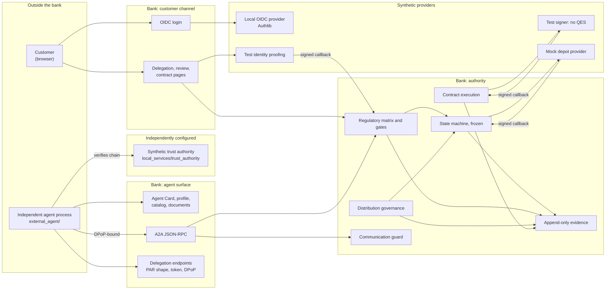
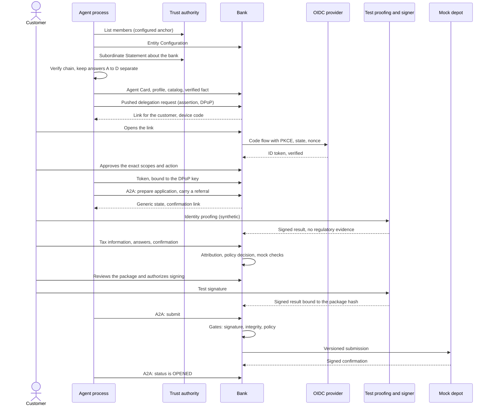

# Agentic commerce: the integrated trust journey

How the nine areas of the 2030 target connect to one journey in this repository, what each one really
is, and what it is not. Everything uses a synthetic institution. No real account, contract,
identification or signature exists here.

**Results and how they were measured:** [integration-evidence.md](integration-evidence.md).

## 1. Classification

The labels have fixed meanings:

| Label | Meaning |
|---|---|
| LIVE IMPLEMENTED | Works with an actual external provider |
| SANDBOX INTEGRATED | Works with a real third-party sandbox, with verified behaviour |
| LOCAL VERIFIED | Complete in the local demonstrator, with independent components and security tests |
| ADAPTER READY | The implementation exists, but real credentials or onboarding are missing |
| CONCEPT ONLY | A proposal, not working software |
| BLOCKED | Cannot legitimately be completed without a named external dependency |

**Nothing in this repository is LIVE IMPLEMENTED or SANDBOX INTEGRATED.**

| # | Area | Part | Classification |
|---|---|---|---|
| 1 | Public agent discovery | A2A 1.0 card, JSON-RPC subset, separate client over HTTP | LOCAL VERIFIED |
| 1 | | Reachable on the public internet, found by arbitrary agents | BLOCKED: no public HTTPS deployment, no directory |
| 2 | Provider identity | Asymmetric signing, trust chain, rotation, revocation, separated answers | LOCAL VERIFIED |
| 2 | | Conformance with OpenID Federation 1.0 | NOT CLAIMED: a subset, no conformance test |
| 2 | | Membership in a real federation | BLOCKED: no real federation or trust authority |
| 2 | | Licence lookup in an authoritative register | BLOCKED: no authoritative lookup established |
| 3 | Customer identity | OIDC code flow with PKCE, against a separate local provider | LOCAL VERIFIED |
| 3 | | A bank's identity provider | ADAPTER READY: needs a client registration |
| 3 | | German eID, VideoIdent, EUDI wallet | ADAPTER READY for the boundary; real proofing BLOCKED: needs contract and credentials |
| 4 | Delegation | Registered agents, approval, scopes, DPoP, revocation | LOCAL VERIFIED, as a local protocol |
| 4 | | FAPI 2.0 authorization server | CONCEPT ONLY: integration path described |
| 5 | Contract and signing | Immutable package, authorization, signed callbacks, test signer | LOCAL VERIFIED |
| 5 | | Qualified electronic signature through a QTSP | ADAPTER READY: no QTSP, no sandbox credentials |
| 6 | Trustworthy communication | Deterministic checks at the LLM output, structured answers | LOCAL VERIFIED, with a fake model |
| 6 | | The same with a real model | NOT RUN: no paid call was authorized |
| 7 | Brand presence | Signed, agent-readable profile, sources, escalation | LOCAL VERIFIED |
| 7 | | Verified domain, real brand | BLOCKED: synthetic institution, `.example` domain |
| 8 | Channel governance | Claims, rules, conflicts, review, sample commission | LOCAL VERIFIED, synthetic contracts |
| 8 | | Real distribution contracts, permissibility of commission | BLOCKED: needs contracts and compliance |
| 9 | Regulatory controls | Versioned matrix, reason codes, evidence in the audit | LOCAL VERIFIED as engineering controls |
| 9 | | Legal compliance | NOT CLAIMED: needs legal and compliance review |

## 2. Architecture

**Trust boundaries.** The agent is untrusted software, and its text decides nothing. Each signed message
crosses a boundary: the verifier holds the signer's key from its own configuration, never from the
message. The customer's identity comes from the login, the agent's from its registered key, the bank's
from the chain. Those identities never stand in for one another.

## 3. The journey

Run it: `.\.venv\Scripts\python.exe -m scripts.demo_trust_journey`. Details:
[the demo runbook](presentation/phase-07-demo-runbook.md#13-the-full-trust-journey).

## 4. Who is responsible for what

| Decision or duty | Customer | Agent | Bank policy | Person at the bank | Provider |
|---|---|---|---|---|---|
| Which product to look at | Decides | Proposes | - | - | - |
| Who the customer is | Authenticates | Never | Binds the subject | - | Identity provider |
| Identity proofing | Takes part | Never | Requires the result | Reviews a failure | Proofing provider |
| Allowing the agent | Decides | Asks | Limits scopes | - | - |
| Confirming the exact action | Decides | Never | Checks the binding | - | - |
| Signing the contract | Decides | Never | Binds hash and signatory | Reviews a failure | QTSP (real) or test signer |
| KYC, compliance outcome | - | Never | Runs the gate | Reviews | Provider (mock) |
| Attribution | May choose the channel | Only carries a signed proof | Applies the rule | Settles a conflict | Partner signs the referral |
| Opening the account | - | Never | Only submits | Never | Depot provider, signed |

## 5. What changed in the original flow

The earlier scenarios behave as before: `TRUSTEQ_FULL_TRUST_PROFILE` is off by default.

With the profile on, and no change to the state machine:

- The customer signs in with OIDC. The DEV sign-in is off. Without a complete provider configuration, customer
  pages fail closed, as they did.
- The confirmation also needs a verified identity-proofing result.
- The confirmation records an attribution decision and a policy decision.
- The agent's submission also needs a signed package with a valid hash, and no unmet mandatory policy gate.
- A failed proofing or signature parks the application in `MANUAL_REVIEW`, using two new review reasons.
- Delegated tokens need DPoP proofs. Every other token stays a plain bearer token.

Schema version 6 adds tables only.

**Existing tests changed additively in two places:** the schema-version pin in three migration tests, from 5 to 6, and the
table list in `tests/test_database.py`. No assertion was weakened.

## 6. Limits that apply to all nine areas

- **Mock:** KYC, compliance, contract record, depot provider.
- **Synthetic:** the institution, the authority, all keys and users, the sample contracts.
- **F-1 remains for the DEV fallback:** while `customer_identity_mode=dev_simulated`, anyone with the handoff values can
  use the DEV sign-in. In the OIDC profile the DEV sign-in is off. See [identity-and-delegation.md](identity-and-delegation.md).
- **F-2 to F-7 stay open.** The new unauthenticated endpoints widen F-4: login states, refused delegation requests and
  refused callbacks write rows, and there are no rate limits. Public A2A reading stores nothing, on purpose.
- **Not done:** external penetration test, load test, SAST, DAST, dependency scan, conformance suites.
- **Passing tests proves nothing about legal compliance.** See [regulatory-policy-matrix.md](regulatory-policy-matrix.md).
