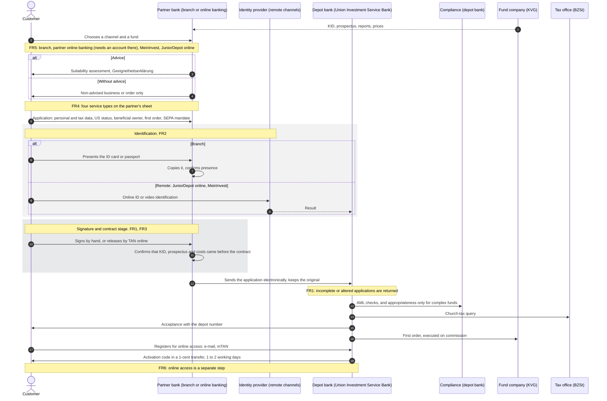

# Ist-Analyse: opening a securities account (UnionDepot) in Germany - Union Investment as the reference case

**Status:** research for the TRUSTEQ case study, updated on 7 November 2026.
**Sources:** S1 to S21 were read on 3 November 2026. S1, S2 and S5 were re-read, and S22 to S37 read, on 7 November
2026. Section 8 has the register; the legal texts are in [../regulatory-policy-matrix.md](../regulatory-policy-matrix.md).
**Not legal advice.**

This document describes how a retail customer opens a UnionDepot today, **as far as public, official
sources show it**. It does not describe internal procedures of Union Investment, Union Investment
Service Bank AG or any cooperative bank. Where an official text could not be retrieved, the point is
marked **NEEDS VERIFICATION** instead of being assumed.

**Companion documents:**
- the per-step process and evidence matrix, which sets today against the prototype and 2030:
  [process-evidence-matrix.md](process-evidence-matrix.md);
- the roles, RACI and trust boundaries: [roles-raci-trust-boundaries.md](roles-raci-trust-boundaries.md);
- the regulatory ownership matrix R01 to R18: [../regulatory-policy-matrix.md](../regulatory-policy-matrix.md).

## 0. How to read this document

| Marker | Meaning |
|---|---|
| **VERIFIED FACT** `[S#]` | Directly supported by the cited source (section 8), read on the date given there. German quotations are verbatim. |
| **PROJECT INFERENCE** | Our interpretation, e.g. a likely bottleneck. Not a statement about how the institutions actually operate. |
| **FUTURE PROPOSAL** | Our conceptual 2030 agentic onboarding design. |
| **NEEDS VERIFICATION** `[G#]` | Not verified: the official page could not be retrieved, or no official source was found. Listed in section 9. Must not be presented as fact. |

Table rows carry the marker of their evidence column. Section 5 separates evidence from inference row by row. The
opportunities in section 6 are FUTURE PROPOSAL.

**How the 7 November sources were read.** Automated fetches of each page. Union Investment's own product and FAQ pages
served the homepage instead of the requested page, so they remain unread (G1, G2). The PDF quotes about the branch
form, the appropriateness rule and the inducement notice were checked again locally against the downloaded files.

German terms kept on purpose:

| Term | Meaning |
|---|---|
| Wertpapierdepot / Depot | securities account |
| Depotvertrag | custody contract |
| Depoteröffnungsantrag | application to open a depot |
| Legitimationsprüfung | check of identity or authority |
| Präsenznachweis | confirmation that the customer was present in person |
| Fernabsatz | distance contract, no meeting in person |
| Kapitalverwaltungsgesellschaft (KVG) | investment management company |
| Vertriebspartner | distribution partner |
| Beratungsfreies Geschäft | non-advised business |
| Reines Ausführungsgeschäft | execution-only business |
| Vermögensverwaltung | portfolio management |
| Rahmenvereinbarung | framework agreement |
| Geeignetheitserklärung | suitability statement |
| Angemessenheitsprüfung | appropriateness assessment |
| Steuer-Identifikationsnummer | tax ID |
| Freistellungsauftrag | tax exemption order for investment income |
| Kirchensteuerabzugsmerkmal (KiStAM) | church-tax deduction attribute |
| Sperrvermerk | objection to the automated church-tax data query |
| Basisinformationsblatt | key information document (KID) |
| Freischaltcode | activation code for online access |
| Zuwendungen | inducements |

## 1. Executive summary

1. **VERIFIED FACT. Who the contract is with.** The depot contract is concluded with **Union Investment Service Bank AG
   ("USB")**, Weißfrauenstraße 7, 60311 Frankfurt am Main, registered at the Amtsgericht Frankfurt am Main under HRB 54979
   `[S1]`. Its business is to hold and administer securities for others and to buy and sell financial instruments on
   commission ("Wertpapiere für andere zu verwalten und zu verwahren sowie Finanzinstrumente im Wege des
   Kommissionsgeschäfts zu erwerben und zu veräußern") `[S1 §1.1; S3]`.
2. **VERIFIED FACT. The fund company is a separate entity.** The USB executes orders "über die jeweils
   fondsverwaltenden Kapitalverwaltungsgesellschaften" `[S1 §2.3]`. One of them is **Union Investment Privatfonds GmbH**,
   named as the Kapitalverwaltungsgesellschaft in the USB's terms. Its staff may also handle the USB's customer service
   `[S2]`. The partner banks, the depot bank and the fund company are three different legal entities.
3. **VERIFIED FACT. Six channels:**
   1. the partner bank's branch, sometimes by appointment only `[S22, S34, S35]`;
   2. the partner bank's online banking, which needs an account at that bank `[S31, S32, S33, S36]`;
   3. a remote form at a direct cooperative bank: download, sign, upload `[S23]`;
   4. MeinInvest, an asset-management service through the partner bank's portal `[S27 to S30]`;
   5. the JuniorDepot, opened directly online with Union Investment `[S24]`;
   6. apps, which manage an existing depot `[S32, S34]`.

   A direct online opening for adults at Union Investment was **not found** `[G13]`.
4. **VERIFIED FACT. In the branch the partner bank identifies the customer.** The application form has a field
   "Präsenznachweis, falls kein Fernabsatzgeschäft vorliegt – Bestätigung/Nachweis durch den Vertriebspartner",
   asks for a copy of the identity card or passport, and states "Original verbleibt beim Vertriebspartner!
   Depoteröffnung elektronisch durch den Vertriebspartner übermittelt." `[S22]`. Remote channels use an online ID or
   video identification:
   - the JuniorDepot: online ID or VideoIdent, and with joint custody both parents `[S24]`;
   - MeinInvest: IDnow video identification or the branch, per a 2021 source `[S26]`.

   Whether the USB relies on the partner bank under GwG § 17(1) or has outsourced the check under § 17(5) is **not
   stated** `[G4]`.
5. **VERIFIED FACT. Service types.** "Die USB bietet keine Anlageberatung an." UCITS funds and non-complex instruments
   are executed as execution-only business, and "Aufträge zum Erwerb von komplexen Fonds oder Wertpapieren führt die USB
   im beratungsfreien Geschäft mit einer Angemessenheitsprüfung durch" `[S1 §7.2]`. The partner bank's processing notes
   distinguish four service types: "Reine Order/Beratung", "Beratungsfreies Geschäft (mit Angemessenheitsprüfung)",
   "Beratung" and "Beratung außerhalb Hausmeinung" `[S22]`. Advice is the partner bank's: personal advice is given
   there `[S5]` and documented on a Geeignetheitserklärung `[S22]`.
6. **VERIFIED FACT. What the application collects** (form 004185, January 2025) `[S22]`:
   - personal data;
   - tax data: tax ID, tax status abroad, US citizenship and US tax residence, and other tax residences, for which a
     supplementary form is needed;
   - the beneficial owner;
   - the delivery channel;
   - a first purchase order, minimum EUR 25;
   - a SEPA mandate;
   - data-processing notes with an optional consent, and the withdrawal notice.

   US persons cannot open a depot, "weil an diese keine Fondsanteile vertrieben werden dürfen". No Freistellungsauftrag
   field was found on the form.
7. **VERIFIED FACT. Signature and acceptance.** On paper the application is signed by hand `[S22]`. In online banking
   the customer accepts the USB's terms "per TAN-Freigabe" `[S36]`. For MeinInvest the customer releases or signs by
   TAN, and the USB confirms the acceptance in text form `[S27]`. **No qualified electronic signature (QES) was found in
   any channel**; the online channels use a TAN release. The contract exists when the USB, "nach der gegebenenfalls erforderlichen
   Legitimationsprüfung", accepts and tells the customer the depot number `[S1 §2.1]`.
8. **VERIFIED FACT. Online access is a separate step:** registration by e-mail and mTAN, then an activation code in a
   1-cent transfer "in spätestens 1 bis 2 Werktagen", and by post for people acting under a power of attorney
   `[S25; S4 §1]`.
9. **VERIFIED FACT (law).** Identification and due diligence before the relationship, reliance that leaves the
   responsibility with the obliged entity, the tax ID, CRS and FATCA self-certification, appropriateness, suitability,
   the KID: see the ownership matrix R01 to R18 in [../regulatory-policy-matrix.md](../regulatory-policy-matrix.md).
10. **VERIFIED FACT. Current depot fees** (price list "000544 06.26") `[S3]`:
    - **EUR 9.00 a year** if only Union Investment funds are held (EUR 7.56 plus VAT);
    - **EUR 33.39 a year** with third-party funds (EUR 28.06 plus VAT);
    - due in December;
    - a UnionDepot Komfort has no depot fee, but it requires a framework agreement with a cooperative distribution
      partner, under which service fees apply.
11. **PROJECT INFERENCE. The seven frictions that matter most** are ranked in section 5. The top three:
    - paper forms, signatures and rework;
    - identification tied to a branch or a separate session;
    - disclosures scattered over separate documents.

    An agent can prepare and coordinate. Identification, advice, consent and the account opening stay with the
    regulated entities.

## 2. Actors and responsibilities

| Actor | Role in the depot opening (VERIFIED FACT unless marked) | Source |
|---|---|---|
| **Customer** (retail investor) | Makes the binding offer (signed paper application, online flow or TAN release). Must tell the USB in text form if they become, or stop being, a politically exposed person. In the remote form, signs an execution-only declaration and answers the knowledge and experience questions | `[S1 §2.1, "Zustandekommen", §2.5; S23; S36]` |
| **Union Investment Service Bank AG (USB)** | Depot bank and contract partner. Accepts the offer after any required Legitimationsprüfung, may refuse incomplete applications, opens the depot, holds the fund units, executes orders on commission through the KVGs, queries church-tax data. Gives no advice; classifies all investors as Privatkunden; assesses appropriateness for complex funds. Grants its distribution partners non-monetary inducements, for example cost calculators or forms | `[S1 §§1.1, 2.1, 2.3, 2.4, 7.1, 7.2, tax provisions, inducement notice; S2]` |
| **Volksbanken and Raiffeisenbanken** (cooperative partner banks) | Distribution partners. Give personal advice and document it, identify the customer in the branch, keep the original application and transmit it electronically. Offer the UnionDepot in their own online banking for their own account holders. Some open new depots only by appointment. A UnionDepot Komfort needs a framework agreement with such a partner. In MeinInvest the local bank is the asset manager | `[S5; S22; S27 §1; S31 to S35; S1 §1.2; S3]` |
| **Fund-managing KVGs** | Issue and redeem fund units; the USB executes orders through them. Union Investment Privatfonds GmbH is one of them. In MeinInvest the asset management is delegated to Union Investment Management GmbH, which "kann diese Tätigkeit auf andere Kapitalverwaltungsgesellschaften der Union Investment-Gruppe weiterverlagern" | `[S1 §2.3; S2; S27 §3(10)]`; the KVG of each fund is named in its KID `[G6]` |
| **Union Investment** (group) | "Als Teil der Genossenschaftlichen FinanzGruppe gehört Union Investment deutschlandweit zu den führenden Fondsgesellschaften"; head office in Frankfurt am Main. Offers the JuniorDepot directly online | `[S6; S24]`; ownership and holding structure: **NEEDS VERIFICATION** `[G5]` |
| **EthikBank eG** | A direct cooperative bank with a remote opening route: download, sign, upload; execution-only | `[S23]` |
| **DZ BANK AG** | Counterparty for the USB's daily foreign-exchange transactions for orders in Union Investment funds | `[S3 no. 7]` |
| **VisualVest GmbH** | Group subsidiary: "digitaler Vermögensverwalter, eine Investmentplattform für ETFs und technischer Plattformanbieter". An existing digital onboarding route within the group | `[S7]` |
| **AUTHADA** (Darmstadt) | eID identification provider integrated by VisualVest in addition to video identification | `[S8, S9]` |
| **IDnow** | Named in a 2021 MeinInvest FAQ as the partner for identification by video conference | `[S26]`; current use **NEEDS VERIFICATION** `[G3]` |
| **External identification providers** (general) | Video identification may only be carried out by trained employees of the obliged entity or of a third party to which identification was outsourced `[S19]`. Outsourcing under GwG § 17(5)-(7) needs a contract; the measures count as the obliged entity's own | `[S14, S19]` |
| **BaFin** | Supervisor; Circular 3/2017 (GW) sets the requirements for video identification | `[S19, S20]` |
| **Bundeszentralamt für Steuern (BZSt)** | Answers the bank's automated query for a tax ID the customer did not provide (AO § 154(2b)). Answers the USB's church-tax query, made at depot opening and once a year | `[S17; S1 tax provisions; S2 §11.4]` |

**PROJECT INFERENCE: the legally responsible entity per step**, to be validated against the real contracts:
- **Identification and AML due diligence:** the obliged entity that establishes the relationship, presumably the USB.
  In the branch the partner bank performs the identity check `[S22]`. Under either form of GwG § 17 the USB would remain
  responsible.
- **Advice and suitability:** the entity that gives the advice, the partner bank.
- **Custody, order execution and tax withholding:** the USB.
- **Product information (KID):** the KVG prepares it; whoever sells or advises provides it. In the branch the partner
  bank confirms that it was provided `[S22]`.

The full actor model, the RACI and the trust boundaries are in
[roles-raci-trust-boundaries.md](roles-raci-trust-boundaries.md).

## 3. Current-state process

### 3.1 Channels

| Channel | How it works | Identification | Declaration | Sources |
|---|---|---|---|---|
| Partner bank, branch | Paper form 004185 with the adviser: advice, non-advised business or order only | In person: ID document, copy, presence confirmation | Handwritten signature; the original stays at the bank | `[S22, S34, S35]` |
| Partner bank, online banking | "in wenigen Schritten direkt im OnlineBanking", "ohne Papierkram". Only for the bank's own account holders: "Um dieses Angebot ... nutzen zu können, brauchen Sie ein Konto bei uns." | Not stated `[G19]` | The USB's terms accepted "per TAN-Freigabe" | `[S31, S32, S33, S36]` |
| Remote form (EthikBank) | Five steps: read the starter pack and documents; fill in the application; sign the execution-only declaration, confirm the pre-contractual information and answer the knowledge and experience questions; upload; Union Investment informs "nach ca. 2 Werktagen" | Not stated | Signed and uploaded | `[S23]` |
| MeinInvest (asset management) | "1. Angebot erhalten, 2. Legitimieren & online abschließen, 3. Geldanlage verwalten lassen". The local bank builds an investment and risk profile. Only for customers tax-resident in the EU or Switzerland, not for US persons | IDnow video or the branch (2021 source) | Released or signed by TAN; the USB confirms acceptance in text form | `[S26 to S30]` |
| JuniorDepot, direct online | The child's tax ID, birth certificate, IBAN, the guardians' IDs | Online ID function or VideoIdent; both parents with joint custody | Not stated | `[S24]` |
| Apps | The VR Banking App manages an existing UnionDepot. Opening in an app was not found | - | - | `[S32, S34]` |

### 3.2 The journey, step by step

The assignment gives a fourteen-step hypothesis. The table tests each step against the sources. "Conditional" means the
step depends on the channel, the service or the customer.

| # | Step (hypothesis) | What the sources show | Occurs | Responsible | Sources |
|---|---|---|---|---|---|
| 1 | Discover a provider | Personal advice at the partner banks; the provider's and the banks' websites | Yes | Customer, partner bank | `[S5, S31 to S35]` |
| 2 | Choose a channel | Six channels (3.1). Online banking only for existing account holders; some banks by appointment | Yes, conditional | Customer | `[S22, S33 to S35]` |
| 3 | Review products, costs, risks and documents | KID, prospectus, annual and half-year reports and the cost information under WpHG § 63(7). The partner bank ticks that they were provided "rechtzeitig vor Vertragsschluss". A starter pack with the MiFID information, the terms, pre-contractual information and the withdrawal notice | Yes | KVG (content), partner bank (provision), USB (terms) | `[S1, S22]` |
| 4 | Request a depot relationship | A binding offer on the paper form or in an online flow | Yes | Customer | `[S1 "Zustandekommen"]` |
| 5 | Personal information | Name, title, gender, address, date, place and country of birth, nationality, occupation; phone and e-mail optional | Yes | Customer | `[S22]` |
| 6 | Identity verification | "gegebenenfalls erforderlich". Branch: in person by the partner bank. Remote: online ID or video identification. Minors: all parties checked, an absent parent later "oft über eine Filiale oder per Postident-Verfahren" | Yes, method per channel | Partner bank or identification provider; responsibility presumably the USB | `[S1 §2.1; S22; S24; S26; S37]` |
| 7 | Tax information | Tax ID, tax status abroad, US status, other tax residences on a supplementary form. Church-tax query by the USB at opening and yearly. No Freistellungsauftrag field on the form; it can be given later online | Yes | Customer, USB | `[S22; S2 §11.4; S4 §8]` |
| 8 | Knowledge and experience | Collected in the remote form. Needed for non-advised orders in complex funds | Conditional on service and product | Customer, USB, partner bank | `[S23; S1 §7.2; S22]` |
| 9 | Disclosures, warnings, suitability | Advice: Geeignetheitserklärung. Non-advised: appropriateness with warnings. Execution-only declaration in the remote form | Conditional on the service | Partner bank (advice), USB (non-advised orders) | `[S22; S23; S15; S16]` |
| 10 | Contract terms | Terms, special terms and price lists, agreed "bei der Depoteröffnung oder bei Erteilung eines Auftrags" | Yes | USB | `[S1 §1.2; S3]` |
| 11 | Consent and signature | Handwritten, or TAN release online. The data-processing consent is optional | Yes | Customer | `[S22; S27; S36]` |
| 12 | Processing | The partner bank keeps the original and transmits electronically. The USB returns a form whose pre-printed text was changed and may refuse incomplete applications. The AML checks themselves are internal and not public | Yes | Partner bank, USB | `[S22; S1 §2.1]` |
| 13 | Opened, rejected or referred | Acceptance after any required Legitimationsprüfung, with the depot number. Refusal of incomplete applications. A referral path is not public | Partly visible | USB | `[S1 §2.1]` |
| 14 | Confirmation and documents | Notice with the depot number; text-form confirmation for MeinInvest; about 2 working days at EthikBank; documents in an electronic mailbox; online access as a separate step | Yes | USB | `[S1 §2.1; S23; S25; S27; S32]` |

**Not in the hypothesis, but in the process.** The application usually carries the first purchase order and a SEPA
mandate `[S22]`. So account opening and the first investment are submitted together, and the KID and cost information
duties apply at that moment.

### 3.3 Online access to an existing depot (UnionDepotOnline)

**VERIFIED FACT** `[S25; S4 §1]`. Registration:
1. E-mail address, confirmed through a link valid for 30 minutes.
2. Terms accepted and a password set.
3. A mobile number, confirmed by mTAN.
4. The depot or access number plus the date of birth.
5. The activation code (Freischaltcode) in the reference field of a 1-cent transfer, "in spätestens 1 bis 2
   Werktagen". People acting under a power of attorney receive it by post.

Access is only possible once the application, "mit Legitimationsprüfung durch den zuführenden Vertriebspartner", has
reached the USB `[S22]`. At one partner bank the signed activation application goes to the branch `[S36]`.

**VERIFIED FACT** `[S4]`. After registration, UnionDepotOnline offers:
- orders and savings plans `[§6]`;
- an electronic postbox with ex-ante cost information and document upload `[§§6.6, 7]`;
- profile data including name, date and place of birth, nationality, address and Steuer-ID `[§4]`;
- changes to the **Freistellungsauftrag** `[§8]`;
- **pushTAN** approval of each transaction `[§10]`.

**VERIFIED FACT** `[S5]`. For **MeinInvest / VermögenPlus** depots, online access is only via the customer login on
the partner bank's website.

### 3.4 Existing-customer servicing (context for human involvement)

**VERIFIED FACT** `[S5]`:
- Sell orders are accepted by phone and in the chat, or through the bank adviser.
- For sales of EUR 10,000 or more by phone or chat, the customer's personal signature is needed (scan
  or photo by e-mail).
- Above EUR 25,000, the signed order is sent to the USB by post, or placed through the bank adviser.
- The general rule: "Der USB müssen eigenhändig unterschriebene Aufträge vorliegen" `[S1 §5]`.

### 3.5 The AS-IS journey as a swimlane diagram

Each participant is a lane. FR1 to FR6 mark the frictions of section 5. Source:
[../diagrams/01-as-is-customer-journey.mmd](../diagrams/01-as-is-customer-journey.mmd).

<!-- diagram: ../diagrams/01-as-is-customer-journey.mmd -->

Three points are simplified. The AML checks at the USB are required by law, but their internal process is not
public. Where a remote identification result goes is not stated for each channel. The order of the checks between the
application and the acceptance is not stated (PROJECT INFERENCE).

## 4. Regulatory requirements

All rows are VERIFIED FACT (law) unless marked. The last column is PROJECT INFERENCE. The complete ownership and
automation-boundary matrix, with who is accountable, who executes, what the customer must do personally and what an
agent may never decide, is **R01 to R18 in [../regulatory-policy-matrix.md](../regulatory-policy-matrix.md)**.

| Obligation | Source | Content (abridged; quotations verbatim) | Consequence for an agentic design |
|---|---|---|---|
| General due diligence | GwG § 10(1), (3) `[S10]` | identification of the contracting party and of persons acting for it; beneficial owner; purpose and intended nature; PEP check; ongoing monitoring - to be fulfilled "bei der Begründung einer Geschäftsbeziehung" | the bank, not the agent, performs and records CDD |
| Identification timing and data | GwG § 11(1), (4) `[S11]` | "vor Begründung der Geschäftsbeziehung"; may be completed during the establishment "unverzüglich" if needed not to interrupt the normal course of business and the ML/TF risk is low. Natural persons: first and last name, place of birth, date of birth, nationality, residential address | identity data come from verified evidence, never from agent assertions |
| Means of verification | GwG § 12(1) `[S12]` | valid official photo ID; eID (§ 18 PAuswG, § 12 eID-Karte-Gesetz, § 78(5) AufenthG); qualified electronic signature, with validation (Art. 32(1) eIDAS) and a transaction directly from a payment account in the customer's name; notified eID scheme; documents under the ZIdPrüfV | eID and wallet-based identification are legally recognised building blocks (2030) |
| Verification procedure | GwG § 13(1), (2) `[S13]` | "durch angemessene Prüfung des vor Ort vorgelegten Dokuments" or another suitable procedure with a security level "das dem in Nummer 1 genannten Verfahren gleichwertig ist" | remote identification must reach an equivalent security level |
| Third-party reliance | GwG § 17(1) `[S14]` | may rely on listed third parties for § 10(1) nos. 1-4; "Die Verantwortung für die Erfüllung der allgemeinen Sorgfaltspflichten bleibt bei dem Verpflichteten" | partner-bank evidence can be relied on under the conditions; accountability does not move |
| Contractual outsourcing | GwG § 17(5)-(7) `[S14]` | CDD measures may be transferred by contract; they "werden dem Verpflichteten als eigene Maßnahmen zugerechnet" | a video or eID provider acts for the bank; the customer's agent cannot take that role |
| Video identification | BaFin Circular 3/2017 (GW) `[S19]`; evaluation of 9 May 2022 `[S20]` | trained staff; explicit, logged consent; real time; end-to-end encryption; security features checked; records kept. 2022: continued "als Brückentechnologie". The circular page showed no amendment on 7 November 2026 | video identification is accepted but transitional; eID is the more durable path |
| Appropriateness / execution-only | WpHG § 63(10), (11) `[S15]`; MiFID II Art. 25(3), (4) | warnings, not rejection; the exemption only if every condition holds. The USB applies it: execution-only for UCITS and non-complex instruments, appropriateness for complex funds `[S1 §7.2]` | a negative assessment means a warning; execution-only is decided by compliance, never assumed |
| Investment advice / suitability | WpHG § 64(1), (3), (4) `[S16]`; MiFID II Art. 25(2) | suitability, and a Geeignetheitserklärung for retail clients before the contract | advice and suitability stay with the advising bank |
| Account truthfulness and tax ID | AO § 154(1), (2), (2a), (2b) `[S17]` | no account under a false name; record identity and the Identifikationsnummer; query the BZSt "bis zum Ablauf des dritten Monats nach Begründung der Geschäftsbeziehung" if missing | tax ID collection is part of onboarding |
| Freistellungsauftrag | EStG § 44a(2), (2a) `[S18]` | on the official form; only with the creditor's Identifikationsnummer | tax-data completeness affects withholding |
| Fund sales documents | KAGB § 297(1), (2) `[S21]` | sales documents and the KID or key investor information before the contract | delivery of the KID must be evidenced per document version |
| PRIIPs KID for retail investors | Reg. (EU) No 1286/2014 Art. 13(1); Reg. (EU) 2021/2259 | **VERIFIED on 7 November 2026:** the KID in good time before the retail investor is bound; the UCITS exemption ended on 31 December 2022 (R12) | the first order in the application triggers it |
| CRS and FATCA self-certification | FKAustG § 13; FATCA-USA-UmsV § 5 | **VERIFIED on 7 November 2026** (R07). The form asks for US status and other tax residences `[S22]` | the customer's own declaration; the agent may only explain |
| Tipping-off; human intervention in distance contracts; electronic withdrawal | GwG § 47; EGBGB Art. 246b § 3(3); BGB § 356a | cited in the frozen ADR; **NEEDS VERIFICATION** - not re-read `[G12]` | - |

**Distinction by service type.** VERIFIED (law), and how the USB applies it:

| Service | Rule | At the USB |
|---|---|---|
| Investment advice | suitability assessment (§ 64) | not offered; the partner banks advise `[S1 §7.2; S5]` |
| Other investment services | appropriateness assessment with warnings (§ 63(10)) | complex funds `[S1 §7.2]` |
| Execution-only | exemption only when every condition of § 63(11) is met | UCITS funds and non-complex instruments `[S1 §7.2]` |

The terms of UnionDepotOnline bundled in a 2025 document state that the USB performs no appropriateness or suitability
assessment for orders placed there `[S22]`. How that fits the 05.26 rule for complex funds is open `[G18]`.

## 5. Frictions: evidence and prioritization

### 5.1 Evidence inventory

Each row cites what the sources state. The interpretation in the last column is PROJECT INFERENCE.

| # | Observation | Sources | What it suggests |
|---|---|---|---|
| B1 | A signed paper application must reach the USB through the partner bank. Orders generally need a handwritten signature; larger phone or chat sales need one, and sales above EUR 25,000 go by post | `[S1 §§2.1, 5; S5; S22]` | media breaks |
| B2 | First the depot number after acceptance, then a separate activation code for online access (1-2 working days) | `[S1 §2.1; S4 §1; S25]` | two waiting periods |
| B3 | Advice at the partner bank, contract and custody at the USB, fund units at the KVG | `[S1 §§2.3, 7.2; S5; S22]` | split responsibility, status travels between three parties |
| B4 | Identification in person at the branch, or a separate remote session; for minors all guardians | `[S22; S24; S26; S37]` | a channel break before the opening |
| B5 | Without the tax ID a Freistellungsauftrag is ineffective, and the bank must query the BZSt. Other tax residences need a supplementary form | `[S17; S18; S22]` | tax-data completeness |
| B6 | An advised purchase needs a suitability assessment and a Geeignetheitserklärung first | `[S16; S22]` | advice dependency |
| B7 | Terms, price lists and product information must be the version valid at the time of agreement | `[S1 §1.2; S3; S21]` | document versions |
| B8 | MeinInvest / VermögenPlus customers sign in through each partner bank's own login, and existing customers get a new depot with its own number | `[S5; S26]` | fragmented online access |
| B9 | The USB returns a form whose pre-printed text was changed, and may refuse incomplete applications | `[S22; S1 §2.1]` | rework |
| B10 | Online opening needs an account at the partner bank; other banks require an appointment | `[S33; S34; S35]` | the channel decides who may open digitally |
| B11 | Four service types on the partner's processing sheet; the USB's rules differ for complex and non-complex funds; the online terms say no assessment | `[S22; S1 §7.2]` | the service type is easy to get wrong |
| B12 | KID, prospectus, reports, cost information, terms and a starter pack are separate documents; the partner bank ticks that they were provided | `[S22]` | disclosures are scattered and confirmed by a tick |
| B13 | Union Investment's product and FAQ pages served the homepage to automated requests on 3 and 7 November 2026. No machine-readable provider identity or product data was found | this research; `[G1, G2]` | an agent cannot verify the provider or read its facts. An observation, not a measurement |

### 5.2 Method

Each candidate friction is scored on three criteria, 1 to 3 each. The scores are the author's judgment against these
definitions, not measurements.
- **Evidence (E):** 3 = stated in a provider or partner-bank source; 2 = inferred from such sources; 1 = hypothesis.
- **Impact (I):** 3 = affects every opening, or blocks it; 2 = affects some channels or customers; 1 = minor.
- **Addressability (A):** 3 = the 2030 architecture removes or shortens it and the prototype shows the mechanism;
  2 = the architecture addresses it, but the prototype does not show it; 1 = a legal or human control must stay as is.

Priority is E + I + A, at most 9. Ties are broken by impact, then by the order of the journey. Two candidates fell below
the cut: tax-data completeness (B5: 3 + 1 + 2 = 6, lower impact than FR7) and repeated data entry for existing customers
(a hypothesis: 1 + 2 + 2 = 5).

### 5.3 The seven prioritized frictions

| ID | Friction | Evidence | Affected | Business consequence | Constraint that stays | E+I+A |
|---|---|---|---|---|---|---|
| FR1 | **Paper forms, signatures and rework** | B1, B9 | Customer, partner bank, depot bank | Forms travel and come back; nothing is checked before it arrives (inferred) | The declaration must be the customer's, in the form the law requires (R15) | 3+3+3 = 9 |
| FR2 | **Identification tied to a branch or a separate session** | B4 | Customer, partner bank | An appointment or a second session before anything opens; drop-off is a hypothesis, not measured | Identification before the relationship; the depot bank stays responsible (R01 to R03) | 3+3+2 = 8 |
| FR3 | **Disclosures scattered over separate documents** | B7, B12 | Customer, agent | Fees and risks are hard to check; confirmed by a tick, not by evidence of what was shown | KID before the order; cost information; only the provider's verified versions (R11, R12) | 3+2+3 = 8 |
| FR4 | **The service type is easy to get wrong** | B6, B11 | Customer, partner bank, compliance | The wrong regime: missing warning, or advice without suitability | Appropriateness, execution-only and suitability each have their own rules (R08 to R10) | 3+2+3 = 8 |
| FR5 | **Fragmented channels and partner attribution** | B3, B8, B10 | Customer, partner bank, provider | Which partner owns a customer who comes through an agent? Partners may resist an agent channel (inferred) | Inducement rules and the partner contracts (R13) | 2+3+2 = 7 |
| FR6 | **Online access and status come separately** | B2 | Customer | A second wait after the opening; status by notice | Secure customer authentication for access | 3+2+2 = 7 |
| FR7 | **No verifiable provider identity or machine-readable facts for agents** | B13 | Agent, customer, provider | An agent relies on web pages or search results and can be misled | No regulated attestation of provider metadata exists yet | 1+2+3 = 6 |

| ID | 2030 improvement | Shown in the prototype | Success metric (proposed KPI, nothing measured) |
|---|---|---|---|
| FR1 | The agent prepares a structured, validated application; the customer confirms the exact action in the bank channel; the contract package is immutable and signed in the required form | Yes: typed validation, action digest, package hash, test signer `TEST_NO_LEGAL_EFFECT` | Share of applications returned for rework; first-time-right rate |
| FR2 | Online ID or the EUDI Wallet in the bank's own channel, started from the agent's handoff | The gate and its orchestration, with a synthetic provider. No real identification | Time from start to verified identity; share completed in the first session |
| FR3 | Signed, versioned product facts with document digests; the bank releases only verified claims | Yes: signed catalog, verified facts, disclosure receipts | Share of agent answers backed by a verified fact; unsupported claims released (target: none) |
| FR4 | The service is explicit, and versioned policy decides what applies; the agent never advises | Yes: service applicability, refusal of other services | Share of applications with a recorded service type and policy decision |
| FR5 | Attribution from signed partner proofs and the bank's register; conflicts go to a person; the account continues | Yes, with synthetic partners and invented contracts | Share of agent-originated applications with undisputed attribution; time to resolve a conflict |
| FR6 | One identity for opening and access; the agent sees a generic status, the customer the details | Partly: generic status and the OIDC session; no access activation | Time from submission to usable online access |
| FR7 | Signed Agent Card, entity statements and product facts, verified against a trust anchor | Yes, with a synthetic trust authority | Share of agent sessions that verified the provider's signature |

### 5.4 One-slide summary

**Seven frictions, ranked by evidence, impact and addressability:**
1. Paper and rework → a validated application and an exact-action confirmation.
2. Identification in a branch or a second session → online ID or wallet in the bank channel.
3. Scattered disclosures → signed, versioned facts with digests.
4. Ambiguous service type → explicit service and versioned policy.
5. Channel conflict → signed referral proofs, conflicts to a person.
6. Separate online access → one identity and one status.
7. No verifiable provider identity for agents → signed metadata and a trust anchor.

**What stays human or legal:** identification, consent and signature by the customer; KYC, AML and the account decision
by the bank; advice by the advising bank; commission by contract.

### 5.5 What already exists today

**Human involvement (VERIFIED):** advisers at partner banks, and orders by phone or chat `[S5]`; trained staff for video
identification `[S19]`; on-site document check as the reference identification procedure `[S13, S22]`.

**Automation (VERIFIED):** online opening in partner online banking `[S31 to S36]`; online identification for the
JuniorDepot `[S24]`; online-access activation by code `[S4, S25]`; pushTAN approval `[S4]`; eID identification at
VisualVest `[S8, S9]`.

## 6. Opportunities and limitations of agentic onboarding

**Opportunities (FUTURE PROPOSAL):**
- **Verified product information.** The customer's agent discovers the official, versioned product information (fees,
  risk text, KID references) and explains it with source citations, not marketing claims.
- **Prepared application, bank-side confirmation.** The agent **prepares** the application, a draft with structured
  data, and coordinates the steps. The bank turns it into a **request-bound handoff**, which the customer confirms on a
  bank-controlled channel.
- **eID as a fully digital path (2030).** eID-based identification is legally listed (GwG § 12(1) no. 2) and already
  used in the group: VisualVest with AUTHADA, the JuniorDepot online `[S8, S12, S24]`. The EUDI Wallet adds an
  acceptance duty for banks (R16).
- **One status view and human escalation.** Status is visible across partner bank, depot bank and fund company, and
  "Speak to a person" works at every active step.

**Limitations (VERIFIED legal constraints, with PROJECT INFERENCE on their consequence):**
- **Identification and due diligence.** The agent **cannot identify the customer or perform due diligence**. These are
  duties of the obliged entity, and reliance or outsourcing leaves the responsibility there `[S10 to S14]`.
- **Advice.** The agent **cannot give personalised advice** in place of the bank's suitability process
  `[S16]`. Appropriateness warnings must come from the institution `[S15]`.
- **Contract.** The **contract** only comes into existence through the USB's acceptance `[S1 §2.1]`. An agent cannot
  open the depot.
- **Tax data.** The institution must collect and record the tax data `[S17, S18]`.

## 7. Today, the prototype and 2030

The prototype column describes the **full-trust profile** of the current working tree, run locally with synthetic
parties. The per-step matrix, with routes, records and tests, is
[process-evidence-matrix.md](process-evidence-matrix.md); the traced scenario is
[page3-e2e-traceability.md](page3-e2e-traceability.md).

| Aspect | Today (VERIFIED unless marked) | TRUSTEQ prototype, 2026, local | Target 2030 |
|---|---|---|---|
| Finding the provider | Branch, websites `[S5]` | Signed Agent Card and entity statements, synthetic trust authority | A sector trust anchor |
| Product information | Separate documents, agreed at opening `[S1 §1.2; S22]` | Signed, versioned catalog with digests; verified facts; disclosure receipts. Synthetic data | Feeds from the KVGs' product governance |
| Application | Paper form or online flow `[S1; S22]` | The agent drafts it with a delegated, DPoP-bound token | Same, over a FAPI profile |
| Identification | Partner bank in person; online ID or video in remote channels `[S22; S24; S26]` | Identity-proofing gate; **synthetic** provider, `regulatory_evidence=false` | Contracted eID or video provider, then the EUDI Wallet |
| Tax data | Tax ID, US status, other residences; church-tax query `[S22; S2]` | Format-checked form; the identifier is discarded | Encrypted storage, BZSt interfaces |
| Service type and appropriateness | Execution-only for UCITS, appropriateness for complex funds `[S1 §7.2]`; advice at partners | Questionnaire with synthetic rules; warning, no rejection; other services refused | Compliance-owned rule sets per product |
| Consent and signature | Handwritten or TAN `[S22; S36]` | Exact-action confirmation; package hash; **test** signer | The form the law requires; a QTSP only where needed |
| Account opening | USB acceptance with the depot number `[S1 §2.1]` | Only a signed provider callback sets `OPENED`; **mock** provider | The custodian's API |
| Online access and status | Separate registration `[S25]` | Generic status for the agent; OIDC session for the customer | One identity |
| Human involvement | Advisers, phone and chat `[S5]` | Review cases; a request for a person at every step | Staffed queues with service levels |
| Partner attribution | Distribution partners; Komfort framework agreements `[S1; S3]` | Signed referral proofs, register, conflicts to a person; synthetic | Real partner contracts |

## 8. Source register

S1 to S21 were accessed on **3 November 2026**; S1, S2 and S5 were re-read and S22 to S37 accessed on **7 November
2026**. The single-section pages on gesetze-im-internet.de show no "Stand" date; they are the official consolidated
text. The legal sources read on 7 November 2026 are listed in
[../regulatory-policy-matrix.md](../regulatory-policy-matrix.md#sources-and-what-each-supports).

| ID | Source | URL | Date / version | Supports |
|---|---|---|---|---|
| S1 | Union Investment Service Bank AG - "Bedingungen für UnionDepots und Sonderbedingungen" (PDF) | https://cdn.dam.union-investment.de/404369_Bedingungen_fuer_UnionDepots_Standard_und_VL.pdf | form 000563, footer "05.26"; PDF created 18 May 2026 | business purpose, register entry, contract formation, Legitimationsprüfung, Privatkunde classification, PEP duty, order execution through the KVGs, execution-only and appropriateness rule (§7.2), order signatures, church-tax query, withdrawal reminder, price-list agreement, non-monetary inducements to partners |
| S2 | USB terms, edition with the special terms for the UniProfiRente ("SB_UPR") (PDF) | https://www.union-investment.de/dam/jcr:600b1281-4a9b-468b-9012-191d9e7b72f3/FM_000563_Bedingungen_UnionDepots_SB_UPR.pdf | footer "000563 01.26" on 7 November 2026 (on 3 November recorded as created 14 November 2025) | Union Investment Privatfonds GmbH as KVG; its staff in the customer service; custody of the units; church-tax query at opening and yearly (§11.4) |
| S3 | USB - "Allgemeines Preisverzeichnis (alle Angaben inklusive gesetzlicher Umsatzsteuer)" (PDF) | https://cdn.dam.union-investment.de/404368_Preisverzeichnis_000544_11.21.pdf | footer "000544 06.26" / "NGR 06.26"; PDF created 10 March 2026 | depot fees, UnionDepot Komfort, online opening channels for minors, FX via DZ BANK AG |
| S4 | "UnionDepotOnline Handbuch" (PDF) | https://cdn.dam.union-investment.de/441444_UDO-Handbuch_Klick-PDF.pdf | PDF created 11 September 2025, modified 14 April 2026 | online-access registration, activation code, profile data, functions |
| S5 | Union Investment customer homepage | https://www.union-investment.de/ | figures "Stand: 04.03.2026" | advice at partner banks, servicing rules, MeinInvest / VermögenPlus access, pushTAN |
| S6 | Union Investment corporate start page | https://unternehmen.union-investment.de/ | undated | group description, head office |
| S7 | VisualVest press page and imprint | https://www.visualvest.de/dialog/presse ; https://www.visualvest.de/rechtliches/impressum | undated | subsidiary description |
| S8 | AUTHADA press release "VisualVest integriert eID-Service von AUTHADA" | https://authada.de/visualvest-integriert-eid-service-von-authada/ | 9 March 2020, updated 18 May 2022 | eID identification before depot opening |
| S9 | AUTHADA case study on VisualVest (English) | https://authada.de/en/?p=11617 | page timestamp 24 June 2025 | redirect integration, eID with the app |
| S10 | GwG § 10 | https://www.gesetze-im-internet.de/gwg_2017/__10.html | - | general due diligence and triggers |
| S11 | GwG § 11 | https://www.gesetze-im-internet.de/gwg_2017/__11.html | - | identification timing and data |
| S12 | GwG § 12 | https://www.gesetze-im-internet.de/gwg_2017/__12.html | - | means of verification |
| S13 | GwG § 13 | https://www.gesetze-im-internet.de/gwg_2017/__13.html | - | verification procedures |
| S14 | GwG § 17 | https://www.gesetze-im-internet.de/gwg_2017/__17.html | - | third-party reliance, contractual outsourcing, responsibility |
| S15 | WpHG § 63 | https://www.gesetze-im-internet.de/wphg/__63.html | - | appropriateness, warnings, execution-only conditions |
| S16 | WpHG § 64 | https://www.gesetze-im-internet.de/wphg/__64.html | - | advice disclosures, suitability, Geeignetheitserklärung |
| S17 | AO § 154 | https://www.gesetze-im-internet.de/ao_1977/__154.html | - | account truthfulness, Identifikationsnummer, BZSt query |
| S18 | EStG § 44a | https://www.gesetze-im-internet.de/estg/__44a.html | - | Freistellungsauftrag and tax ID |
| S19 | BaFin Circular 3/2017 (GW) - video identification procedures (English version) | https://www.bafin.de/SharedDocs/Veroeffentlichungen/EN/Rundschreiben/2017/rs_1703_gw_videoident_en.html | 10 April 2017; in force 15 June 2017 | video identification requirements, outsourcing to third parties |
| S20 | BaFin - "Ergebnis der Evaluierung des Videoidentifizierungsverfahrens i. S. d. Rundschreibens 3/2017 (GW)" | https://www.bafin.de/SharedDocs/Veroeffentlichungen/DE/Auslegungsentscheidung/A/ae_videoident_rs_3_2017.html | 9 May 2022 | continued as a bridge technology |
| S21 | KAGB § 297 | https://www.gesetze-im-internet.de/kagb/__297.html | - | sales documents |
| S22 | "Schritt für Schritt durch den UnionDepot-Eröffnungsantrag", with the USB form 004185 "Depoteröffnungsantrag für ein UnionDepot", the partner's processing notes 005899 and the UnionDepotOnline terms (PDF; USB material published by EthikBank) | https://www.ethikbank.de/fileadmin/ethikbank/Dokumente/Antraege/DEA_FairWorldFonds.pdf | form "Stand: Januar 2025" (004185 01.25); notes 005899 01.23 | application fields, US exclusion, identification by the partner, presence confirmation, original kept by the partner, electronic transmission, service types, Geeignetheitserklärung form, document checklist, return of altered forms, UnionDepotOnline terms |
| S23 | "UnionDepot eröffnen - EthikBank" | https://www.ethikbank.de/privatkunden/geld-anlegen/investmentfonds/uniondepot/uniondepot-eroeffnen | undated | remote opening in five steps, execution-only declaration, knowledge and experience, about 2 working days |
| S24 | "Union Investment - Frühstart-Rente" (JuniorDepot) | https://kidstarter.union-investment.de/ | "Stand 31.01.2026" | JuniorDepot direct online, documents, online ID or VideoIdent, both parents |
| S25 | "Ihre Erstanmeldung in UnionDepotOnline" (PDF, Union Investment Privatfonds GmbH, hosted by Atruvia) | https://atruvia.scene7.com/is/content/atruvia/meinebank-erstanmeldung-uniondepotonline-2025pdf | "Stand 23.05.2025" | registration steps, mTAN, activation code within 1-2 working days, post for power-of-attorney holders |
| S26 | "Fragen und Antworten" (MeinInvest FAQ, PDF; publisher not named) | https://vbidr.anlegen.meininvest.de/resources/docs/MeinInvest_FAQ.pdf | July 2021 | IDnow video identification or branch; new depot for existing customers; Freistellungsauftrag in the user account |
| S27 | "Rahmenvereinbarung - MeinInvest", Volksbank Alzey-Worms eG (PDF) | https://vbalzeyworms.service.meininvest.de/investment-account-functional-service/pre-contract/products/MEININVEST/documents/ASSET_MANAGEMENT_AGREEMENT | "Stand: Dezember 2024" | the local bank as asset manager, delegation within the group, depot contract only between investor and USB, eligibility, TAN release, USB confirmation in text form |
| S28 | "MeinInvest", Volksbank Lüneburger Heide eG | https://www.vblh.de/privatkunden/geldanlage/meininvest.html | 25.09.2026 | MeinInvest steps, USB as custodian |
| S29 | "MeinInvest", Volksbank Kaiserslautern eG | https://www.vobakl.de/privatkunden/geldanlage-und-sparen/produkte/geldanlage/meininvest.html | 25.09.2026 | same |
| S30 | "MeinInvest", Volksbank im Münsterland eG | https://www.vb-muensterland.de/privatkunden/sparen-und-anlegen/anlegen/depot-und-brokerage/meininvest.html | 13.05.2026 | documents for MeinInvest |
| S31 | "UnionDepot eröffnen", Leipziger Volksbank eG | https://www.leipziger-volksbank.de/privatkunden/investieren/wertpapierdepots/uniondepot/uniondepot-eroeffnen.html | undated | opening in online banking in a few steps |
| S32 | "UnionDepot", Volksbank eG - Die Gestalterbank | https://www.gestalterbank.de/privatkunden/geldanlage-und-sparen/produkte/depot-brokerage/uniondepot.html | undated | opening in online banking without paperwork; VR Banking App; electronic mailbox |
| S33 | "UnionDepot Komfort", VReG Volksbank Raiffeisenbank eG | https://www.vreg.de/privatkunden/sparen-geldanlage/depot-brokerage/uniondepot.html | 01.03.2025 | an account at the bank required; Komfort service fee |
| S34 | "UnionDepot", meine Volksbank Raiffeisenbank | https://www.vb-rb.de/privatkunden/anlegen-sparen/depot-und-brokerage/uniondepot.html | undated | opening by appointment; app |
| S35 | "UnionDepot", Volksbank Raiffeisenbank Fürstenfeldbruck | https://www.vrbank-ffb.de/privatkunden/sparen-geldanlage/depot-brokerage/uniondepot.html | undated | opening by appointment |
| S36 | "UnionDepotOnline", Sparda-Bank Südwest | https://www.sparda-sw.de/privatkunden/geldanlage/weitere-services/uniondepotonline.html | undated | terms accepted by TAN release; signed activation application to the branch |
| S37 | "Junior-Depot: Clever sparen mit Fonds für Kinder", vr.de | https://www.vr.de/privatkunden/produkte/geldanlage/depot-brokerage/junior-depot.html | undated | identification of all parties on site; an absent parent via branch or Postident |

Read only as search snippets, not used for claims: "Depotzugang" (https://www.union-investment.de/einzelseiten/depotzugang),
the kd bank MeinInvest information sheet (HTTP 404), and the UnionDepotOnline FAQ category
(https://www.union-investment.de/unsere-services/haeufige-fragen/haeufige-fragen/kategorie/UnionDepotOnline).

## 9. NEEDS VERIFICATION - checklist for independent checking

Status on 7 November 2026. **Closed** items keep their row so that the history stays traceable.

| ID | Open question | Status | Where to check |
|---|---|---|---|
| G1 | Union Investment's own description of how new customers open a UnionDepot | Open: the FAQ pages still serve the homepage to automated requests | https://www.union-investment.de/unsere-services/haeufige-fragen/haeufige-fragen/frage/Wie-kann-ich-ein-Depot-eroeffnen- in a browser |
| G2 | Union Investment's product and service pages | Open, same reason | the UnionDepot and UnionDepotOnline pages in a browser |
| G3 | Identification methods for a new UnionDepot | **Mostly closed:** branch in person `[S22]`; JuniorDepot online ID or VideoIdent `[S24]`; MeinInvest IDnow or branch, 2021 source `[S26]`. Open: partner online banking (G19), MeinInvest today | current MeinInvest pages; the online flows |
| G4 | Whether the USB relies on partner banks (GwG § 17(1)) or outsources identification (§ 17(5)) | Open: the form shows that the partner performs the check, not on which legal basis | partner and outsourcing documentation (may not be public) |
| G5 | Ownership and holding structure | Open | annual report |
| G6 | Legal names of the KVGs | **Partly closed:** Union Investment Privatfonds GmbH `[S2]`; Union Investment Management GmbH in MeinInvest `[S27]`. Per fund: its KID | the KID of a specific fund |
| G7 | MiFID II Art. 25 wording | **Closed** on 7 November 2026 (regulatory matrix, R08 to R10) | - |
| G8 | PRIIPs Arts. 5 and 13 | **Closed** for Art. 13(1) and 32(1) (R12). Art. 5 not re-read | EUR-Lex |
| G9 | FATCA / CRS self-certification at onboarding | **Mostly closed:** FKAustG § 13 read (R07); the form asks for US status and other tax residences, with a supplementary form `[S22]`. A named self-certification document was not found | the supplementary form |
| G10 | MeinInvest onboarding and legitimation at cooperative banks | **Mostly closed** `[S26 to S30]`; current identification method open | current MeinInvest pages |
| G11 | Paper activation form for online access at a partner bank | Partly closed: at one bank the signed activation application goes to the branch `[S36]` | partner-bank forms |
| G12 | GwG § 47, EGBGB Art. 246b § 3(3), BGB § 356a (cited in the ADR) | Open: not re-read | gesetze-im-internet.de |
| G13 | Whether an online opening is open to every new customer | **Partly closed:** partner online banking only for the bank's own account holders `[S33]`; direct online only for the JuniorDepot `[S24]`. A direct online opening for adults was not found | Union Investment's pages in a browser |
| G14 | VisualVest's current identification methods | Open | current VisualVest onboarding pages |
| G15 | Customer figures differ: 6.01 million (S5) vs 6.04 million (S6) | Open, not relevant to the process | annual report |
| G16 | Treatment of customers who are tax-resident abroad | Partly closed: a tax-status-abroad field and a supplementary form `[S22]`; withholding not re-read | tax provisions of S1 |
| G17 | Whether the USB assesses appropriateness for direct orders or relies on WpHG § 63(11) | **Closed:** execution-only for UCITS and non-complex instruments, appropriateness for complex funds `[S1 §7.2]` | - |
| G18 | How the UnionDepotOnline terms in the 2025 document ("keine Angemessenheits- oder Geeignetheitsprüfung") fit the 05.26 rule for complex funds | New, open | the current UnionDepotOnline terms |
| G19 | What the partner online-banking flow collects, and whether it reuses the bank's existing identification | New, open | a partner's online-banking flow |
| G20 | Processing time in the branch channel, and whether the acceptance comes by letter or in the mailbox | New, open | USB customer information |
