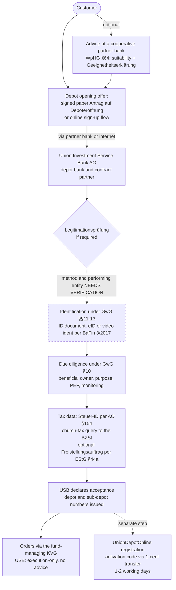

# Ist-Analyse: opening a securities account (UnionDepot) in Germany - Union Investment as the reference case

**Status:** research draft for the TRUSTEQ case study.
**Research and access date for every source:** 3 November 2026.
**Not legal advice.**

This document describes how a retail customer opens a UnionDepot today, **as far as public, official
sources show it**. It does not describe internal procedures of Union Investment, Union Investment
Service Bank AG or any cooperative bank. Where an official text could not be retrieved, the point is
marked **NEEDS VERIFICATION** instead of being assumed.

## 0. How to read this document

| Marker | Meaning |
|---|---|
| **VERIFIED FACT** `[S#]` | Directly supported by the cited source (section 8), read on 3 November 2026. German quotations are verbatim. |
| **PROJECT INFERENCE** | Our interpretation, e.g. a likely bottleneck. Not a statement about how the institutions actually operate. |
| **FUTURE PROPOSAL** | Our conceptual 2030 agentic onboarding design (TRUSTEQ ADR v1.1, frozen). |
| **NEEDS VERIFICATION** `[G#]` | Not verified: the official page could not be retrieved, or no official source was found. Listed in section 9. Must not be presented as fact. |

Table rows carry the marker of their evidence column. Section 5 is entirely PROJECT INFERENCE. The
opportunities in section 6 are FUTURE PROPOSAL.

German terms kept on purpose:

| Term | Meaning |
|---|---|
| Wertpapierdepot / Depot | securities account |
| Depotvertrag | custody contract |
| Legitimationsprüfung | check of identity or authority |
| Kapitalverwaltungsgesellschaft (KVG) | investment management company |
| Vertriebspartner | distribution partner |
| Geeignetheitserklärung | suitability statement |
| Angemessenheitsprüfung | appropriateness assessment |
| Steuer-Identifikationsnummer | tax ID |
| Freistellungsauftrag | tax exemption order for investment income |
| Kirchensteuerabzugsmerkmal (KiStAM) | church-tax deduction attribute |
| Sperrvermerk | objection to the automated church-tax data query |
| Basisinformationsblatt | key information document (KID) |

## 1. Executive summary

1. **VERIFIED FACT.** The depot contract is concluded with **Union Investment Service Bank AG ("USB")**,
   Weißfrauenstraße 7, 60311 Frankfurt am Main. Its business is to hold and administer securities for
   others and to buy and sell financial instruments on commission ("Wertpapiere für andere zu verwalten
   und zu verwahren sowie Finanzinstrumente im Wege des Kommissionsgeschäfts zu erwerben und zu
   veräußern") `[S1 §1.1; S3]`.
2. **VERIFIED FACT.** The customer makes a binding offer "entweder über ein Papierformular („Antrag auf
   Depoteröffnung") oder über eine im Internet angebotene Abschlusstrecke". The offer is sent to the USB
   "(zum Beispiel von einer Bank der genossenschaftlichen Finanzgruppe) oder über das Internet"
   `[S1, "Zustandekommen des Depotvertrags"]`. The contract comes into existence when the USB "nach der
   gegebenenfalls erforderlichen Legitimationsprüfung" declares acceptance, opens a UnionDepot with an up
   to 10-digit number and tells the customer the depot and sub-depot numbers `[S1 §2.1]`.
3. **VERIFIED FACT.** The USB gives no advice: "Ausschluss der Beratung („Execution-only")". It assumes the
   investor was informed by the referring distribution partner ("zuführenden Vertriebspartner")
   `[S1 §7.2]`. Union Investment states that personal advice is given at its cooperative partner banks
   `[S5]`. The USB classifies all investors as Privatkunden (retail clients) under the WpHG `[S1 §2.4]`. It
   executes orders as commission agent via the fund-managing KVGs `[S1 §7.1]`.
4. **VERIFIED FACT.** Digital opening routes exist. The price list refers to minors' depots opened **via
   UnionDepotOnline from 1 January 2026** and **via the UnionDepot in a distribution partner's online
   banking from 23 June 2026** `[S3, footnote 6]`. The terms name online sign-up flows such as that of
   the UnionDepot Komfort or of an asset-management service `[S1, withdrawal provisions]`. **Online access
   to an existing depot is a separate registration**: depot number and date of birth, then an activation
   code, usually sent within 1-2 working days in a 1-cent transfer `[S4 §1]`.
5. **VERIFIED FACT (law).** Before a business relationship is established, the obliged entity must
   identify the customer and verify the identity (GwG §§ 10-13). It may rely on certain third parties or
   outsource the measures by contract, but **the responsibility stays with the obliged entity**
   (GwG § 17) `[S10-S14]`. Credit institutions must record the customer's Steuer-Identifikationsnummer
   (AO § 154(2a)) `[S17]`. BaFin allows video identification under Circular 3/2017 (GW) and continues it
   as a "Brückentechnologie" (bridge technology) `[S19, S20]`.
6. **VERIFIED FACT (law).** Investment advice requires a suitability assessment and, for retail clients,
   a Geeignetheitserklärung on a durable medium before the contract (WpHG § 64). Non-advised services
   require an appropriateness assessment with warnings, unless all statutory execution-only conditions
   are met (WpHG § 63(10), (11)) `[S15, S16]`.
7. **VERIFIED FACT.** Current depot fees (price list "000544 06.26") `[S3]`:
   - **EUR 9.00 a year** if only Union Investment funds are held (EUR 7.56 plus VAT);
   - **EUR 33.39 a year** with third-party funds (EUR 28.06 plus VAT);
   - due in December;
   - a UnionDepot Komfort has no depot fee, but it requires a framework agreement with a cooperative
     distribution partner, under which service fees apply.
8. **NEEDS VERIFICATION.** The public documents read do not state which identification method is used
   for a new UnionDepot (branch check at the partner bank, video identification or eID). Nor do they
   state whether the USB relies on the partner banks or outsources identification under GwG § 17
   `[G3, G4]`.
9. **PROJECT INFERENCE.** The main friction points are:
   - media breaks (paper forms and signatures);
   - responsibilities split across partner bank, depot bank and fund company;
   - the separate activation of online access.

   This is where an agent could **prepare and coordinate**. Identification, advice, consent and account
   opening stay with the regulated entities.

## 2. Actors and responsibilities

| Actor | Role in the depot opening (VERIFIED FACT unless marked) | Source |
|---|---|---|
| **Customer** (retail investor) | Makes the binding offer (signed paper application or online flow); must tell the USB in text form if they become, or stop being, a politically exposed person | `[S1 §2.1, "Zustandekommen", §2.5]` |
| **Union Investment Service Bank AG (USB)** | Depot bank and contract partner. Accepts the offer after any required Legitimationsprüfung, opens the depot, holds the fund units, executes orders on commission and queries church-tax data. Classifies all investors as Privatkunden; gives no advice | `[S1 §§1.1, 2.1, 2.4, 7.1, 7.2, tax provisions]` |
| **Volksbanken and Raiffeisenbanken** (cooperative partner banks) | Distribution partners. Give personal advice and can forward the application to the USB; terms and price lists are available there. A UnionDepot Komfort needs a framework agreement with such a partner. From 23 June 2026, minors' depots can be opened in a partner's online banking | `[S1 §1.2, §7.2, "Zustandekommen"; S3 footnotes 3, 6; S5]` |
| **Fund-managing KVGs** | Issue and redeem fund units; the USB executes orders through them | `[S1 §7.1]`; legal names of the Union Investment KVGs: **NEEDS VERIFICATION** `[G6]` |
| **Union Investment** (group) | "Als Teil der Genossenschaftlichen FinanzGruppe gehört Union Investment deutschlandweit zu den führenden Fondsgesellschaften"; head office in Frankfurt am Main | `[S6]`; ownership and holding structure: **NEEDS VERIFICATION** `[G5]` |
| **DZ BANK AG** | Counterparty for the USB's daily foreign-exchange transactions for orders in Union Investment funds | `[S3 no. 7]` |
| **VisualVest GmbH** | Group subsidiary: "digitaler Vermögensverwalter, eine Investmentplattform für ETFs und technischer Plattformanbieter". Founded 2015 as a 100 % subsidiary of the Union Investment group; investment advice since March 2016, portfolio management since July 2017; supervised by BaFin. An existing digital onboarding route within the group | `[S7]` |
| **AUTHADA** (Darmstadt) | eID identification provider integrated by VisualVest in addition to video identification. Customers are redirected from the VisualVest website to the AUTHADA identification website | `[S8, S9]` |
| **External identification providers** (general) | Video identification may only be carried out by trained employees of the obliged entity or of a third party to which identification was outsourced `[S19]`. Outsourcing under GwG § 17(5)-(7): needs a contract; the measures count as the obliged entity's own; the entity checks the provider's reliability first and uses spot checks during the cooperation `[S14]` | `[S14, S19]` |
| **BaFin** | Supervisor; Circular 3/2017 (GW) sets the requirements for video identification | `[S19, S20]` |
| **Bundeszentralamt für Steuern (BZSt)** | Answers the bank's automated query for a tax ID the customer did not provide (AO § 154(2b)). Answers the USB's church-tax query, made at depot opening and once a year | `[S17; S1 tax provisions]` |

**PROJECT INFERENCE — legally responsible entity per step** (to be validated against the real contracts):
- **Identification and AML due diligence:** the obliged entity that establishes the relationship,
  presumably the USB. It may use the partner bank as a third party or an ID provider as an outsourcing
  contractor; either way it remains responsible (GwG § 17).
- **Advice and suitability:** the entity that actually gives the advice, i.e. the partner bank.
- **Custody, order execution and tax withholding:** the USB.
- **Product information (KID):** the fund company and whoever sells or advises `[G8]`.

## 3. Current-state process

### 3.1 Initial depot opening

| # | Step | Evidence |
|---|---|---|
| 1 | Personal advice is offered at the cooperative partner banks: "Eine persönliche Beratung erhalten Sie in unseren genossenschaftlichen Partnerbanken" | VERIFIED `[S5]`. The terms also provide for offers sent via the internet, and for direct orders "ohne Einbindung eines Vertriebspartners (zum Beispiel online)" `[S1 "Zustandekommen", §7.2]`. So advice is not part of every route (PROJECT INFERENCE) |
| 2 | If advice is given: suitability assessment and, for retail clients, a Geeignetheitserklärung before the contract | VERIFIED (law) `[S16]`; how the partner banks carry it out: **NEEDS VERIFICATION** |
| 3 | The customer completes the application on paper or in an online flow. The paper route requires "den vollständig und lesbar ausgefüllten sowie unterzeichneten Depoteröffnungsantrag" | VERIFIED `[S1 §2.1, "Zustandekommen"]` |
| 4 | The offer reaches the USB "(zum Beispiel von einer Bank der genossenschaftlichen Finanzgruppe) oder über das Internet" | VERIFIED `[S1 "Zustandekommen"]` |
| 5 | Legitimationsprüfung "gegebenenfalls erforderlich" | VERIFIED `[S1 §2.1]`. Method and performing entity: **NEEDS VERIFICATION** `[G3, G4]`. The same terms use "Legitimationsprüfung" for checking that a person placing an order is authorised `[S1 §5]`, so the word alone does not show which GwG procedure is used (PROJECT INFERENCE) |
| 6 | Customer due diligence: identification, beneficial owner, purpose and nature of the relationship, PEP check, ongoing monitoring. The terms add a PEP self-disclosure duty and the Privatkunde classification | VERIFIED (law) `[S10]`; `[S1 §§2.4, 2.5]` |
| 7 | Tax data. Credit institutions record the Steuer-Identifikationsnummer `[S17]`. At depot opening, and yearly between 1 September and 31 October, the USB queries the BZSt for the church-tax attribute using the tax ID and date of birth, unless the customer filed a Sperrvermerk `[S1 tax provisions]`. A Freistellungsauftrag is optional and only valid with the tax ID `[S18]` | VERIFIED. Foreign tax residence and FATCA/CRS: **NEEDS VERIFICATION** `[G9, G16]` |
| 8 | Special conditions and price lists are available from the distribution partners and "werden bei der Depoteröffnung oder bei Erteilung eines Auftrags mit dem Anleger vereinbart" | VERIFIED `[S1 §1.2]` |
| 9 | **Acceptance.** The USB declares acceptance and opens the UnionDepot (up to 10-digit master number, at least one sub-depot). It tells the customer the depot and sub-depot numbers | VERIFIED `[S1 §2.1]` |
| 10 | **Withdrawal.** If the application was made through an online interface, the USB reminds the customer of the withdrawal right by e-mail. After a valid withdrawal, no depot fee is owed | VERIFIED `[S1 withdrawal provisions]` |
| 11 | **First order.** Executed via the fund-managing KVG. General rule: "Der USB müssen eigenhändig unterschriebene Aufträge vorliegen". For direct orders without a partner, the USB itself provides the legally required information | VERIFIED `[S1 §§5, 7.1, 7.2]` |

### 3.2 Online access to an existing depot (UnionDepotOnline)

**VERIFIED FACT** `[S4 §1]`. Registration takes three steps:
1. The customer enters the **depot number or access/customer number and the date of birth**.
2. The **activation code (Freischaltcode)** arrives within 1-2 working days, usually in the reference
   field of a **1-cent transfer** to the stored bank account, otherwise by letter.
3. The customer signs in with e-mail address and password and enters the code.

**VERIFIED FACT** `[S4]`. After registration, UnionDepotOnline offers:
- orders and savings plans `[§6]`;
- an electronic postbox with ex-ante cost information and document upload `[§§6.6, 7]`;
- profile data including name, date and place of birth, nationality, address and Steuer-ID `[§4]`;
- changes to the **Freistellungsauftrag** `[§8]`;
- **pushTAN** approval of each transaction `[§10]`.

**VERIFIED FACT** `[S5]`. For **MeinInvest / VermögenPlus** depots, online access is only via the customer
login on the partner bank's website.

**PROJECT INFERENCE.** Opening a depot and activating online access are separate processes, each with its
own security step. A customer who opens on paper waits for the depot number, then waits again for the
activation code.

### 3.3 Existing-customer servicing (context for human involvement)

**VERIFIED FACT** `[S5]`:
- Sell orders are accepted by phone and in the chat, or through the bank adviser.
- For sales of EUR 10,000 or more by phone or chat, the customer's personal signature is needed (scan
  or photo by e-mail).
- Above EUR 25,000, the signed order is sent to the USB by post, or placed through the bank adviser.

### 3.4 Current-state process diagram

The dashed node marks a NEEDS VERIFICATION point: the identification method for a new UnionDepot. The
legal requirements for identification are verified. The sources do not state the order of the checks
between offer and acceptance, so the sequence shown is simplified (PROJECT INFERENCE).

## 4. Regulatory requirements

All rows are VERIFIED FACT (law) unless marked. The last column is PROJECT INFERENCE.

| Obligation | Source | Content (abridged; quotations verbatim) | Consequence for an agentic design |
|---|---|---|---|
| General due diligence | GwG § 10(1), (3) `[S10]` | identification of the contracting party and of persons acting for it; beneficial owner; purpose and intended nature; PEP check; ongoing monitoring - to be fulfilled "bei der Begründung einer Geschäftsbeziehung" | the bank, not the agent, performs and records CDD |
| Identification timing and data | GwG § 11(1), (4) `[S11]` | "vor Begründung der Geschäftsbeziehung"; may be completed during the establishment "unverzüglich" if needed not to interrupt the normal course of business and the ML/TF risk is low. Natural persons: first and last name, place of birth, date of birth, nationality, residential address | identity data come from verified evidence, never from agent assertions |
| Means of verification | GwG § 12(1) `[S12]` | valid official photo ID; eID (§ 18 PAuswG, § 12 eID-Karte-Gesetz, § 78(5) AufenthG); qualified electronic signature, with validation (Art. 32(1) eIDAS) and a transaction directly from a payment account in the customer's name; notified eID scheme; documents under the ZIdPrüfV | eID and wallet-based identification are legally recognised building blocks (2030) |
| Verification procedure | GwG § 13(1), (2) `[S13]` | "durch angemessene Prüfung des vor Ort vorgelegten Dokuments" or another suitable procedure with a security level "das dem in Nummer 1 genannten Verfahren gleichwertig ist". The Federal Ministry of Finance may specify procedures by regulation. Electronic procedures for trial use are admitted only after the BSI has confirmed the security level | remote identification must reach an equivalent security level |
| Third-party reliance | GwG § 17(1) `[S14]` | may rely on listed third parties for § 10(1) nos. 1-4; "Die Verantwortung für die Erfüllung der allgemeinen Sorgfaltspflichten bleibt bei dem Verpflichteten" | partner-bank evidence can be reused; accountability does not move |
| Contractual outsourcing | GwG § 17(5)-(7) `[S14]` | CDD measures under § 10(1) nos. 1-4 may be transferred by contract to other suitable persons and companies; their measures "werden dem Verpflichteten als eigene Maßnahmen zugerechnet". The transfer must not impair compliance, management control or supervision; reliability check before, spot checks during the cooperation | a video or eID provider acts for the bank; the customer's agent cannot take that role |
| Video identification | BaFin Circular 3/2017 (GW) `[S19]`; evaluation of 9 May 2022 `[S20]` | Circular: trained employees of the obliged entity or of an outsourcing third party; separate premises with restricted access; explicit, logged consent; real time, without interruption; only end-to-end encrypted video chats (BSI TR-02102); at least three randomly selected security features from different categories; records kept five years (GwG § 8(3)); not possible for legal persons or partnerships. 2022 evaluation: continued "als Brückentechnologie"; use of AI under examination (transparency, traceability, explainability); a regulation under GwG § 13(2) under consideration | video identification is accepted but transitional; eID is the more durable path |
| Appropriateness / execution-only | WpHG § 63(10), (11) `[S15]` | before services other than investment advice or portfolio management: obtain information on knowledge and experience; warn if not appropriate or if the information is insufficient; the warnings "können in standardisierter Form erfolgen". Exemption only if all conditions hold: service "auf Veranlassung des Kunden" for listed non-complex instruments, including UCITS units except structured UCITS; not combined with a loan (with exceptions); client explicitly informed that no appropriateness assessment takes place | a negative assessment means a warning, not an automatic rejection (consistent with the ADR) |
| Investment advice / suitability | WpHG § 64(1), (3), (4) `[S16]` | (1) inform "rechtzeitig vor der Beratung und in verständlicher Form" whether the advice is independent and how broad the analysis is; (3) obtain knowledge and experience, financial situation including the ability to bear losses, and objectives including risk tolerance; (4) give retail clients a Geeignetheitserklärung "auf einem dauerhaften Datenträger vor Vertragsschluss"; exception for distance communication that does not allow prior delivery | advice and suitability stay with the advising bank; an agent must not give personalised advice |
| Account truthfulness and tax ID | AO § 154(1), (2), (2a), (2b) `[S17]` | (1) no account under a false or fictitious name; (2) "sich zuvor Gewissheit über die Person und Anschrift jedes Verfügungsberechtigten und jedes wirtschaftlich Berechtigten" and record it; (2a) credit institutions collect and record the Identifikationsnummer of each account holder, authorised person and beneficial owner; (2b) if not provided by the start of the relationship, query the BZSt by machine "bis zum Ablauf des dritten Monats nach Begründung der Geschäftsbeziehung" | tax ID collection is part of onboarding (not modelled in the prototype) |
| Freistellungsauftrag | EStG § 44a(2), (2a) `[S18]` | on the officially prescribed form ("nach amtlich vorgeschriebenem Muster"); only with the creditor's Identifikationsnummer; ineffective without it since 1 January 2016 | tax-data completeness affects withholding |
| Fund sales documents | KAGB § 297(1), (2) `[S21]` | (1) to the **professional** investor interested in a UCITS: "die wesentlichen Anlegerinformationen oder das Basisinformationsblatt gemäß Verordnung (EU) Nr. 1286/2014" free of charge in good time before the contract, plus prospectus and latest reports; (2) **retail** investors in an **AIF**: latest net asset value or market price before the contract, plus sales documents in good time | delivery of the KID must be evidenced per document version (prototype: disclosure receipt) |
| PRIIPs KID for retail investors | Reg. (EU) No 1286/2014, Arts. 5, 13 | **NEEDS VERIFICATION** `[G8]` - the EUR-Lex text could not be retrieved | check the KID duty towards retail investors |
| MiFID II suitability and appropriateness | Directive 2014/65/EU, Art. 25 | **NEEDS VERIFICATION** `[G7]`; the German implementation (WpHG §§ 63, 64) is verified above | - |
| FATCA / CRS self-certification | FKAustG | **NEEDS VERIFICATION** `[G9]` | - |
| Tipping-off; human intervention in distance contracts; electronic withdrawal | GwG § 47; EGBGB Art. 246b § 3(3); BGB § 356a | cited in the frozen ADR; **NEEDS VERIFICATION** - not re-read for this document `[G12]` | - |

**Distinction by service type (topic 6).** These three rules are VERIFIED (law):

| Service | Rule |
|---|---|
| Investment advice | suitability assessment (§ 64) |
| Other investment services | appropriateness assessment with warnings (§ 63(10)) |
| Execution-only | exemption only when every condition of § 63(11) is met |

The USB states that it gives no advice and classifies every investor as a Privatkunde
`[S1 §§2.4, 7.2]`. **NEEDS VERIFICATION** `[G17]`: whether it carries out an appropriateness assessment
for direct orders or relies on § 63(11).

## 5. Potential bottlenecks, human involvement and automation (PROJECT INFERENCE)

Each point interprets verified facts. None is an observation of the institutions' operations.

| # | Bottleneck | Grounded in |
|---|---|---|
| B1 | **Media breaks.** A signed paper application must reach the USB, possibly via the partner bank. Orders generally need a handwritten signature. Larger phone or chat sales need a signature; sales above EUR 25,000 go by post | `[S1 §§2.1, 5; S5]` |
| B2 | **Two waiting periods.** First the depot number after acceptance, then a separate activation code for online access (1-2 working days) | `[S1 §2.1; S4 §1]` |
| B3 | **Split responsibility.** Advice at the partner bank, contract and custody at the USB, fund units at the KVG; status and data must travel between them | `[S1 §§7.1, 7.2; S5]` |
| B4 | **Identification channel.** A branch visit or a video session; remote procedures must reach an equivalent security level | `[S12, S13, S19, S20]` |
| B5 | **Tax-data completeness.** Without the tax ID a Freistellungsauftrag is ineffective, and the bank must query the BZSt | `[S17, S18]` |
| B6 | **Advice dependency.** An advised purchase needs a suitability assessment and a Geeignetheitserklärung first | `[S16]` |
| B7 | **Document versions.** Conditions, price lists and product information must be the version valid at the time of agreement | `[S1 §1.2; S3; S21]` |
| B8 | **Fragmented online access.** MeinInvest / VermögenPlus customers sign in via each partner bank's own login | `[S5]` |

**Human involvement today (VERIFIED):**
- advisers at partner banks, and orders by phone or chat `[S5]`;
- trained staff for video identification `[S19]`;
- on-site document check as the reference identification procedure `[S13]`.

**Automation that already exists (VERIFIED):**
- online sign-up flows `[S1, S3]`;
- online-access activation by code `[S4]`;
- pushTAN approval `[S4]`;
- eID identification at VisualVest `[S8, S9]`.

## 6. Opportunities and limitations of agentic onboarding

**Opportunities (FUTURE PROPOSAL, from the TRUSTEQ ADR):**
- **Verified product information.** The customer's agent discovers the official, versioned product
  information (fees, risk text, KID references) and explains it with source citations, not marketing
  claims.
- **Prepared application, bank-side confirmation.** The agent **prepares** the application (a draft
  with structured data) and coordinates the steps. The bank turns it into a **request-bound handoff**,
  which the customer confirms on a bank-controlled channel.
- **eID as a fully digital path (2030).** eID-based identification is legally listed (GwG § 12(1) no. 2)
  and already used in the group's digital channel (VisualVest with AUTHADA) `[S8, S12]`.
- **One status view and human escalation.** Status is visible across partner bank, depot bank and fund
  company, and "Speak to a person" works at every active step.

**Limitations (VERIFIED legal constraints, with PROJECT INFERENCE on their consequence):**
- **Identification and due diligence.** The agent **cannot identify the customer or perform due
  diligence**. These are duties of the obliged entity, and reliance or outsourcing leaves the
  responsibility there `[S10-S14]`.
- **Advice.** The agent **cannot give personalised advice** in place of the bank's suitability process
  and Geeignetheitserklärung `[S16]`. Appropriateness warnings must come from the institution `[S15]`.
- **Contract.** The **contract** only comes into existence through the USB's acceptance `[S1 §2.1]`. An
  agent cannot open the depot.
- **Tax data.** The institution must collect and record the tax data (Steuer-ID) `[S17, S18]`.

## 7. Today's process compared with the TRUSTEQ prototype (2026)

The prototype column describes P0 as implemented at commit `5f781b5`. Everything marked MOCK or
simulated is not a real banking function.

| Aspect | Today (VERIFIED unless marked) | TRUSTEQ prototype |
|---|---|---|
| Product information | terms and price lists agreed at opening `[S1 §1.2; S3]`; KID rules `[S21; G8]` | signed, versioned, expiring provider manifest with a pinned digest; KID and price list with version and digest; disclosure receipt per document version; all synthetic (MOCK) data (`app/integrations/catalog_fixture.py`, `app/domain/receipts.py`) |
| Application | paper form or online flow `[S1]` | agent creates a draft (`POST /v1/applications` with Idempotency-Key and a scoped bootstrap token) |
| Customer consent | signed application or online flow `[S1 §2.1]` | one-time, request-bound handoff on a bank-controlled page; the customer confirms the exact action digest; sign-in is **simulated** (`/customer/dev-login`) |
| Identification and CDD | Legitimationsprüfung where required; method **NEEDS VERIFICATION** `[G3]` | **MOCK** KYC and compliance adapters (`app/integrations/mock.py`); no real identification |
| Advice / appropriateness | advice at partner banks `[S5]`; USB execution-only `[S1 §7.2]` | no advice; pages state "not investment advice and not a suitability assessment"; no appropriateness questionnaire in P0 |
| Tax data | Steuer-ID, church-tax query, Freistellungsauftrag `[S1; S17; S18]` | not modelled |
| Account opening | USB acceptance and depot number `[S1 §2.1]` | only a signed depot-provider callback (`POST /internal/depot-provider/confirmations`, MOCK provider) can set `OPENED`; the agent mandate is then revoked |
| Online access | separate UnionDepotOnline registration `[S4 §1]` | the agent sees only generic status; the customer uses a server-side session (HttpOnly cookies, CSRF token) |
| Human involvement | advisers, phone and chat `[S5]`; trained video-ident staff `[S19]` | "Speak to a person" request (session + CSRF), durable review cases, operator decisions that cannot bypass checks (`app/services/review_service.py`, `scripts/dev_operator.py`) |
| Partner attribution | distribution partners; Komfort framework agreements `[S1; S3]` | registry-based partner directory; the attribution is bound into the approved action (`app/domain/attribution.py`) |
| Withdrawal | e-mail reminder for online applications; no depot fee after withdrawal `[S1]` | not modelled (ADR: a separate workflow, not "undo OPENED") |

## 8. Source register

Every source was accessed on **3 November 2026**. The single-section pages on gesetze-im-internet.de
show no "Stand" date; they are the official consolidated text.

| ID | Source | URL | Date / version | Supports |
|---|---|---|---|---|
| S1 | Union Investment Service Bank AG - "Bedingungen für UnionDepots und Sonderbedingungen" (PDF) | https://cdn.dam.union-investment.de/404369_Bedingungen_fuer_UnionDepots_Standard_und_VL.pdf | form 000563, footer "05.26"; PDF created 18 May 2026 | business purpose, contract formation, Legitimationsprüfung, Privatkunde classification, PEP duty, execution-only, KVG execution, order signatures, church-tax query, withdrawal reminder, price-list agreement |
| S2 | older edition of S1 (PDF) | https://www.union-investment.de/dam/jcr:600b1281-4a9b-468b-9012-191d9e7b72f3/FM_000563_Bedingungen_UnionDepots_SB_UPR.pdf | PDF created 14 November 2025 | not used for claims (superseded by S1) |
| S3 | USB - "Allgemeines Preisverzeichnis (alle Angaben inklusive gesetzlicher Umsatzsteuer)" (PDF) | https://cdn.dam.union-investment.de/404368_Preisverzeichnis_000544_11.21.pdf | footer "000544 06.26" / "NGR 06.26"; PDF created 10 March 2026 (the file name still says 11.21) | depot fees, UnionDepot Komfort, online opening channels for minors (footnote 6), FX via DZ BANK AG |
| S4 | "UnionDepotOnline Handbuch" (PDF) | https://cdn.dam.union-investment.de/441444_UDO-Handbuch_Klick-PDF.pdf | PDF created 11 September 2025, modified 14 April 2026 | online-access registration, activation code, profile data, functions |
| S5 | Union Investment customer homepage | https://www.union-investment.de/ | figures "Stand: 04.03.2026" (6.01 million customers, 4.1 million fund savings plans) | advice at partner banks, servicing rules, MeinInvest / VermögenPlus access |
| S6 | Union Investment corporate start page | requested https://unternehmen.union-investment.de/ueber-uns/unser-unternehmen ; the server returned the start page https://unternehmen.union-investment.de/ | undated (4,409 employees, 6.04 million customers, EUR 569.3 bn assets under management) | group description, head office |
| S7 | VisualVest press page and imprint | https://www.visualvest.de/dialog/presse ; https://www.visualvest.de/rechtliches/impressum | undated | subsidiary description, founding, licences, supervisor |
| S8 | AUTHADA press release "VisualVest integriert eID-Service von AUTHADA" | https://authada.de/visualvest-integriert-eid-service-von-authada/ | 9 March 2020, updated 18 May 2022 | eID identification before depot opening, in addition to video identification |
| S9 | AUTHADA case study on VisualVest (English) | https://authada.de/en/?p=11617 | page timestamp 24 June 2025 | redirect integration, eID with the app |
| S10 | GwG § 10 | https://www.gesetze-im-internet.de/gwg_2017/__10.html | - | general due diligence and triggers |
| S11 | GwG § 11 | https://www.gesetze-im-internet.de/gwg_2017/__11.html | - | identification timing and data |
| S12 | GwG § 12 | https://www.gesetze-im-internet.de/gwg_2017/__12.html | - | means of verification |
| S13 | GwG § 13 | https://www.gesetze-im-internet.de/gwg_2017/__13.html | - | verification procedures |
| S14 | GwG § 17 | https://www.gesetze-im-internet.de/gwg_2017/__17.html | - | third-party reliance, contractual outsourcing, responsibility |
| S15 | WpHG § 63 | https://www.gesetze-im-internet.de/wphg/__63.html | - | appropriateness, warnings, execution-only conditions |
| S16 | WpHG § 64 | https://www.gesetze-im-internet.de/wphg/__64.html | - | advice disclosures, suitability, Geeignetheitserklärung |
| S17 | AO § 154 | https://www.gesetze-im-internet.de/ao_1977/__154.html | - | Kontenwahrheit (account truthfulness), Identifikationsnummer, BZSt query |
| S18 | EStG § 44a | https://www.gesetze-im-internet.de/estg/__44a.html | - | Freistellungsauftrag and tax ID |
| S19 | BaFin Circular 3/2017 (GW) - video identification procedures (English version) | https://www.bafin.de/SharedDocs/Veroeffentlichungen/EN/Rundschreiben/2017/rs_1703_gw_videoident_en.html | 10 April 2017; in force 15 June 2017 | video identification requirements, outsourcing to third parties |
| S20 | BaFin - "Ergebnis der Evaluierung des Videoidentifizierungsverfahrens i. S. d. Rundschreibens 3/2017 (GW)" | https://www.bafin.de/SharedDocs/Veroeffentlichungen/DE/Auslegungsentscheidung/A/ae_videoident_rs_3_2017.html | 9 May 2022 | continued as a bridge technology; AI use under examination |
| S21 | KAGB § 297 | https://www.gesetze-im-internet.de/kagb/__297.html | - | sales documents (UCITS professional investors; AIF retail investors) |

## 9. NEEDS VERIFICATION - checklist for independent checking

| ID | Open question | Where to check | Why open |
|---|---|---|---|
| G1 | Union Investment's own description of how new customers open a UnionDepot | https://www.union-investment.de/unsere-services/haeufige-fragen/haeufige-fragen/frage/Wie-kann-ich-ein-Depot-eroeffnen- | automated retrieval returned the homepage instead; check in a browser |
| G2 | Product and service pages | https://www.union-investment.de/fonds_depot/uniondepot ; https://www.union-investment.de/fonds_depot/uniondepot/uniondepotonline ; https://www.union-investment.de/einzelseiten/depotzugang ; https://www.union-investment.de/einzelseiten/exantekosteninformation ; https://www.union-investment.de/fonds_depot/uniondepot/besonderes-preis-leistungsverzeichnis ; https://www.union-investment.de/unsere-services/haeufige-fragen/haeufige-fragen/frage/Wie-hoch-ist-die-Depotgebuehr-in-unserem-UnionDepot ; https://www.union-investment.de/unsere-services/kontakte-im-ueberblick | every one returned the homepage text |
| G3 | Identification method(s) for a new UnionDepot (branch check, video identification, eID) and their providers | the online sign-up flow itself; partner-bank onboarding pages | not stated in S1, S3 or S4 |
| G4 | Whether the USB relies on partner banks (GwG § 17(1)) or outsources identification (§ 17(5)) | partner and outsourcing documentation (may not be public) | not stated publicly |
| G5 | Ownership and holding structure (e.g. DZ BANK, Union Asset Management Holding AG) | https://unternehmen.union-investment.de/ueber-uns/unser-unternehmen and .../unser-management (both returned the start page); https://www.union-investment.com/de_DE/ueber-uns/ueber-union-investment (returned 103 characters); annual report | not retrievable |
| G6 | Legal names of the KVGs that manage the UnionFonds | the KID or prospectus of a specific fund | not named in the documents read |
| G7 | MiFID II Art. 25 wording | https://eur-lex.europa.eu/eli/dir/2014/65 ; https://eur-lex.europa.eu/legal-content/EN/TXT/HTML/?uri=CELEX:32014L0065 | EUR-Lex returned HTTP 202 with an empty body |
| G8 | PRIIPs Arts. 5 and 13 (KID drawn up by the manufacturer; provided to retail investors before they are bound) | https://eur-lex.europa.eu/eli/reg/2014/1286/oj ; https://eur-lex.europa.eu/legal-content/EN/TXT/HTML/?uri=CELEX:32014R1286 | same |
| G9 | FATCA / CRS self-certification at onboarding | FKAustG on gesetze-im-internet.de; USB opening forms | not checked |
| G10 | MeinInvest onboarding and legitimation at cooperative banks | https://www.kd-bank.de/content/dam/f0388-1/privatkunden/wertpapiere/kd-bank_MeinInvest_Informationsblatt.pdf ; https://www.volksbank-rhein-lippe.de/content/dam/f0876-0/cloud-transfer/Webcenter/PDF/MeinInvest_Rahmenvereinbarung.pdf | HTTP 404 |
| G11 | Paper activation form for online access to a UnionDepot at a partner bank | https://www.psd-karlsruhe-neustadt.de/content/dam/f0719-0/cloud-transfer/formulare__servicecenter_/sonstige_formulare/FreischaltungsantragOnline-UnionDepot.pdf | HTTP 404 |
| G12 | GwG § 47, EGBGB Art. 246b § 3(3), BGB § 356a (cited in the ADR) | gesetze-im-internet.de | not re-read for this document |
| G13 | Whether the online sign-up flow is open to every new customer, or only via partners / for certain depot types | G1 and the flow itself | S3 names the channels only for minors' depots; S1 names Komfort and asset-management flows |
| G14 | VisualVest's current identification methods | current VisualVest onboarding pages; the press-release PDF https://www.visualvest.de/static/downloads/Pressemitteilung_Online-Ausweisfunktion.pdf returned a 404 page | only the 2020 statement (updated 2022) is available |
| G15 | Customer figures differ: 6.01 million (S5, as of 4 March 2026) vs 6.04 million (S6, undated) | annual report | not reconciled |
| G16 | Treatment of customers who are tax-resident abroad (withholding) | tax provisions of S1 | not re-confirmed for this document |
| G17 | Whether the USB carries out an appropriateness assessment for direct orders or relies on WpHG § 63(11) | USB client information / order forms | not stated in the documents read |
