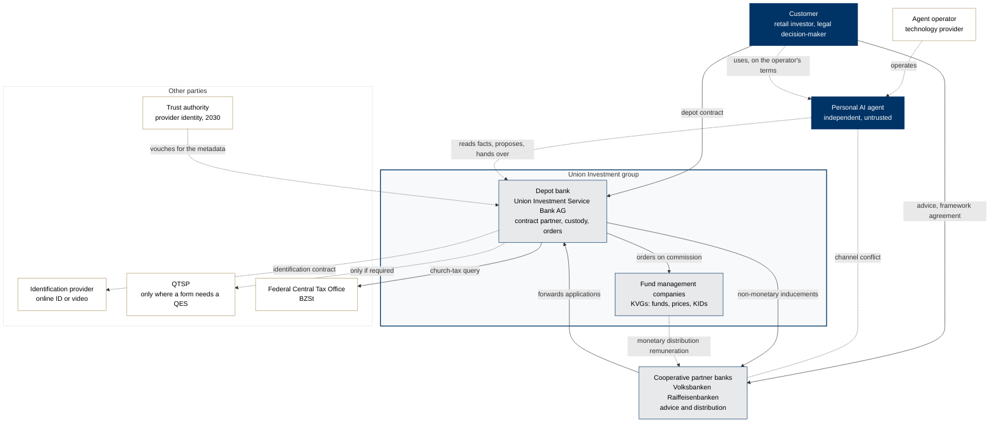
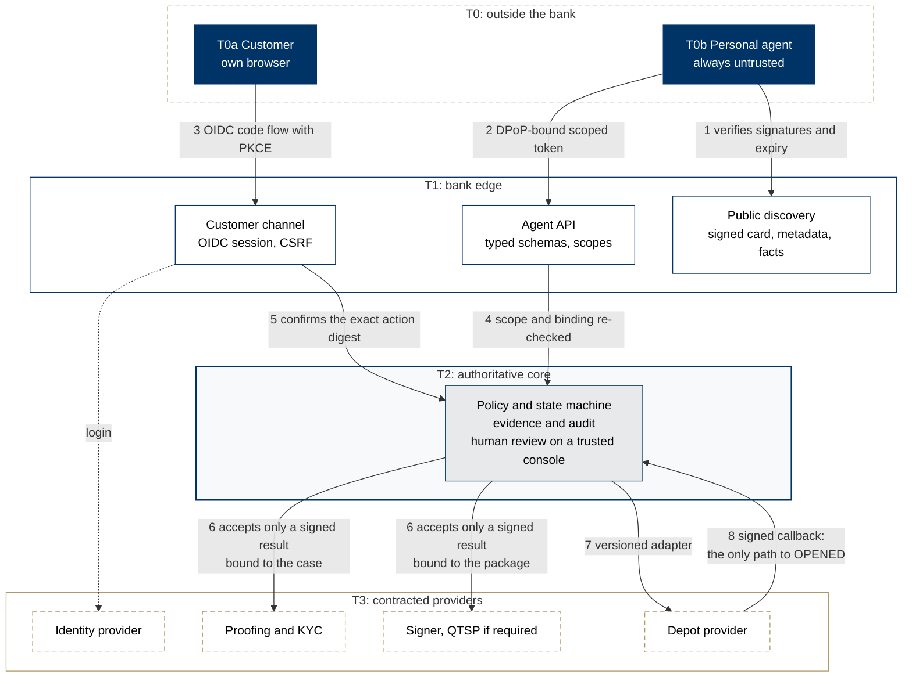

# Roles, responsibilities and trust boundaries

Case-study page 3, "Beteiligte Rollen". This document names every party in an agent-led depot opening, says what each
may and may not decide, and draws the trust boundaries between them. Status: 7 November 2026.

**Two kinds of statements:**
- **VERIFIED** `[S#]`: stated in a public document of the reference case. The register is in
  [ist-analyse-union-investment.md](ist-analyse-union-investment.md#8-source-register).
- **ASSUMPTION**: a reference-architecture assumption. Every relationship that the provider's public documents do not
  show, and everything about the personal agent, is one.

**Three facts that hold the model together:**
1. **The independent AI agent is not the bank.** It acts for the customer, under its operator's terms. It holds no bank
   decision and can never set `OPENED` (`app/domain/workflow.py` gives it no transition).
2. **The partner bank is not the fund provider, and neither is the depot bank.** In the reference case the depot
   contract is with Union Investment Service Bank AG, the funds come from KVGs such as Union Investment Privatfonds GmbH,
   and the cooperative banks advise and distribute `[S1 §2.3; S2; S5; S22]`.
3. **The platform operator and the custodian can be different legal entities.** In the reference case the depot bank is
   both. The TRUSTEQ architecture also allows a distributor with a separate licensed depot provider, so the diagrams draw
   the custodian system as its own party.

## 1. Actors and responsibilities

### 1.1 Role, systems and access

| Actor | Business role | Owns | Data access | Authenticates with | Authorization and delegation |
|---|---|---|---|---|---|
| **Customer** | The legal decision-maker: offers the contract, identifies, declares, consents, signs `[S1 "Zustandekommen"; S22]` | Own devices; the choice of agent | Own data and application status, in the bank's channel | OIDC at the bank's identity provider; in 2030 the bank's strong authentication, online ID or the EUDI Wallet | Grants the agent scoped, revocable delegation on the bank's page |
| **Personal AI agent** (ASSUMPTION) | Researches, explains verified facts, prepares the application, tracks a generic status | Its runtime and its registered key | Public facts. With delegation: draft, handoff request, generic status, submission after consent. Never identity documents, the tax ID, answers or KYC results | Client assertion with its registered key; a DPoP proof on every request | Scopes `create_draft`, `request_handoff`, `read_status`, `submit_after_consent`, bound to the delegation and the exact offer |
| **Agent operator** (ASSUMPTION) | Provides the agent as a product | The agent service | What the customer gives the agent | Its own | None at the bank beyond the agent's registration |
| **Fund company (KVG)** | Manages the funds, issues and redeems units `[S1 §2.3]`; prepares the KID (R12) | Fund data, prices, KIDs | Order data for unit issuance (ASSUMPTION) | Contractual interface with the depot bank (ASSUMPTION) | None over the customer's account |
| **Depot bank / custodian** | Contract partner; accepts and opens the depot; holds the units; executes orders; church-tax query `[S1; S2]` | The depot system; in the 2030 design also the agent interface, layers A to G (ASSUMPTION) | Everything needed for onboarding, including KYC results | Runs the customer channel; pins provider keys | Grants agents scoped access; owns every state transition |
| **Partner bank** | Advises and distributes; identifies in the branch; keeps the original; transmits electronically `[S5; S22]` | Branch and online-banking systems; its customer relationships | Its own customers' data | Its own customer login `[S5]`; in 2030 a signing key for referral proofs | None over the depot bank's decisions |
| **Customer identity provider** | Authenticates the customer for the bank's channel. Login is not identification | Login system | Credentials and subject identifiers | Issues ES256-signed ID tokens | None |
| **Identity-proofing / KYC provider** | Identifies remotely, for example by online ID or video `[S24; S26]`; screens (ASSUMPTION) | Identification system | ID documents, video, screening data | Signed results with pinned keys | Under a contract with the depot bank (ASSUMPTION, G4) |
| **QTSP** (only where a form requires a QES) | Qualified certificates and signatures (R15) | Signing service | The signed document's hash | Qualified certificates | Under a contract with the bank (ASSUMPTION) |
| **Compliance and human review** | Own the rules, decide review cases and attribution conflicts, approve methods | Rule sets, the review console | Review-case facts, never the agent's conversation | Trusted console, not HTTP; operator sign-in with roles in 2030 | Resume to the interrupted step, or reject |
| **Trust authority** (ASSUMPTION, synthetic today) | Vouches for the provider's identity and keys | Federation statements | Public metadata | Its own signing keys | None |
| **Federal Central Tax Office (BZSt)** | Answers tax-ID and church-tax queries; receives reports `[S1; S2 §11.4; S17]` | Its registers | What the law allows | Official interfaces | None |
| **Model provider** (ASSUMPTION, never called in the prototype) | Runs the model behind the bank's answer proposer | The model API | Questions and verified facts, no identity data | API key held by the bank | Two read-only tools; a paid-run budget |

### 1.2 Decisions and evidence

| Actor | May decide | Must never decide | Evidence it issues | Evidence it consumes |
|---|---|---|---|---|
| **Customer** | To open or not; the channel; answers; to proceed after a warning; consent; signature; withdrawal; to ask for a person | The bank's acceptance, the KYC result, the assessment outcome | Consent receipts, answers, the self-certification, the signature | Disclosures, KID, cost information, warnings, confirmations |
| **Personal agent** | What to research, what to propose, when to hand over | Any state transition, `OPENED`, applicability, attribution, KYC, appropriateness, consent, signature | Audited requests with correlation ids; it carries partners' signed proofs | Signed metadata, signed facts, generic statuses |
| **Fund company** | Fund terms, prices, KID content | Opening a depot, KYC, attribution | KIDs, prospectuses, prices | Orders |
| **Depot bank** | Accepting or refusing the relationship, the KYC outcome, its policy, opening the depot | The customer's declarations; advice (it gives none `[S1 §7.2]`) | Acceptance with the depot number, receipts, the audit trail | Identification results, signatures, self-certifications |
| **Partner bank** | Advice and the suitability statement when it advises; its own customer acceptance | The depot bank's acceptance; an attribution without the register | Suitability statements; in 2030 signed referral proofs | Applications, KIDs |
| **Identity provider** | Whether a login succeeded | Identification under the GwG; any onboarding decision | ID tokens, authentication events | Login attempts |
| **Proofing / KYC provider** | The technical identification result | Acceptance of the relationship | Signed identification results | The case reference |
| **QTSP** | Whether a qualified signature was created | The content of the contract | Signature evidence | The package hash |
| **Compliance and review** | Resume or reject a case; resolve attribution among accepted claims; approve rules | Skipping a check, inventing a partner, setting `OPENED` | Append-only decisions with reasons | Case facts |
| **Trust authority** | Whom it vouches for | Anything about a customer | Entity statements | Registration requests |

### 1.3 Trust, incentives and failure

| Actor | Trust relationships | Financial incentives and potential conflicts | Owns failure and escalation for |
|---|---|---|---|
| **Customer** | Trusts the bank's channel; trusts the agent at its own risk | Wants speed, low cost and simplicity; can be steered by the agent's incentives | Asking for a person at any step; withdrawal of an online application `[S1]` |
| **Personal agent** | Untrusted by the bank; verifies the bank against the trust anchor | Its operator may prefer certain providers (ASSUMPTION); it can be prompt-injected | Telling the customer to continue in the bank's channel |
| **Fund company** | Trusted source of product facts | Sales volume; may pay distribution remuneration (ASSUMPTION) | Errors in product data |
| **Depot bank** | Trust root for its own metadata; pins the providers' keys | Growth of digital customers against the partner relationships | Review cases, provider failures, reconciliation |
| **Partner bank** | Registered in the bank's partner register | Receives non-monetary inducements `[S1]`; monetary remuneration not found (ASSUMPTION); risks losing customers to direct agent channels | Attribution disputes, raised to a person at the depot bank |
| **Identity provider** | Its issuer and keys are pinned by the bank | - | Login failures |
| **Proofing / KYC provider** | Contract and quality checks (GwG §17) | Fees per identification (ASSUMPTION) | Failed or expired results go to review |
| **QTSP** | EU trusted lists (not checked here) | Fees per signature (ASSUMPTION) | Failed signatures go to review |
| **Compliance and review** | Inside the bank | - | All escalations |
| **Trust authority** | Configured by agents as their anchor | Governance and funding open | Revocation |

## 2. RACI for the onboarding activities

**R** responsible: performs the work. **A** accountable: exactly one per row. **C** consulted. **I** informed. A dash
means not involved. "Depot bank" here is its operations and platform; compliance is listed separately.

| Activity | Customer | Agent | Depot bank | Partner bank | KVG | ID / KYC provider | Signer / QTSP | Compliance and review | Trust authority |
|---|---|---|---|---|---|---|---|---|---|
| Attest the provider's identity | - | I | C | - | - | - | - | - | A, R |
| Publish verified product facts and KIDs | - | I | A, R | I | R | - | - | C | - |
| Research and compare | A | R | - | - | - | - | - | - | - |
| Delegate to the agent | A, R | I | R | - | - | - | - | - | - |
| Prepare the application | A | R | C | - | - | - | - | - | - |
| Identify the customer | R | I | A | R in the branch | - | R remotely | - | C | - |
| AML due diligence and screening | - | - | A | - | - | R | - | R | - |
| Tax information and self-certification | R | - | A | - | - | - | - | - | - |
| Knowledge and experience; warning | R | - | A, R | - | - | - | - | C | - |
| Advice and suitability, only on request | R | - | I | A, R | - | - | - | - | - |
| Confirm the exact action | A, R | I | R | - | - | - | - | - | - |
| Contract package and signature | R | I | A, R | - | - | - | R | C | - |
| Submit and open the depot | I | R | A, R | I | - | - | - | C | - |
| Confirmation and documents | I | I | A, R | I | - | - | - | - | - |
| Attribution and commission | I | - | A, R | C | - | - | - | C | - |
| Human review of exceptions | I | - | C | - | - | - | - | A, R | - |
| Audit and retention | - | - | A, R | - | - | - | - | C | - |

In the branch channel the partner bank performs the identification `[S22]`; on which legal basis is open (G4). The
agent is never accountable for a regulated activity.

## 3. Stakeholder map

Contracts, flows and the channel conflict. Solid edges are stated in public documents of the reference case; dashed
edges are assumptions or 2030 targets. Source: [../diagrams/06-stakeholder-map.mmd](../diagrams/06-stakeholder-map.mmd).

<!-- diagram: ../diagrams/06-stakeholder-map.mmd -->

## 4. Trust boundaries

The zones are those of [../trust-boundaries.md](../trust-boundaries.md): T0a the customer, T0b the agent, T1 the bank's
edge, T2 the authoritative core, T3 the contracted providers. The numbers on the edges are the crossings in the table
below. Source: [../diagrams/07-trust-boundaries.mmd](../diagrams/07-trust-boundaries.mmd).

<!-- diagram: ../diagrams/07-trust-boundaries.mmd -->

| # | Crossing | Control in the prototype | What never crosses | 2030 strengthening |
|---|---|---|---|---|
| 1 | Agent to public discovery | Signed card, profile and entity statements; keys, expiry and revocation checked by the agent | Trust in a web page or a search result | A sector trust anchor |
| 2 | Agent to the agent API | DPoP-bound, scoped, revocable token; typed schemas; unknown fields refused | Customer credentials; any state transition | A FAPI 2.0 profile, rate limits |
| 3 | Customer to the customer channel | OIDC code flow with PKCE, state and nonce; server-side session; CSRF | Agent tokens: refused on every customer route | The bank's strong authentication, EUDI Wallet |
| 4 | Agent API to the core | Scope and binding re-checked inside the transaction | A generic set-status operation | - |
| 5 | Customer channel to the core | Confirmation of the exact action digest, one-time handoff | Approval relayed by an agent | Signed intents shown by the wallet |
| 6 | Providers to the core | ES256 events bound to case, customer and package; pinned keys; one-time ids | Raw documents or biometrics | Contracted providers, mutual TLS |
| 7 | Core to the depot provider | Versioned adapter; the policy gate runs first | A downgrade without two-sided permission | The custodian's API |
| 8 | Depot provider to the core | HMAC over timestamp and body, 300 s window, matching `provider_ref`, idempotent | A synchronous answer that opens an account | Asymmetric signatures or mutual TLS |

## 5. The channel conflict

**Why it matters.** The cooperative banks are the reference provider's distribution channel: personal advice is given
there `[S5]`, applications travel through them `[S22]`, and they receive inducements `[S1]`. An agent that brings
customers to the provider directly can look, to a partner bank, like a way around it. If the partners see it so, the
network that carries the provider's distribution turns against the agent channel. Avoiding a sharper channel conflict is
one of the case study's goals.

**What the architecture does** (details in [../channel-governance.md](../channel-governance.md)):
- Attribution comes from three sources only: the channel the customer confirmed, a partner's signed referral proof, and
  a verified existing relationship. The agent can only carry a proof; it cannot name a partner.
- An existing partner relationship is preserved: a recorded attribution is not overwritten at any later step.
- Two valid claims are a conflict for a person. The commercial result is withheld, and **the customer's account
  continues**.
- Every attributed result is marked for an inducement review and is never payable by the prototype.

**What stays a business and legal decision:** the commission model, the partner contracts, and whether attribution must
be settled before opening (WpHG § 70, R13: LEGAL VALIDATION REQUIRED).
