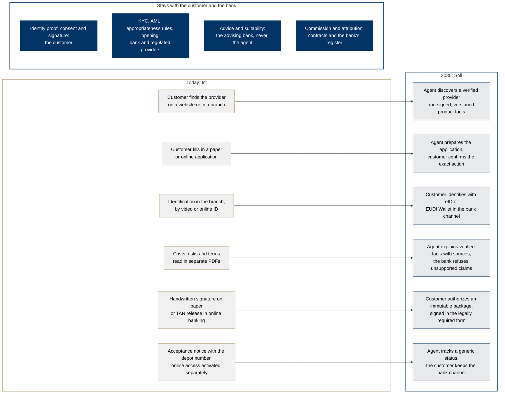
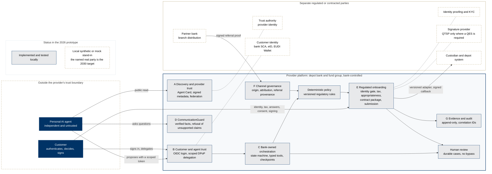
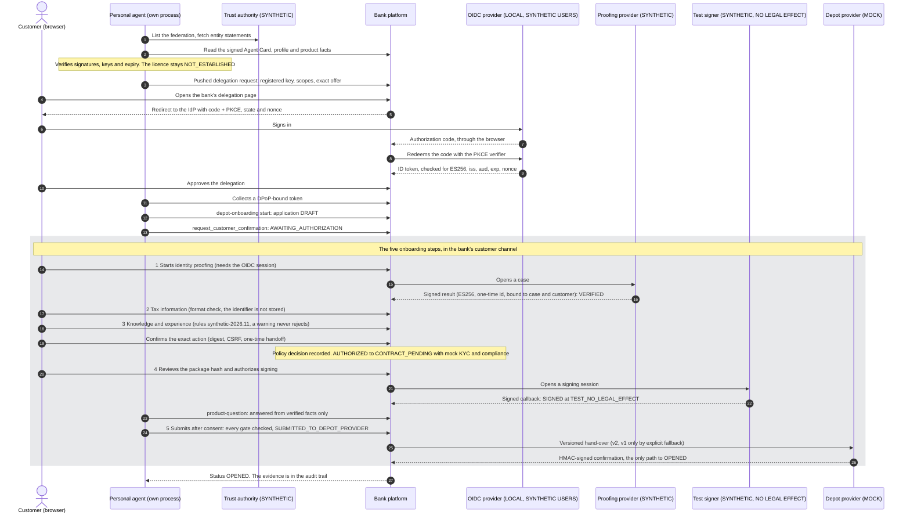
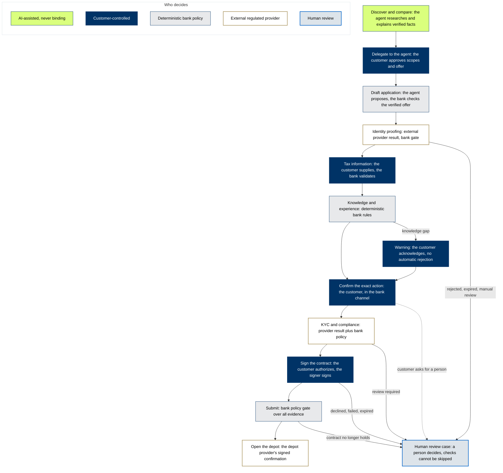

# Technical concept for agent-based depot opening, target 2030

An architecture deliverable, not an implemented system. It starts from the frozen
`TRUSTEQ_ADR_v1.1_FINAL`, keeps its decisions and adds on top: autonomy levels, channel conflicts, a
staged roadmap with roles, and an explicit decision log.

**How to read the labels.** `PROTOTYPE` means built and tested in this repository, with synthetic data.
`PROPOSED FOR 2030` means a design, not built. **All timelines, team sizes and effort figures below are
assumptions by the author**, not verified facts and not a quotation. Legal references are an engineering
applicability view, not legal advice: a client-specific legal and compliance review is mandatory, and the
applicable versions of each text must be checked at implementation time.

The current state of the code is in [final-integration.md](final-integration.md) and, for the nine trust areas,
[agentic-commerce-integration.md](agentic-commerce-integration.md), with exact classifications. In the tables below, "2026
prototype" means built and tested locally with synthetic parties. Nothing is live or connected to a real sandbox.

**Where each part of the concept is:**

| Topic | Document |
|---|---|
| Regulatory ownership and automation boundaries | [regulatory-policy-matrix.md](regulatory-policy-matrix.md) |
| Trust boundaries and channel conflict | [trust-boundaries.md](trust-boundaries.md), [channel-governance.md](channel-governance.md) |
| Target architecture 2030, growing requirements | this document |
| Diagrams, as editable Mermaid sources | [diagrams/](diagrams/README.md) |
| The prototyped end-to-end scenario | section 2.2 and [agentic-commerce-integration.md](agentic-commerce-integration.md) |
| Assumptions and design decisions | section 8 and [decision-register.md](decision-register.md) |

## 1. The problem in one paragraph

A large German fund provider sells securities accounts through its own website and app and through
cooperative branch banks. Personal AI agents increasingly research, compare and start purchases for their
users. The provider must stay discoverable and trustworthy for those agents, and able to complete a
regulated onboarding, without losing control of identity, consent, compliance or the partner banks'
position. The central design question is not "how autonomous can the agent be?" but **"which decisions may
never leave the bank's and the customer's hands?"**

**Assumptions** (from the ADR): a fictional German fund distributor and a separate, appropriately licensed
depot provider. "The fund provider" is not automatically the entity that opens the account. Which entity holds
which duty depends on the actual licence, service model and contracts. A common German structure shows exactly that split:
the depot contract is with a separately licensed depot bank, the funds come from the group's management companies,
and partner banks advise and distribute.

### From today to 2030

What changes, and what deliberately stays with the customer and the bank. Source:
[diagrams/05-as-is-to-be-comparison.mmd](diagrams/05-as-is-to-be-comparison.mmd).

<!-- diagram: diagrams/05-as-is-to-be-comparison.mmd -->

## 2. Target architecture

The customer and the personal agent stay outside the provider's trust boundary. Inside it, seven layers (A to G, section
2.1) hold every decision that binds anyone. The regulated and contracted parties are separate systems, connected through
ports. In the 2026 prototype each of them is a labelled local stand-in. Source:
[diagrams/02-system-context-2030.mmd](diagrams/02-system-context-2030.mmd).

<!-- diagram: diagrams/02-system-context-2030.mmd -->

The component table below lists the same parts by responsibility. Section 2.1 describes each layer's contracts and
failure handling.

| Component | Responsibility | Why this way | 2026 prototype | 2030 target |
|---|---|---|---|---|
| Personal AI agents | Research, prepare, coordinate, report status | Third-party and untrusted by design: the bank cannot certify or control them | Scripted agent; optional LLM agent behind a flag | Any agent that meets the published API and delegation contract |
| Provider discovery | Machine-readable catalog of who offers what | Agents must find the provider without a website visit | A2A 1.0 Agent Card and JSON-RPC subset, signed catalog, a separate client process; local only | A public HTTPS deployment; MCP or A2A as thin adapters over REST |
| Verifiable provider identity | Prove the endpoint belongs to the named legal entity | A register entry alone does not authenticate an endpoint (ADR section 09) | ES256 entity statements with a synthetic authority: rotation and revocation tested. HMAC manifest remains inside the bank. Regulatory status always unknown | Institution-approved trust anchors, a conformance-tested federation library, registry checks |
| Bank API gateway and policy engine | Authenticate, validate, rate-limit, then decide deterministically | An LLM cannot be tested as an authorizer and is open to prompt injection | Validation and policy gate in one process; no rate limits | Dedicated gateway; policy as versioned, reviewed rules |
| Scoped authorization and delegation | What the agent may do, for whom, how long | The agent's identity is not the customer's identity | A local delegation protocol: registered agents, customer approval, DPoP-bound opaque tokens, revocation. Not FAPI | OAuth 2.0 with FAPI 2.0, PAR, RAR, DPoP or mTLS where justified |
| Customer authentication | Prove who the customer is, independent of the agent | Critical threat is session substitution (ADR section 03) | OIDC code flow with PKCE against a separate local provider; DEV simulation for older scenarios. **No real provider.** Synthetic proofing boundary | Bank SCA, eID or EUDI wallet in the bank's channel |
| KYC and AML providers | Identify, screen, monitor | Regulated duty of the obligated entity | Mock, `mock=true` stored | Contracted providers; reliance only under the statutory conditions (GwG section 17) |
| Tax-information collection | Collect and validate tax declarations | Part of today's onboarding | Customer page, local format check, identifier discarded | Encrypted storage and retention; IdNr check and reporting as legally required |
| Appropriateness | Knowledge and experience before relevant orders | Duty depends on service and instrument; never an LLM decision | Synthetic questionnaire, deterministic rules, customer acknowledgement | Compliance-owned rule sets per product and service model |
| Contract generation | Produce the exact contract documents | The customer must approve an immutable version | An immutable contract package: canonical JSON with its SHA-256 hash, synthetic terms, refused if changed | Versioned templates from the bank's contract system, hash bound into the approved action |
| QTSP signing | Legally valid signature where required | The signature level depends on the contract, not on the technology | Test signer, signed callbacks, hash binding, failure handling. Cannot claim a qualified level (tested). **No QES** | QTSP on an EU trusted list, asynchronous signature lifecycle |
| Depot provider | Opens the account, is the only source of `OPENED` | Licensed entity; a synchronous answer may not open anything | Mock, versioned adapter, signed callback | Contracted provider, mutually authenticated, signed events |
| Human intervention | A person can always be asked, and can step in | Customer right in scope cases, plus operational need | Button, durable case, DEV operator console | Staffed case management, SLAs, secure customer messaging |
| Evidence registry and audit | Prove what happened, later | Regulators and disputes need it, not just logs | Append-only table by trigger, receipts bound to digests | Hash chain or WORM store, retention rules, SIEM export |
| Partner attribution | Record which channel an onboarding belongs to | Commercial and regulatory exposure | Claims, deterministic rules, conflict review, sample commission from invented contracts | Governed partner directory, real contract versions, reconciliation |
| Monitoring and operational security | Detect abuse and failure | Agent traffic is automated and fast | JSON logs, correlation IDs | SLOs, alerting, tested runbooks, DORA controls where they apply |

### 2.1 The seven layers

Each layer states what the 2026 prototype implements and what stays a 2030 target. "Synthetic" marks a labelled local
stand-in for a real party.

#### Layer A: discovery and provider trust

| Aspect | Content |
|---|---|
| Purpose | An independent agent finds the provider and verifies that the endpoint and its metadata belong to the named entity, without relying on web pages or its own search ranking |
| Components | A2A Agent Card (`/.well-known/agent-card.json`), OpenID Federation entity configuration (`/.well-known/openid-federation`), signed provider profile (`/v1/agent/profile`), the signed and digest-pinned product manifest, the agent-side `ProviderVerifier` |
| Trust boundary | Public, read-only edge. The bank signs; the agent verifies against the trust anchor it was configured with |
| Contracts | Out: ES256-signed entity statements, signed card and profile, versioned catalog with validity windows and document digests. In: nothing, reading is public |
| Authentication | Of the provider, by the agent: signature chain to the configured anchor, key ids, expiry |
| Authorization | Not needed for reading. Nothing is stored for a public reader |
| Persistence | None for discovery. The manifest is versioned, pinned and checked again at every use |
| Failure handling | Unknown anchor, revoked entity, expired statement, wrong signature or a tampered card: the agent refuses (`TrustFailure`). An expired manifest publishes no facts |
| 2026 prototype | Implemented locally: entity statements, key rotation and revocation, signed card and profile, signed catalog |
| Synthetic | The trust authority and every key. Regulatory status is always `NOT_ESTABLISHED`: a synthetic authority vets nobody |
| 2030 integrations | A sector trust anchor operated under agreed governance, checks against official registers, possibly qualified electronic seals for provider metadata (eIDAS). The governance model is an open question |
| Ownership | The provider's security team (keys), product governance (catalog content) |
| Key trade-off | OpenID Federation is young and needs a governed anchor. In return no agent has to trust a website or a search result |

#### Layer B: customer and agent trust

| Aspect | Content |
|---|---|
| Purpose | Prove who the customer is, let the customer delegate narrowly, and keep the agent's credentials apart from the customer's |
| Components | OIDC login (authorization code with PKCE, state, nonce, ES256 ID tokens), server-side customer sessions with CSRF tokens, the delegation service (pushed request with a client assertion, decision on the bank's page, token collection, DPoP binding, revocation), mandates with scopes and expiry |
| Trust boundary | The customer channel is bank-controlled. The agent never sees a customer credential, and agent tokens are refused on every customer route |
| Contracts | In: a delegation request naming the exact offer and scopes. Out: opaque DPoP-bound tokens with audience, action and expiry |
| Authentication | Customer: OIDC at the identity provider. Agent: registered key (client assertion) and a DPoP proof per request |
| Authorization | Scopes per action (`create_draft`, `request_handoff`, `read_status`, `submit_after_consent`), bound to the delegation and the exact action. In the full-trust profile only sessions from a verified login count |
| Persistence | `delegations`, `delegated_mandates`, `used_jtis`, `identity_bindings`, `authentication_events`, `customer_sessions` |
| Failure handling | A wrong token, state, nonce or PKCE verifier, a replayed or stale proof, a scope outside the registration, a revoked delegation: refused |
| 2026 prototype | Implemented locally. The full-trust profile refuses the DEV identity mode at start-up (decision D21) |
| Synthetic | The OIDC provider and its users |
| 2030 integrations | The bank's own login with strong customer authentication; eID or the EUDI Wallet in the customer channel; a FAPI 2.0 profile (PAR, DPoP or mTLS) for confidential agent clients; RAR for fine-grained authorization |
| Ownership | Identity and access management, security |
| Key trade-off | More moving parts than sharing a token, and a channel break for the customer. Sharing credentials is not an option (D07) |

#### Layer C: bank-owned agent orchestration

| Aspect | Content |
|---|---|
| Purpose | Own the workflow state and every transition. An agent can request, never decide |
| Components | The transition table (`app/domain/workflow.py`), `OnboardingService` (handoff, confirmation, resumable checks, submission, provider confirmation), typed agent tools (A2A skill actions and REST with strict schemas), idempotency keys, `TrustGates`, the review service |
| Trust boundary | Inside the bank. Agents reach it only through typed endpoints with scoped tokens |
| Contracts | Typed requests; unknown fields are refused. The agent receives generic states, never the bank's reasons |
| Authentication | Agent tokens (layer B); customer sessions for customer steps |
| Authorization | Every transition names an authority: `SYSTEM_POLICY`, `CUSTOMER_CHANNEL`, `OPERATOR` or `DEPOT_PROVIDER_CONFIRMATION`. The agent has none |
| Persistence | `applications` (status, interrupted step, version), check results, receipts, review cases, audit events |
| Failure handling | Transactional guards. Checks resume after a crash (`advance_checks`). `MANUAL_REVIEW` remembers the interrupted step, and an operator can only resume it or reject |
| What a model decides | Only proposals: which read-only tool to call with which typed arguments, and which verified facts answer a question (layer D) |
| What deterministic code enforces | Authentication, authorization, policy applicability, every state transition, what is stored, and every sentence released to a customer |
| 2026 prototype | Implemented locally, with mock KYC and compliance checks |
| 2030 integrations | A managed database with an outbox, possibly a workflow engine (D05), staffed review queues with service levels |
| Ownership | The onboarding product team; compliance owns the rules |
| Key trade-off | An explicit table must be maintained, and there are no engine features such as timers. In return nothing can skip a step |

#### Layer D: verified financial product information

| Aspect | Content |
|---|---|
| Purpose | Agents and customers can rely on what the bank states about products: fees, risks, documents, eligibility |
| Components | The signed manifest (products with versions, validity, fees, risk class, document references with digests), the verified-fact registry (`verified_facts.build_fact_lookup`), `CommunicationGuard`, the A2A skills `product-information`, `product-comparison`, `document-retrieval` and `product-question` |
| Trust boundary | Answers are rendered by the bank. What a third party's agent writes is outside the guarantee |
| Contracts | In: a `ModelProposal`, which has no field for prose. Out: a `RegulatedAnswer` whose claims carry source, version, digest, timestamp and the kind of support, plus fixed texts |
| Authentication | Public reading. In LLM mode a question needs a credential |
| Authorization | The model gets two read-only tools; a budget bounds paid runs per process |
| Persistence | The signed catalog; for an authenticated caller, the audit event of each released or withheld answer |
| Failure handling | An unsupported claim gives `INSUFFICIENT_VERIFIED_EVIDENCE` with a fixed text; a model failure gives `REQUIRES_HUMAN_REVIEW`. A withdrawn product or an expired manifest states nothing |
| 2026 prototype | Implemented locally with offline rules and fake model clients: 84 of 84 evaluation cases |
| Not verified | The real model adapter exists and was never called: no paid run was authorized |
| Outside the guarantee | The catalog data routes, a third party's agent, and the public lint endpoint, which is labelled as no bank statement |
| 2030 integrations | An authoritative product feed from the management companies' product governance, KID and price lists from document management with digests, signed-claim display conventions for agents |
| Ownership | Product governance and compliance (approved facts) |
| Key trade-off | A true fact can still miss the question. Relevance is not guaranteed, and the documents say so |

#### Layer E: regulated onboarding

| Aspect | Content |
|---|---|
| Purpose | Perform the regulated steps in a defined order, by the right owner, with evidence |
| Components | Identity-proofing gate, tax information, knowledge and experience, disclosure and consent receipts, the immutable contract package, the signature boundary, the depot submission through the versioned adapter, the provider's confirmation, policy decisions |
| Trust boundary | Customer steps in the bank's channel. Provider results only as signed events. The agent may only submit after consent |
| Contracts | ES256 events from the proofing and signing providers, bound to case, customer and package; HMAC-signed depot confirmations; typed customer forms |
| Authentication | Customer: OIDC session. Providers: pinned keys per provider id |
| Authorization | Gates at the confirmation (identity, tax, knowledge and experience) and at the submission (signature, package binding, policy) |
| Persistence | `identity_proofing_cases`, `tax_information`, `appropriateness_assessments`, consent and disclosure receipts, `contract_packages`, `signature_sessions`, `depot_submissions`, `review_cases`, `policy_decisions` |
| Failure handling | A failed proofing or signature goes to `MANUAL_REVIEW`. Changed terms invalidate the contract, and a person can only reject it. A provider error never produces `OPENED` |
| 2026 prototype | All mechanics implemented locally ([agentic-commerce-integration.md](agentic-commerce-integration.md)) |
| Synthetic or mock | Identity proofing, KYC, compliance, the signer and the depot provider |
| 2030 integrations | Identification through a contracted provider (online ID, video identification where still permitted, later the EUDI Wallet), KYC and AML screening, the tax checks that apply, a QTSP where a QES is legally required, the custodian's API |
| Ownership | The depot bank: its AML officer, compliance and operations |
| Key trade-off | Channel breaks and asynchronous providers cost time. They are where the customer acts personally, by design (D01) |

#### Layer F: partner channel governance

| Aspect | Content |
|---|---|
| Purpose | Record where an onboarding came from and keep attribution fair between direct and partner channels |
| Components | Channels in the signed manifest (direct, partner bank), the bank's partner register, signed partner referral proofs, attribution claims and decisions, a commission figure that is calculated for demonstration and never payable |
| Trust boundary | The agent may name a channel and carry a partner's signed proof. It cannot name a partner or a commission recipient |
| Contracts | Referral proofs signed with the partner's key, checked against the register |
| Authentication | Partner keys in the register |
| Authorization | Only the register makes a partner valid; an ended partnership makes the approved action no longer current |
| Persistence | `attribution_claims`, `attribution_decisions`, `channel_attributions` bound to the consent receipt |
| Failure handling | Conflicting claims are recorded for a person. A conflict never stops the account |
| Existing relationships | A recorded partner attribution is not overwritten at any later step (`test_partner_attribution_is_not_overwritten_at_any_later_step`) |
| 2026 prototype | Implemented locally with synthetic partners and invented sample contracts |
| 2030 integrations | A governed partner directory, real contract versions, reconciliation with the partners, a partner council for the rules |
| Ownership | Distribution management and legal |
| Key trade-off | Partners must manage signing keys. The demonstration rules are not a legally valid commission model (D19) |

#### Layer G: observability, security and governance

| Aspect | Content |
|---|---|
| Purpose | Prove later what happened, detect abuse and failure, and change rules and models in a controlled way |
| Components | Append-only audit events with correlation ids, the evidence tables (consent and disclosure receipts as the consent history, packages, policy decisions, authentication events), versioned policy (`regulatory-matrix-2026.11-engineering`), the pinned model and its evaluation harness with a drift test, the security mutation harness, schema versioning |
| Trust boundary | Internal. Customers and agents see generic states only |
| Contracts | Audit events carry the application, the actor, the event type, a correlation id and the versions in force; evidence rows carry digests instead of documents |
| Authentication and access | Operators act through a trusted console (`scripts/dev_operator.py`), not over HTTP. Operator authentication and role separation are 2030 targets |
| Persistence | SQLite tables protected by append-only triggers |
| Failure handling | Updates and deletes of evidence are refused by trigger. Finding F-6: anyone with database access can still change rows |
| 2026 prototype | Implemented locally: audit trail, correlation ids, version records, mutation and evaluation harnesses |
| 2030 integrations | A hash-chained or WORM evidence store, retention schedules (periods to be confirmed by legal), SIEM export, rate limits, incident response, ICT risk management and testing under DORA where it applies, a regulatory change process |
| Ownership | Security, operations and compliance |
| Key trade-off | Evidence volume against data minimization: statuses and digests are stored, not raw personal data |

### 2.2 The prototyped end-to-end sequence

This is the end-to-end scenario the prototype runs. Every synthetic party is
labelled in the diagram. Source: [diagrams/03-full-trust-e2e-sequence.mmd](diagrams/03-full-trust-e2e-sequence.mmd);
the implementation status of each part is in [agentic-commerce-integration.md](agentic-commerce-integration.md).

<!-- diagram: diagrams/03-full-trust-e2e-sequence.mmd -->

### 2.3 Who authorizes whom

| Decision | Decided by | Never by |
|---|---|---|
| Which product to look at, which questions to ask | Customer with their agent | - |
| Whether a request is allowed at all | Bank policy engine | LLM |
| Who the customer is | Identity provider through the bank's channel | Agent assertion |
| Agreement to the exact action and contract | Customer, in the bank's channel | Agent |
| KYC, AML, compliance outcome | Obligated institution and its providers, with staff | LLM, agent |
| Whether the account is open | Licensed depot provider, by signed confirmation | Agent, bank operator, any synchronous answer |
| Commission or partner attribution | Verified register and contracts | Agent, LLM recommendation |

The same boundaries along the journey, with every path that goes to a person. Source:
[diagrams/04-decision-escalation-boundaries.mmd](diagrams/04-decision-escalation-boundaries.mmd).

<!-- diagram: diagrams/04-decision-escalation-boundaries.mmd -->

## 3. Autonomy levels L0 to L4

Decision rights per level, the prerequisites, the target choice and the prototype mapping are in
[autonomy-levels.md](autonomy-levels.md).

**Today's market** sits between L0 and L2: agents research on public websites and at most prefill. **"Fully
autonomous" (L4)** means the agent concludes the contract as a delegate, with the customer involved only at
setup. The levels describe the journey as a whole. A single journey may mix them per step.

| Level | What the agent may do | What the human decides | What the bank decides | Preconditions | Regulatory and security limits |
|---|---|---|---|---|---|
| **L0 Human-led digital journey** (no agent access) | Reads public web pages like any browser | Everything, on the bank's site | Everything | None | Brand and facts depend on scraping; no provenance |
| **L1 Informational assistant** (verified information) | Reads the signed catalog and cites approved facts, or asks the bank a question and gets an answer rendered from verified facts | Everything else, on the bank's site | What it publishes, signs and renders | Signed manifest, approved claims, the communication boundary | Bank cannot control how the agent renders facts. Marketing and advice rules still apply. Not investment advice |
| **L2 Delegated preparation** (prepared application) | L1 plus prefills a draft the customer completes alone | Whether to continue, all statements, all signatures | All checks | L1, draft API, idempotency | Agent-supplied fields are proposals only. Low automation value, phishing risk at the handover |
| **L3 Controlled agent-led commerce (chosen)** | L2 plus orchestrates: requests the handoff, tracks a generic state, submits after consent, within a narrow revocable mandate | Identity, tax statements, knowledge and experience, confirmation of the exact action, signature | Policy for each sensitive step, KYC, AML, appropriateness rules, contract. The depot provider confirms the opening | Bank-controlled channel, scoped tokens, durable workflow, deterministic policy, human review, evidence | Identity and consent stay in the bank's channel. Human-intervention duties in scope (EGBGB Art. 246b section 3, not re-read: G12). GDPR Art. 22 assessment. AI Act Art. 50 transparency where in scope (not read here) |
| **L4 Fully autonomous delegated conclusion** | Concludes on the customer's behalf under a pre-granted mandate | Sets the mandate and its limits, can revoke, reviews afterwards | As L3, plus verifies the delegation for each action | Legally recognized delegation, verifiable wallet-bound mandates, QES or equivalent by delegate, liability rules | **Not supportable today.** Open legal questions: delegation for identification and for consent to contract, GwG duties, appropriateness warnings that must reach the customer, and liability when an agent errs |

### Why L3

- **L2 under-delivers:** the customer does the same work as today, so an agent adds little and the funnel still
  ends at a website.
- **L4 rests on assumptions that do not hold yet:** identity, contract consent and compliance would all be
  delegated without an established legal basis, or a technical means of proving the delegation.
- **L3 captures most of the value and keeps the risk where it belongs.** Everything that can be repeated safely
  is automated. Everything that binds the customer legally stays a single, explicit, bank-controlled act.
- **What would change it:** law, identity proofs and mandate models that demonstrably support delegation (ADR
  decision 01), plus a depot provider willing to accept the liability.

**Status of the prototype:** it implements the *mechanics* of L3 with simulated identity. It does not show L3 in
a regulated setting.

## 4. Distribution and channel conflicts

### The channels

| Channel | How it works | What is at stake |
|---|---|---|
| Direct distribution | Customer onboards with the provider's own digital channel | Margin, customer relationship, own brand |
| Cooperative branch banks | Partner banks advise and sell; they hold the relationship and expect attribution | Trust built over decades, commission, the partner network's loyalty |
| Partner identification | A registered partner, identified by code or an existing relationship | Whether the claimed relationship is real and authorized |
| Revenue and commission attribution | Who receives what, by contract | Contract and inducement rules, disputes |

### How agents create conflict

- **Bypass:** an agent routes a customer of a branch bank straight to the direct channel because the page was easier
  to read. The bank loses a customer it advised for years, and the provider damages its partner network.
- **Opaque steering:** an agent's vendor favours whichever channel pays it, so the customer cannot see why a channel
  was chosen.
- **Invented or claimed attribution:** an agent asserts a partner code to trigger commission or to reuse an
  identification it has no right to.
- **Attribution races:** a customer spoke to a branch, then asked an agent. Whose onboarding is it?
- **Silent overwrite:** the channel changes between proposal and consent, and nobody notices.

### Governance that keeps attribution fair and auditable

| Rule | Mechanism | Prototype |
|---|---|---|
| The customer's choice of bank is explicit and visible | Shown on the bank's page and bound into the approved action | `PROTOTYPE`: channel in the action digest |
| Partner identity comes from the bank's register, never from the agent | Registered partner directory, signed referral proofs | `PROTOTYPE`: proofs checked against the register; unknown partners refused |
| An existing relationship is asserted only after authorized verification | Partner confirmation, not an agent's statement | `PROTOTYPE`: a verified relationship from the bank's synthetic register. Real partner confirmation: `PROPOSED FOR 2030` |
| Default when there is no partner: disclosed direct or unassigned route under product rules | Deterministic rule; never inferred from an LLM recommendation | `PROTOTYPE`: direct channel |
| Attribution is fixed with the consent and append-only | Attribution record bound to the consent receipt | `PROTOTYPE` |
| No AI decides commission | Attribution records provenance. Compensation stays in contracts and needs legal review | `PROTOTYPE`: a figure for demonstration only, never payable, flagged for inducement review |
| Disputes can be resolved from evidence | Registry version and consent receipt in the record; partner reconciliation | Record, and a person's resolution among the accepted claims: `PROTOTYPE`. Only a known operator may decide. A dispute process with the partners: `PROPOSED FOR 2030` |
| Partners see fair treatment | Parity rules for agent-visible offers, a partner council, regular reporting | `PROPOSED FOR 2030` |

**KYC reliance** on a partner's identification is conditional under GwG section 17, and accountability stays with
the obligated institution. It is a legal assessment per partner, not a technical switch.

## 5. Staged roadmap to 2030

**Every date and team size in this section is an assumption**, to be replaced by real planning with the client. The
stages are gated by evidence, not by dates: a stage ends when its exit criteria hold.

| Phase | Assumed time | Goal | Exit criteria |
|---|---|---|---|
| **A. Discovery and regulatory validation** | H1 2027 | Replace assumptions with facts | Named accountable entity per duty; legal answers to every LEGAL VALIDATION REQUIRED row; scope agreed with compliance |
| **B. Trust, identity and delegation foundations** | H1 to H2 2027 | Bank-grade identity behind the existing boundaries | Bank login and a contracted identification provider in a sandbox journey; FAPI profile and key management reviewed |
| **C. Bank and provider integration** | H2 2027 to H1 2028 | Real providers behind the ports | Sandbox journey with the real custodian, KYC and signer APIs; contract tests per version |
| **D. Pilot with human supervision** | 2028 | Real people, tight limits | Pilot limits hold; every case reviewed by staff; no open critical finding from an external penetration test |
| **E. Production controls and operational readiness** | 2028 to 2029 | Run it safely | Compliance and legal sign-off; DORA mapping; disaster-recovery test; evidence store and SLOs |
| **F. Controlled expansion across channels and products** | 2029 to 2030 | Partners and products, one by one | Partner rules agreed; attribution disputes settled from evidence; product approvals; a recorded decision on L4 |

### Team and responsibilities

Peak sizes are **assumptions for planning discussion**, at stages 2 to 4. Not all roles are full time throughout.

| Role | Main responsibility | Assumed peak FTE |
|---|---|---|
| AI / application engineering | Agent-facing contracts, evaluation, provider-side explainer, prompt-injection testing | 2 |
| Backend / integration engineering | Workflow, adapters, version lifecycle, reconciliation | 3 to 4 |
| Security / IAM | Identity, FAPI profile, delegation, threat modelling, key management | 2 |
| Compliance / legal | Duties per entity, appropriateness rules, tax, GwG, AI Act, DORA, contract and signature levels | 1.5 to 2 |
| Banking product expert | Product terms, customer journey, approved facts, partner rules | 1 |
| SRE / platform operations | Environments, monitoring, resilience, secrets, CI, incident response | 1.5 to 2 |
| UX / customer journey | The customer pages, handoffs, consent and warning wording, accessibility | 1 |
| QA / test engineering | Contract and end-to-end tests, evaluation suite, external penetration test coordination | 1 to 2 |
| Partner integration | Partner onboarding, directory, attribution reconciliation | 1, from stage 4 |
| Product owner and delivery lead | Priorities, stage gates, stakeholders | 1 |

## 6. Production limitations of the current prototype

| Area | Today | What production needs |
|---|---|---|
| Bank identity and strong customer authentication | A local OIDC provider proves the mechanism; the DEV sign-in remains for older scenarios and accepts any synthetic ID. No bank provider exists, and an incomplete configuration fails closed | Bank SCA, eID or EUDI wallet in a bank channel. DEV routes absent from the production build. A verified OIDC login proves authentication only, not KYC or eID |
| Regulated KYC and AML | Mock, stored with `mock=true` | Contracted providers, compliance sign-off, reliance only under statutory conditions, asynchronous outcomes |
| Tax-authority integrations | Local format check of an invented identifier. Identifier discarded. No BZSt or other authority involved | Real identifier under encryption and retention rules. Whatever checks and reporting duties apply (for example IdNr, exemption orders, church tax, CRS/FATCA), to be established by tax and legal |
| QTSP and legally valid signing | Test signer with signed callbacks, no legal effect | QTSP on an EU trusted list. Signature level determined per contract. Asynchronous lifecycle (typed boundary exists, isolated) |
| OAuth, OIDC, FAPI, PAR, DPoP, mTLS | OIDC with a local provider. Delegated agent tokens are DPoP-bound; DEV tokens stay plain bearer tokens. No FAPI, PAR server or mTLS | OIDC for customers. FAPI 2.0 with PAR for confidential agent clients where justified. DPoP or mTLS sender constraint. RAR for fine-grained authorization, token exchange only where justified |
| Tamper-evident evidence | Append-only by database trigger, rewritable with database access | Hash chain or WORM storage, retention rules, independent verification |
| Monitoring, abuse protection, rate limiting | JSON logs; **no rate limits** | Edge limits, abuse detection, alerting, audit-volume controls |
| Real provider deprecation and migration | Synthetic v1/v2 adapter with explicit fallback policy. The signed manifest does not list versions, and the callback is unversioned. A timeout's outcome is unknown and not reconciled | Versions and sunset dates in the signed manifest, deprecation monitoring, provider reconciliation, versioned events, contract tests in CI |
| Operational resilience | SQLite, single node, depot call inside the transaction, no outbox | Managed database, outbox, idempotent retries, tested disaster recovery, DORA controls where they apply |
| Partner and regulator governance | Register in code, sample rules and contracts, service-level conflict resolution, no payment, no partner process | Governed directory, contracts, partner council, regulator engagement where required |

The findings F-2 to F-7 from Phase 06 also stay open, and the F-1 residual: in the default development profile, anyone
who can use the DEV sign-in form can claim to be a customer. The full-trust profile refuses that identity mode at
start-up. See [phase-06-security-reliability.md](phase-06-security-reliability.md).

## 7. Designed for change: growing requirements

The case study grades robustness against deprecation, and page 3 asks how the concept copes with growing requirements.
Each scenario below names the boundary that absorbs the change. **IMPLEMENTED** means a mechanism with tests in this
repository, exercised only with synthetic parties. **ADAPTER READY** means the port exists and the real counterpart does
not. **PROPOSED** means a design only. No row has been tried against a real provider.

| # | Change | Boundary | Migration and compatibility | Fail-closed and rollback | Regression evidence | Status |
|---|---|---|---|---|---|---|
| 1 | New regulatory policy, for example the EU AML Regulation (EU) 2024/1624, which applies from 10 July 2027 | `regulatory_policy` rules with a version id, evaluated at confirmation and submission. Each decision stores the version it used | A new version is code plus tests. Old decisions keep their version | `UNRESOLVED` never counts as satisfied. Rollback: the previous version | `test_each_decision_records_its_inputs_and_policy_version`, `test_the_journey_records_policy_decisions_with_their_version` | IMPLEMENTED as rules in code. A compliance-owned rule repository is PROPOSED |
| 2 | New KYC or eID provider | `IdentityProofingPort`, pinned keys per provider id, the signed callback contract | Run providers side by side by provider id; switch by configuration | An unknown issuer or key is refused. A claimed regulated provider is refused outside production | `test_a_callback_signed_by_another_key_is_refused`, `test_production_refuses_the_insecure_local_setting_and_a_regulated_claim` | ADAPTER READY |
| 3 | The EUDI Wallet becomes usable | The customer identity boundary: OIDC today, a wallet presentation as a further method | Add a login method in the bank's channel. The journey after login is unchanged | Without a verified presentation there is no session that counts | none | PROPOSED |
| 4 | Electronic-signature requirements change | `SignatureProviderPort`, the `signature_level` setting, the package hash in the signed event | Add a QTSP adapter. The level is part of the signed event and is checked | A QES level without a named QTSP is refused at start-up. A signer claiming another level is refused | `test_nothing_can_claim_a_qualified_signature_without_a_named_qtsp`, `test_a_correctly_signed_but_wrong_message_is_refused` | ADAPTER READY |
| 5 | A new custodian API | `DepotProviderPort` behind `VersionedDepotAdapter` | A new adapter behind the same port. The policy gate runs before it | A refusal is audited and leaves the application where it was | `test_the_application_uses_the_versioned_adapter_by_default` | IMPLEMENTED with a mock provider |
| 6 | Provider API v1 to v2 | `COMPATIBILITY_POLICY` in `app/integrations/provider_contract.py` | Ask for the newest version; fall back only if the provider names the fallback and the bank allows it | A gone version alone is no permission. A timeout is never retried in another version | `test_acceptance_a_b_c_supported_versions_complete_the_journey`, `test_a_gone_version_alone_is_no_permission_to_fall_back`, `test_acceptance_f_an_outage_is_never_retried_in_another_version` | IMPLEMENTED with synthetic v1 and v2 |
| 7 | Deprecations and breaking changes elsewhere | `/v1` routes, A2A version negotiation, `minimum_manifest_version`, the schema version | Additive changes; a new major version runs beside the old one | An unsupported A2A version gets a defined error. A newer database schema is refused. A failed upgrade rolls back completely | `test_an_unsupported_a2a_version_gets_version_not_supported`, `test_a_database_from_a_newer_version_is_refused`, `test_a_failed_upgrade_leaves_the_version_5_database_exactly_as_it_was` | IMPLEMENTED |
| 8 | New product types | Signed catalog entries with versions, validity and documents; facts derived per product; the stricter knowledge level for an unknown product | Add products as signed data; compliance adds the rule set | A withdrawn or expired product states nothing | `test_a_withdrawn_product_in_a_signed_manifest_is_really_withdrawn`, `test_the_catalog_has_versions_sources_digests_and_dates` | IMPLEMENTED for the catalog. Product-specific rule sets PROPOSED |
| 9 | A model upgrade or replacement | The `AnswerProposer` interface, the pinned model id, the `ModelProposal` schema, the offline evaluation and its drift test | Run the evaluation on the new model before switching. The boundary does not depend on the model | An invalid proposal or a refused tool gives a fixed answer. No model text is released | `test_the_recorded_results_are_those_of_this_code_and_this_dataset`, `test_llm_mode_without_a_key_never_falls_back_to_the_rules` | IMPLEMENTED. A live model evaluation is NOT VERIFIED |
| 10 | A new customer-agent protocol | REST core with protocol adapters (A2A today) | Add an adapter, for example MCP, over the same typed endpoints | The same authorization applies to every protocol | `test_the_rest_route_answers_like_the_a2a_skill` | IMPLEMENTED for A2A and REST. MCP PROPOSED |
| 11 | Signing-key rotation or revocation | Federation statements with key sets, pinned provider keys, manifest keys with an end date | Publish the new key while the superior names both, then drop the old one | A revoked entity, an expired statement or an unknown key fails | `test_key_rotation_works_while_the_superior_names_both_keys_and_ends_after`, `test_a_revoked_entity_fails`, `test_expired_statements_fail` | IMPLEMENTED with synthetic keys |
| 12 | More branch and distribution channels | Channel entries in the manifest, the partner register, referral-proof keys | New partners are data, not code paths | An unregistered or ended partner is refused. A conflict goes to a person | `test_an_invalid_referral_is_rejected_and_recorded` | IMPLEMENTED with synthetic partners |
| 13 | Growing audit and retention requirements | Append-only evidence tables, correlation ids, versioned events | Add evidence fields additively; move to a WORM or hash-chained store | Evidence cannot be updated or deleted through the application | `test_the_package_cannot_be_changed_or_deleted`, `test_applications_state_and_audit_trail_survive_a_restart` | IMPLEMENTED in part. Retention schedules and a WORM store PROPOSED |

Two further growth paths are structural rather than tested:
- **More scale and separate teams:** the modular monolith's ports become service boundaries when teams or load require
  it, not before (D02).
- **More autonomy:** each step can move up a level on its own, once its legal and technical preconditions hold (D01).

## 8. Decision log

Criteria used: **R** regulatory fit, **T** trust and security, **C** cost and complexity, **D** deprecation and change
risk, **V** demo and delivery value. These are engineering recommendations, not proofs of optimality.

This table is the index. [decision-register.md](decision-register.md) holds every decision with all 17 of its fields:
- why it was chosen and why the alternatives were not;
- its security, regulatory, cost and interoperability implications;
- the trade-off, evidence, reversibility, revisit trigger and implementation status.

The register also marks the seven decisions that carry the architecture: D01, D03, D07, D10, D13, D15 and D19. It has
scorecards for the seven decision questions asked most often.

| # | Decision | Alternatives | Criteria | Chosen | Rejected because | Trade-off accepted | Would change if |
|---|---|---|---|---|---|---|---|
| 1 | Autonomy level | L2, L3, L4 | R, T, V | **L3** | L2 adds too little. L4 assumes unsupported delegation | The customer must still act in the bank's channel | Law and mandate models support delegation |
| 2 | Bank core shape | Microservices, modular monolith | C, V | **Modular monolith with ports and adapters** | Microservices cost more before scale or team boundaries exist | One deployable, shared database | Separate teams or load require boundaries |
| 3 | Who authorizes | LLM judgment, deterministic policy, both | R, T | **LLM proposes, deterministic policy authorizes** | LLM decisions are untestable and open to injection | Rules must be written and maintained | LLMs may assist triage, never as sole authorizer |
| 4 | Agent interface | MCP first, A2A first, REST first | D, C | **REST first; protocols as thin adapters** | Tying the core to young protocols risks deprecation | Agents need a REST client or an adapter | A contract makes one protocol essential |
| 5 | Workflow | Conversation memory, state machine, BPMN or Temporal | T, C | **Persistent state machine with transactional guards** | Conversation memory cannot protect financial state | No workflow engine features | Long-running scale warrants an engine |
| 6 | Customer approval | Agent-relayed approval, bank-controlled one-time handoff | R, T | **Bank-controlled, request-bound handoff** | Agent-delivered approval allows phishing and session substitution | A channel break for the customer | Wallet-centric proofs become deployable |
| 7 | Identities | One identity, separate agent, customer and mandate | T | **Separate** | Passing customer tokens to agents is unsafe | More moving parts | Partner IAM frameworks are established |
| 8 | Roles of provider and depot | Assume the fund provider opens the account, separate roles | R | **Distinct roles, explicit attribution** | Assumption creates legal risk | More adapters | A specific regulated entity justifies simplifying |
| 9 | Tax and appropriateness in the flow | New workflow states, a subflow bound to the handoff | D, C, V | **Subflow bound to the handoff; state machine unchanged** | New states would rewrite a frozen, tested core for no added authority | Not visible as separate states to the agent | A regulator or provider needs separate statuses |
| 10 | When the assessment runs | At each order only, during onboarding | R, V | **During onboarding, assessed for the order context; never blocks the account** | Order step does not exist in the prototype; blocking the account would invent a rule | Compliance must confirm it is valid later | Compliance requires it at order time |
| 11 | Tax identifier storage | Plain text, hash, discard after validation | T, C | **Discard after format check** | A hash of a short ID is brute-forceable, and plain text is needless risk in a prototype | The bank cannot read it back | Production: encrypted storage under retention rules |
| 12 | Default for the new gate | Off with an opt-in, on with an explicit legacy opt-out | T, V | **On by default; the three P0 scenarios opt out and say so** | Off by default would leave the integration a demo trick | Old tests run with a flag | - |
| 13 | Provider version fallback | Silent fallback, no fallback, explicit permission from both sides | D, T | **Explicit: provider names it and the bank's policy allows it** | Silent fallback can downgrade unnoticed; no fallback breaks on every deprecation | A policy table to maintain | Providers publish signed version metadata |
| 14 | Provider failure and retries | Retry in another version, refuse | T | **Refuse; only a stated "not processed" may fall back** | A timeout's outcome is unknown, so a retry may duplicate | Manual reconciliation needed in production | Provider offers idempotency guarantees |
| 15 | Where claims are enforced | Filter LLM output, structured approved claims at the tool boundary | T, D, C | **Structured approved claims, plus a claim-check endpoint.** For the bank's own question answering (2026-11-07): the model proposes claim identifiers, and the server verifies them and renders the answer from facts. No model text is released | An output filter cannot control a third party's agent and invites false safety. A filter on the bank's own model output reads no meaning | The bank does not control a third party's final wording. A true fact can still be irrelevant to the question | Agents adopt signed-claim display standards |
| 16 | Customer identity now | Fake tokens presented as real, a vendor sandbox registration, a local OIDC provider and synthetic proofing behind real protocol checks | T, C, V | **Local OIDC provider and synthetic proofing, labelled synthetic; the DEV sign-in stays only in the default development profile** | Fake signed tokens would be dishonest; vendor setup was out of scope | F-1 residual in the default profile | A legitimate sandbox becomes available |
| 17 | Provider manifest in this pass | Add versions to the signed manifest, keep it | D, C | **Keep it, with the digest pinned** | Re-pinning late adds risk to recorded evidence for little benefit | Version policy lives in the bank's code | Production: move it into the signed manifest |
| 18 | What may open a depot | Synchronous answer, polling, operator, signed callback | T, R | **Only the provider's signed confirmation**, bound to the submission, fresh, idempotent | A synchronous or human action could open an account nobody confirmed | A lost callback leaves the application submitted | The provider offers a standard signed event protocol |
| 19 | Channel attribution | Agent's claim, first come, block on conflict, register and signed proofs | R, T, V | **Signed referral proofs and the bank's register; conflicts to a person; no AI commission** | Trusting the agent invites invented attribution; blocking harms the customer | A governed partner register to run | Partners agree another allocation model |
| 20 | Regulated providers in the prototype | Claim integrations, public sandboxes, labelled synthetic stand-ins | T, R, V | **Labelled synthetic stand-ins behind the real ports, refused in production** | A mock presented as real would mislead; unvetted sandboxes add risk | Nothing regulated is shown | Contracted sandboxes become available |
| 21 | Full-trust profile and the DEV sign-in | Documentation only, enforced configuration | T | **Enforced: the profile requires OIDC and only verified-login sessions count** | Documentation does not stop a misconfiguration | - | - |
| 22 | Schema evolution | Migration framework, in-place atomic steps | D, T | **In-place steps in one transaction, rebuilds where SQLite cannot alter a constraint** | A framework adds a dependency the prototype does not need | Hand-written steps, tested on real historical schemas | Production moves to a managed database |
| 23 | Provider discovery and trust | TLS and the domain alone, a central marketplace, vendor allow-lists, signed metadata under a trust anchor | T, D, V | **Signed Agent Card and entity statements under a trust anchor; signed manifest with a pinned digest** | TLS proves a domain, not a licence; a marketplace is a gatekeeper | The synthetic anchor proves the mechanism, not the identity | A sector trust anchor or a supervisor's register publishes statements |
| 24 | Contract package and signature form | A page without a hash, an agent-built contract, QES everywhere, a test signature as valid | R, T | **Immutable package with a stable hash; a signer port, test signer now, the legally required form later** | Without a hash nothing proves what was signed; no general form requirement found | Legal effect waits for the legal answer | The legal validation names the form per declaration |
| 25 | Human review | An operator web route, an approve decision, a model deciding, no review | R, T | **Review cases on a trusted console with a fixed decision list; no approve; REJECT by a supervisor** | A route adds attack surface; approve would bypass a failed check | Cases wait for a person; the console has no staff login | The bank's case management and staff IAM are connected |
| 26 | Evidence and audit | Logs only, an updatable table, a WORM store now | R, T, C | **Append-only records in the same transaction as the state change; no secrets or customer data in the audit** | Logs are not transactional; an updatable table can be rewritten | Append-only is not tamper-evident (F-6) | Production adds a WORM or hash-chained store |

## 9. What comes after the prototype

Open questions a client project must answer first: which legal entity holds each duty, what the depot provider's
integration really looks like, which identity route the bank accepts, whether agents will be allowed to hold mandates at
all, and how partners want to be treated. Facts about today's process taken from public documents still need
independent verification, and every row marked LEGAL VALIDATION REQUIRED in
[regulatory-policy-matrix.md](regulatory-policy-matrix.md) needs a lawyer before production.
