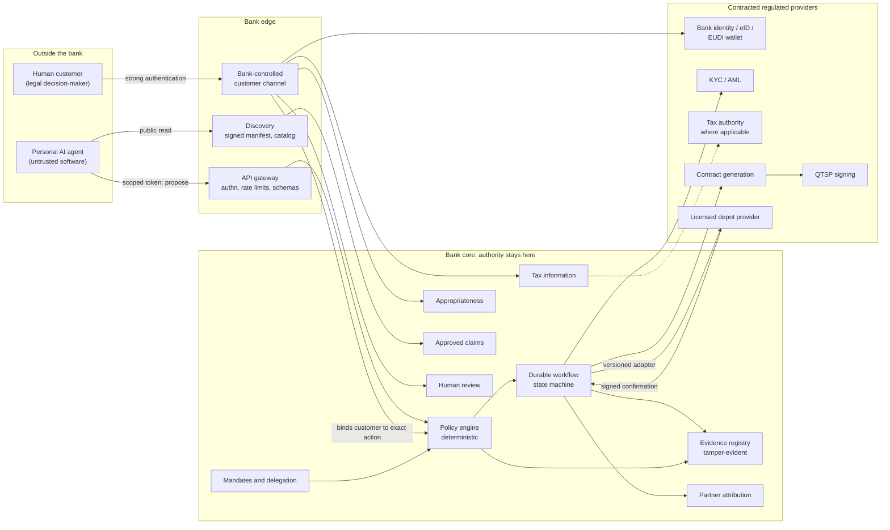
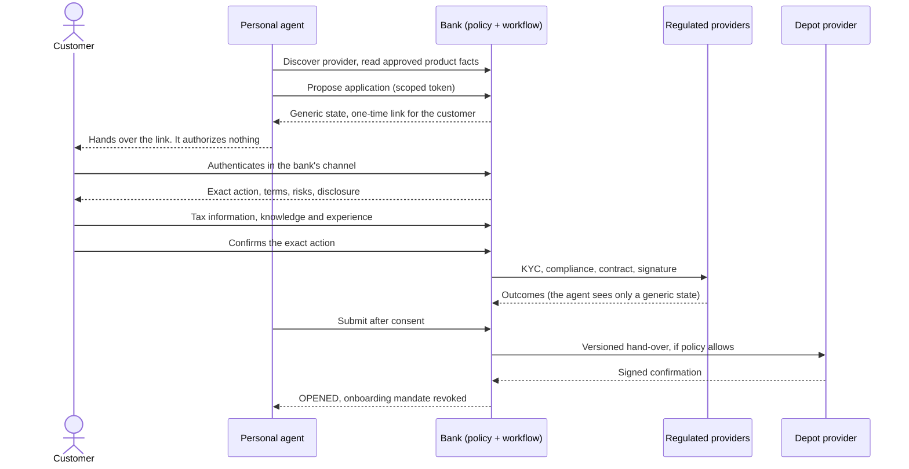

# TRUSTEQ - technical concept for agent-based depot opening, target 2030

An architecture deliverable, not an implemented system. It starts from the frozen
`TRUSTEQ_ADR_v1.1_FINAL`, keeps its decisions and adds what the case study asks for on top: autonomy
levels, channel conflicts, a staged roadmap with roles, and an explicit decision log.

**How to read the labels.** `PROTOTYPE` means built and tested in this repository, with synthetic data.
`PROPOSED FOR 2030` means a design, not built. **All timelines, team sizes and effort figures below are
assumptions by the author**, not verified facts and not a quotation. Legal references are an engineering
applicability view, not legal advice: a client-specific legal and compliance review is mandatory, and the
applicable versions of each text must be checked at implementation time.

The current state of the code is in [final-integration.md](final-integration.md) and, for the nine trust areas,
[agentic-commerce-integration.md](agentic-commerce-integration.md), with exact classifications. In the tables below, "2026
prototype" means built and tested locally with synthetic parties. Nothing is live or connected to a real sandbox.

## 1. The problem in one paragraph

A large German fund provider sells securities accounts through its own website and app and through
cooperative branch banks. Personal AI agents increasingly research, compare and start purchases for their
users. The provider must stay discoverable and trustworthy for those agents, and able to complete a
regulated onboarding, without losing control of identity, consent, compliance or the partner banks'
position. The central design question is not "how autonomous can the agent be?" but **"which decisions may
never leave the bank's and the customer's hands?"**

**Assumptions** (from the ADR): a fictional German fund distributor and a separate, appropriately licensed
depot provider. "The fund provider" is not automatically the entity that opens the account. Which entity holds
which duty depends on the actual licence, service model and contracts.

## 2. Target architecture

| Component | Responsibility | Why this way | 2026 prototype | 2030 target |
|---|---|---|---|---|
| Personal AI agents | Research, prepare, coordinate, report status | Third-party and untrusted by design: the bank cannot certify or control them | Scripted agent; optional LLM agent behind a flag | Any agent that meets the published API and delegation contract |
| Provider discovery | Machine-readable catalog of who offers what | Agents must find the provider without a website visit | A2A 1.0 Agent Card and JSON-RPC subset, signed catalog, a separate client process; local only | A public HTTPS deployment; MCP or A2A as thin adapters over REST |
| Verifiable provider identity | Prove the endpoint belongs to the named legal entity | A register entry alone does not authenticate an endpoint (ADR section 09) | ES256 entity statements with a synthetic authority: rotation and revocation tested. HMAC manifest remains inside the bank. Regulatory status always unknown | Institution-approved trust anchors, a conformance-tested federation library, registry checks |
| Bank API gateway and policy engine | Authenticate, validate, rate-limit, then decide deterministically | An LLM cannot be tested as an authorizer and is open to prompt injection | Validation and policy gate in one process; no rate limits | Dedicated gateway; policy as versioned, reviewed rules |
| Scoped authorization and delegation | What the agent may do, for whom, how long | The agent's identity is not the customer's identity | A local delegation protocol: registered agents, customer approval, DPoP-bound opaque tokens, revocation. Not FAPI | OAuth 2.0 with FAPI 2.0, PAR, RAR, DPoP or mTLS where justified |
| Customer authentication | Prove who the customer is, independent of the agent | Critical threat is session substitution (ADR section 03) | OIDC code flow with PKCE against a separate local provider; DEV simulation for older scenarios. **No real provider.** Synthetic proofing boundary | Bank SCA, eID or EUDI wallet in the bank's channel |
| KYC and AML providers | Identify, screen, monitor | Regulated duty of the obligated entity | Mock, `mock=true` stored | Contracted providers; reliance only under the statutory conditions (GwG section 17) |
| Tax-information collection | Collect and validate tax declarations | Part of today's onboarding | Customer page, local format check, identifier discarded | Encrypted storage and retention; IdNr check and reporting as legally required |
| Appropriateness | Knowledge and experience before relevant orders | Duty depends on service and instrument; never an LLM decision | Synthetic questionnaire, deterministic rules, customer acknowledgement | Compliance-owned rule sets per product and service model |
| Contract generation | Produce the exact contract documents | The customer must approve an immutable version | Mock record | Versioned templates, hash bound into the approved action |
| QTSP signing | Legally valid signature where required | The signature level depends on the contract, not on the technology | Test signer, signed callbacks, hash binding, failure handling. Cannot claim a qualified level (tested). **No QES** | QTSP on an EU trusted list, asynchronous signature lifecycle |
| Depot provider | Opens the account, is the only source of `OPENED` | Licensed entity; a synchronous answer may not open anything | Mock, versioned adapter, signed callback | Contracted provider, mutually authenticated, signed events |
| Human intervention | A person can always be asked, and can step in | Customer right in scope cases, plus operational need | Button, durable case, DEV operator console | Staffed case management, SLAs, secure customer messaging |
| Evidence registry and audit | Prove what happened, later | Regulators and disputes need it, not just logs | Append-only table by trigger, receipts bound to digests | Hash chain or WORM store, retention rules, SIEM export |
| Partner attribution | Record which channel an onboarding belongs to | Commercial and regulatory exposure | Claims, deterministic rules, conflict review, sample commission from invented contracts | Governed partner directory, real contract versions, reconciliation |
| Monitoring and operational security | Detect abuse and failure | Agent traffic is automated and fast | JSON logs, correlation IDs | SLOs, alerting, tested runbooks, DORA controls where they apply |

### The end-to-end sequence

### Who authorizes whom

| Decision | Decided by | Never by |
|---|---|---|
| Which product to look at, which questions to ask | Customer with their agent | - |
| Whether a request is allowed at all | Bank policy engine | LLM |
| Who the customer is | Identity provider through the bank's channel | Agent assertion |
| Agreement to the exact action and contract | Customer, in the bank's channel | Agent |
| KYC, AML, compliance outcome | Obligated institution and its providers, with staff | LLM, agent |
| Whether the account is open | Licensed depot provider, by signed confirmation | Agent, bank operator, any synchronous answer |
| Commission or partner attribution | Verified register and contracts | Agent, LLM recommendation |

## 3. Autonomy levels L0 to L4

**Today's market** sits between L0 and L2: agents research on public websites and at most prefill. **"Fully
autonomous" (L4)** means the agent concludes the contract as a delegate, with the customer involved only at
setup. The levels describe the journey as a whole. A single journey may mix them per step.

| Level | What the agent may do | What the human decides | What the bank decides | Preconditions | Regulatory and security limits |
|---|---|---|---|---|---|
| **L0 No agent access** | Reads public web pages like any browser | Everything, on the bank's site | Everything | None | Brand and facts depend on scraping; no provenance |
| **L1 Verified information** | Reads the signed catalog and cites approved facts | Everything else, on the bank's site | What it publishes and signs | Signed manifest, approved claims | Bank cannot control how the agent renders facts. Marketing and advice rules still apply. Not investment advice |
| **L2 Prepared application** | L1 plus prefills a draft the customer completes alone | Whether to continue, all statements, all signatures | All checks | L1, draft API, idempotency | Agent-supplied fields are proposals only. Low automation value, phishing risk at the handover |
| **L3 Controlled agentic onboarding (chosen)** | L2 plus orchestrates: requests the handoff, tracks a generic state, submits after consent, within a narrow revocable mandate | Identity, tax statements, knowledge and experience, confirmation of the exact action, signature | Policy for each sensitive step, KYC, AML, appropriateness rules, contract. The depot provider confirms the opening | Bank-controlled channel, scoped tokens, durable workflow, deterministic policy, human review, evidence | Identity and consent stay in the bank's channel. Human-intervention duties in scope (EGBGB Art. 246b section 3). GDPR Art. 22 assessment. AI Act Art. 50 transparency where in scope |
| **L4 Delegated conclusion** | Concludes on the customer's behalf under a pre-granted mandate | Sets the mandate and its limits, can revoke, reviews afterwards | As L3, plus verifies the delegation for each action | Legally recognized delegation, verifiable wallet-bound mandates, QES or equivalent by delegate, liability rules | **Not supportable today.** Open legal questions: delegation for identification and for consent to contract, GwG duties, appropriateness warnings that must reach the customer, and liability when an agent errs |

### Why L3

- **L2 under-delivers:** the customer does the same work as today, so an agent adds little and the funnel still
  ends at a website.
- **L4 rests on assumptions that do not hold yet:** identity, contract consent and compliance would all be
  delegated without an established legal basis, or a technical means of proving the delegation.
- **L3 captures most of the value and keeps the risk where it belongs.** Everything that can be repeated safely
  is automated. Everything that binds the customer legally stays a single, explicit, bank-controlled act.
- **What would change it:** law, identity proofs and mandate models that demonstrably support delegation (ADR
  decision 01), plus a depot provider willing to accept the liability.

**Status of the prototype:** it implements the *mechanics* of L3 with simulated identity. It does not show L3 in
a regulated setting.

## 4. Distribution and channel conflicts

### The channels

| Channel | How it works | What is at stake |
|---|---|---|
| Direct distribution | Customer onboards with the provider's own digital channel | Margin, customer relationship, own brand |
| Cooperative branch banks | Partner banks advise and sell; they hold the relationship and expect attribution | Trust built over decades, commission, the partner network's loyalty |
| Partner identification | A registered partner, identified by code or an existing relationship | Whether the claimed relationship is real and authorized |
| Revenue and commission attribution | Who receives what, by contract | Contract and inducement rules, disputes |

### How agents create conflict

- **Bypass:** an agent routes a customer of a branch bank straight to the direct channel because the page was easier
  to read. The bank loses a customer it advised for years, and the provider damages its partner network.
- **Opaque steering:** an agent's vendor favours whichever channel pays it, so the customer cannot see why a channel
  was chosen.
- **Invented or claimed attribution:** an agent asserts a partner code to trigger commission or to reuse an
  identification it has no right to.
- **Attribution races:** a customer spoke to a branch, then asked an agent. Whose onboarding is it?
- **Silent overwrite:** the channel changes between proposal and consent, and nobody notices.

### Governance that keeps attribution fair and auditable

| Rule | Mechanism | Prototype |
|---|---|---|
| The customer's choice of bank is explicit and visible | Shown on the bank's page and bound into the approved action | `PROTOTYPE`: channel in the action digest |
| Partner identity comes from the bank's register, never from the agent | Registered partner directory, validated code | `PROTOTYPE`: unknown partner refused with 422 |
| An existing relationship is asserted only after authorized verification | Partner confirmation, not an agent's statement | `PROPOSED FOR 2030` |
| Default when there is no partner: disclosed direct or unassigned route under product rules | Deterministic rule; never inferred from an LLM recommendation | `PROTOTYPE`: direct channel |
| Attribution is fixed with the consent and append-only | Attribution record bound to the consent receipt | `PROTOTYPE` |
| No AI decides commission | Attribution records provenance. Compensation stays in contracts and needs legal review | `PROTOTYPE`: no commission is calculated |
| Disputes can be resolved from evidence | Registry version and consent receipt in the record; partner reconciliation | Record: `PROTOTYPE`. Process: `PROPOSED FOR 2030` |
| Partners see fair treatment | Parity rules for agent-visible offers, a partner council, regular reporting | `PROPOSED FOR 2030` |

**KYC reliance** on a partner's identification is conditional under GwG section 17, and accountability stays with
the obligated institution. It is a legal assessment per partner, not a technical switch.

## 5. Staged roadmap to 2030

**Every date and team size in this section is an assumption**, to be replaced by real planning with the client. The
stages are gated by evidence, not by dates: a stage ends when its exit criteria hold.

| Stage | Assumed time | Goal | Main work | Exit criteria |
|---|---|---|---|---|
| **1. Discovery and sandbox integration** | H1 2027 | Replace assumptions with facts | Confirm legal entities and duties. Sandbox access to one IdP, one KYC vendor, one QTSP, the depot provider. Threat model review. Architecture decisions confirmed | Named accountable entity per duty. Sandbox journey with real vendor APIs and test data. Compliance agrees the scope |
| **2. Controlled pilot** | H2 2027 to H1 2028 | Real people, tight limits | Small group of consenting customers and staff, one product, direct channel. L1 and L3 with staff watching every case. Evidence store, monitoring | Agreed pilot limits hold. Every case reviewed. No unresolved critical finding from an external penetration test |
| **3. Bank-grade identity and regulated providers** | 2028 | Production-grade trust | Bank SCA or eID; EUDI wallet as adapter when eligible. Contracted KYC and AML. QTSP in the flow. FAPI profile for agents. DORA mapping of ICT third parties | Compliance and legal sign-off. Regulator engaged as required. Disaster-recovery test passed |
| **4. Wider distribution-channel rollout** | 2029 | Partners on board, more products | Partner directory and attribution reconciliation. First cooperative banks. Further products, with appropriateness per product. Partner governance | Partner council agrees the rules. Attribution disputes resolved from evidence. Product-level compliance approvals |
| **5. Security, compliance and operational hardening** | Continuous, target state 2030 | Run it safely at scale | Abuse detection, API version lifecycle, model-risk process for the provider-side explainer, regular audits. L4 reassessed against the law at the time | Agreed SLOs met. Audits clean. An explicit, recorded decision on L4 |

### Team and responsibilities

Peak sizes are **assumptions for planning discussion**, at stages 2 to 4. Not all roles are full time throughout.

| Role | Main responsibility | Assumed peak FTE |
|---|---|---|
| AI / application engineering | Agent-facing contracts, evaluation, provider-side explainer, prompt-injection testing | 2 |
| Backend / integration engineering | Workflow, adapters, version lifecycle, reconciliation | 3 to 4 |
| Security / IAM | Identity, FAPI profile, delegation, threat modelling, key management | 2 |
| Compliance / legal | Duties per entity, appropriateness rules, tax, GwG, AI Act, DORA, contract and signature levels | 1.5 to 2 |
| Banking product expert | Product terms, customer journey, approved facts, partner rules | 1 |
| Platform / DevOps | Environments, monitoring, resilience, secrets, CI | 1.5 to 2 |
| QA / test engineering | Contract and end-to-end tests, evaluation suite, external penetration test coordination | 1 to 2 |
| Partner integration | Partner onboarding, directory, attribution reconciliation | 1, from stage 4 |
| Product owner and delivery lead | Priorities, stage gates, stakeholders | 1 |

## 6. Production limitations of the current prototype

| Area | Today | What production needs |
|---|---|---|
| Bank identity and strong customer authentication | A local OIDC provider proves the mechanism; the DEV sign-in remains for older scenarios and accepts any synthetic ID. No bank provider exists, and an incomplete configuration fails closed | Bank SCA, eID or EUDI wallet in a bank channel. DEV routes absent from the production build. A verified OIDC login proves authentication only, not KYC or eID |
| Regulated KYC and AML | Mock, stored with `mock=true` | Contracted providers, compliance sign-off, reliance only under statutory conditions, asynchronous outcomes |
| Tax-authority integrations | Local format check of an invented identifier. Identifier discarded. No BZSt or other authority involved | Real identifier under encryption and retention rules. Whatever checks and reporting duties apply (for example IdNr, exemption orders, church tax, CRS/FATCA), to be established by tax and legal |
| QTSP and legally valid signing | Test signer with signed callbacks, no legal effect | QTSP on an EU trusted list. Signature level determined per contract. Asynchronous lifecycle (typed boundary exists, isolated) |
| OAuth, OIDC, FAPI, PAR, DPoP, mTLS | OIDC with a local provider. Delegated agent tokens are DPoP-bound; DEV tokens stay plain bearer tokens. No FAPI, PAR server or mTLS | OIDC for customers. FAPI 2.0 with PAR for confidential agent clients where justified. DPoP or mTLS sender constraint. RAR for fine-grained authorization, token exchange only where justified |
| Tamper-evident evidence | Append-only by database trigger, rewritable with database access | Hash chain or WORM storage, retention rules, independent verification |
| Monitoring, abuse protection, rate limiting | JSON logs; **no rate limits** | Edge limits, abuse detection, alerting, audit-volume controls |
| Real provider deprecation and migration | Synthetic v1/v2 adapter with explicit fallback policy. The signed manifest does not list versions, and the callback is unversioned. A timeout's outcome is unknown and not reconciled | Versions and sunset dates in the signed manifest, deprecation monitoring, provider reconciliation, versioned events, contract tests in CI |
| Operational resilience | SQLite, single node, depot call inside the transaction, no outbox | Managed database, outbox, idempotent retries, tested disaster recovery, DORA controls where they apply |
| Partner and regulator governance | Register in code, sample rules and contracts, service-level conflict resolution, no payment, no partner process | Governed directory, contracts, partner council, regulator engagement where required |

The findings F-2 to F-7 from Phase 06 also stay open, and the F-1 residual: anyone who can use the DEV sign-in form
can claim to be a customer. See [phase-06-security-reliability.md](phase-06-security-reliability.md).

## 7. Handling growing requirements

| Requirement that grows | How the design absorbs it |
|---|---|
| New agent protocols (MCP, A2A and successors) | Thin adapters over REST. The core does not depend on a protocol version |
| Provider API changes | Versioned adapter, explicit fallback policy, contract tests |
| New products | Catalog data plus a compliance-owned appropriateness rule set |
| New partners | Register entries, not code paths |
| Stronger identity (eID, EUDI wallet) | Replaceable behind the customer identity boundary, with the customer channel unchanged |
| More scale and separate teams | The modular monolith's ports become service boundaries when teams or load require it, not before |
| More autonomy | Each step can move up a level on its own, once its legal and technical preconditions hold |

## 8. Decision log

Criteria used: **R** regulatory fit, **T** trust and security, **C** cost and complexity, **D** deprecation and change
risk, **V** demo and delivery value. These are engineering recommendations, not proofs of optimality.

| # | Decision | Alternatives | Criteria | Chosen | Rejected because | Trade-off accepted | Would change if |
|---|---|---|---|---|---|---|---|
| 1 | Autonomy level | L2, L3, L4 | R, T, V | **L3** | L2 adds too little. L4 assumes unsupported delegation | The customer must still act in the bank's channel | Law and mandate models support delegation |
| 2 | Bank core shape | Microservices, modular monolith | C, V | **Modular monolith with ports and adapters** | Microservices cost more before scale or team boundaries exist | One deployable, shared database | Separate teams or load require boundaries |
| 3 | Who authorizes | LLM judgment, deterministic policy, both | R, T | **LLM proposes, deterministic policy authorizes** | LLM decisions are untestable and open to injection | Rules must be written and maintained | LLMs may assist triage, never as sole authorizer |
| 4 | Agent interface | MCP first, A2A first, REST first | D, C | **REST first; protocols as thin adapters** | Tying the core to young protocols risks deprecation | Agents need a REST client or an adapter | A contract makes one protocol essential |
| 5 | Workflow | Conversation memory, state machine, BPMN or Temporal | T, C | **Persistent state machine with transactional guards** | Conversation memory cannot protect financial state | No workflow engine features | Long-running scale warrants an engine |
| 6 | Customer approval | Agent-relayed approval, bank-controlled one-time handoff | R, T | **Bank-controlled, request-bound handoff** | Agent-delivered approval allows phishing and session substitution | A channel break for the customer | Wallet-centric proofs become deployable |
| 7 | Identities | One identity, separate agent, customer and mandate | T | **Separate** | Passing customer tokens to agents is unsafe | More moving parts | Partner IAM frameworks are established |
| 8 | Roles of provider and depot | Assume the fund provider opens the account, separate roles | R | **Distinct roles, explicit attribution** | Assumption creates legal risk | More adapters | A specific regulated entity justifies simplifying |
| 9 | Tax and appropriateness in the flow | New workflow states, a subflow bound to the handoff | D, C, V | **Subflow bound to the handoff; state machine unchanged** | New states would rewrite a frozen, tested core for no added authority | Not visible as separate states to the agent | A regulator or provider needs separate statuses |
| 10 | When the assessment runs | At each order only, during onboarding | R, V | **During onboarding, assessed for the order context; never blocks the account** | Order step does not exist in the prototype; blocking the account would invent a rule | Compliance must confirm it is valid later | Compliance requires it at order time |
| 11 | Tax identifier storage | Plain text, hash, discard after validation | T, C | **Discard after format check** | A hash of a short ID is brute-forceable, and plain text is needless risk in a prototype | The bank cannot read it back | Production: encrypted storage under retention rules |
| 12 | Default for the new gate | Off with an opt-in, on with an explicit legacy opt-out | T, V | **On by default; the three P0 scenarios opt out and say so** | Off by default would leave the integration a demo trick | Old tests run with a flag | - |
| 13 | Provider version fallback | Silent fallback, no fallback, explicit permission from both sides | D, T | **Explicit: provider names it and the bank's policy allows it** | Silent fallback can downgrade unnoticed; no fallback breaks on every deprecation | A policy table to maintain | Providers publish signed version metadata |
| 14 | Provider failure and retries | Retry in another version, refuse | T | **Refuse; only a stated "not processed" may fall back** | A timeout's outcome is unknown, so a retry may duplicate | Manual reconciliation needed in production | Provider offers idempotency guarantees |
| 15 | Where claims are enforced | Filter LLM output, structured approved claims at the tool boundary | T, D, C | **Structured approved claims, plus a claim-check endpoint** | An output filter cannot control a third party's agent and invites false safety | The bank does not control final wording | Agents adopt signed-claim display standards |
| 16 | Customer identity now | Fake OIDC, new vendor registration, labelled DEV sign-in with a tested boundary | T, C, V | **Labelled DEV sign-in; boundary fails closed; reported as blocked** | Fake signed tokens would be dishonest; vendor setup was out of scope | F-1 residual stays | A legitimate sandbox becomes available |
| 17 | Provider manifest in this pass | Add versions to the signed manifest, keep it | D, C | **Keep it, with the digest pinned** | Re-pinning late adds risk to recorded evidence for little benefit | Version policy lives in the bank's code | Production: move it into the signed manifest |

## 9. What comes after the prototype

Open questions a client project must answer first: which legal entity holds each duty, what the depot provider's
integration really looks like, which identity route the bank accepts, whether agents will be allowed to hold mandates at
all, and how partners want to be treated. The open items in
[research/ist-analyse-union-investment.md](research/ist-analyse-union-investment.md#9-needs-verification---checklist-for-independent-checking)
still need independent verification.
